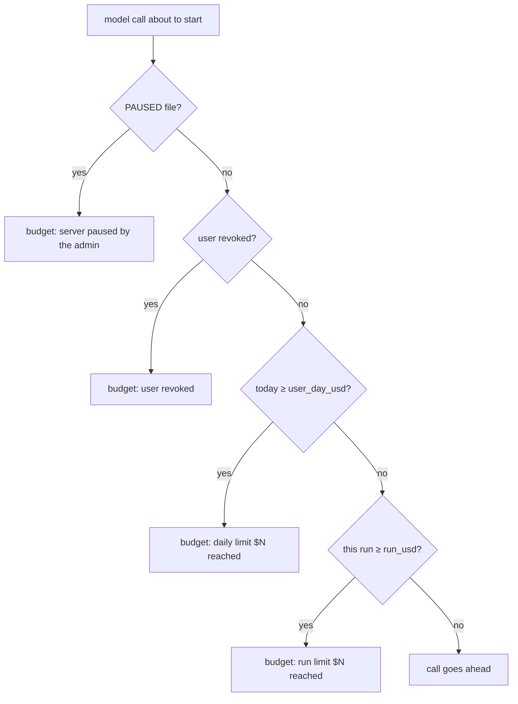

# 24 — Money and limits

> **Who this is for:** an operator who pays for the model calls and wants to cap them.
> **What you need first:** [21 Configuration reference](21-configuration.md#4-budget) (the `[budget]` keys), [20 Operator tutorial](20-operator-tutorial.md#8-see-the-budget) (a first look). Words: [budget](glossary.md#budget), [run](glossary.md#run), [kill switch](glossary.md#kill-switch), [profile](glossary.md#profile), [session](glossary.md#session), [provider](glossary.md#provider).
> **What you will learn:** how cost is counted, how to set and change limits, how to see spend, how to stop everything at once, and exactly how limits can be exceeded.
> **Code paths covered:** `apps/server/src/simp_server/budget.py`, `server.py` (`over_budget`, `_title`, `/api/usage`, `main`), `store.py` (`usage` table), tests in `apps/server/tests/test_budget.py`.
> **Verified at commit:** `cbea25f` (read from code; not run).

**Back:** [23 Sandboxes](23-sandboxes.md) · **Next:** [25 Day-to-day ops](25-ops.md)

## 1. How cost is counted

After each model answer, the server saves a row in the `usage` table (in `simp.db`): user, session, model, input tokens, output tokens, time and **cost**.

```text
cost = (input tokens × price_in + output tokens × price_out) / 1,000,000
```

The prices come from the [profile](21-configuration.md#3-profilesname) (`price_in`, `price_out`, USD per 1M tokens). Not the provider's bill: the server only knows your prices. Wrong prices mean wrong limits.

## 2. Two limits

Set in `settings.toml` (keys and defaults: [21 §4](21-configuration.md#4-budget)):

| Limit | Default | Counts |
|---|---|---|
| `user_day_usd` | `2.0` | everything one user spent since **local midnight of the server** |
| `run_usd` | `0.5` | what one run spent in one session |

A **run** starts when the user sends a prompt. A follow-up that was queued during the run belongs to the same run. A new prompt starts a new run, so the run limit is "per prompt", not "per session". `/compact` and `/continue` also start a new run, which resets the run limit.

Edit `settings.toml`, then **restart the server**: limits are read once at start. A misspelled key in `[budget]` stops the server at boot.

## 3. The check

Before every model call, the server checks four things. The first that fails stops the call:



The run **ends** with that message. It is never retried. The user can wait (daily limit), send a new prompt (run limit), or ask you to raise the limit. See [27 Troubleshooting](27-troubleshooting.md).

## 4. Kill switch

Stop every model call for everyone:

```sh
uv run simp-server pause     # prints: paused
uv run simp-server resume    # prints: resumed
```

`pause` makes an empty file `PAUSED` in `data_dir`; `resume` deletes it. The running server looks for the file at each check, so no restart is needed. You can also `touch` it by hand. A call that is already running finishes ([section 6](#6-how-limits-can-be-exceeded)). To stop one person only, use `revoke` ([22](22-users.md)).

## 5. Seeing spend

- **Web UI:** the chat header shows `$spent / $limit` for the signed-in user, and `· paused` ([11 §9](11-web.md#9-spend-display)).
- **API:** `GET /api/usage` returns `today_usd`, `day_limit_usd`, `paused`, for the user whose token you send ([20 §8](20-operator-tutorial.md#8-see-the-budget)). It shows no run spend and no other users.
- **All users:** there is no operator report. Read the `usage` table with `sqlite3`, for example:

```sh
# default data_dir
sqlite3 ~/.simp-server/simp.db \
  "select user_id, round(sum(cost),4) from usage group by user_id"
```

The path is the default `data_dir`; `SIMP_SERVER_HOME` moves it ([21](21-configuration.md)). Add `where at >= <unix time>` to limit it to a day.

## 6. How limits can be exceeded

> **Limits are soft.** Do not treat the limit as a hard wall.

- **The check is before the call, the cost is saved after it.** One call may take a user past the limit. Several sessions of one user can each pass the check at the same time.
- **Running calls are not cut.** Pause and revoke apply at the next call.
- **Profile without prices costs $0.** It never reaches any limit. The server only warns at start (`profile … has no prices`).
- **Title calls count.** The small call that names a session is saved as spend. If the budget blocks it, nothing is saved and the title stays empty, with only a log warning.
- **Compaction is checked but not counted.** It goes through the same check, but its tokens are not saved as spend. It costs real money and is invisible here. A blocked compaction shows `compaction failed: … budget: …`.
- **A failed call** usually has 0 tokens, so it costs $0 in the table.
- **The day** is the server's clock, not the user's.

Keep a safety margin: set limits below what you can afford, and set a spending cap at the provider too.

## 7. Where to go next

- [25 Day-to-day ops](25-ops.md): logs and backups of `simp.db`, which holds the usage rows.
- [27 Troubleshooting](27-troubleshooting.md): budget errors.
