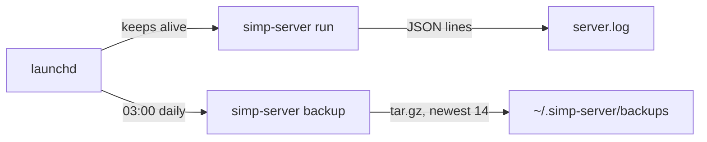

# 25 — Day-to-day ops

> **Who this is for:** an operator who runs the server every day on one Mac.
> **What you need first:** [20 Operator tutorial](20-operator-tutorial.md) (you have run the server and done one restore drill) and [21 Configuration reference](21-configuration.md). Words: [run](glossary.md#run), [session](glossary.md#session), [sandbox](glossary.md#sandbox).
> **What you will learn:** how to read the logs, run the server as a service, take daily backups and restore them, what happens to a run when the server restarts, and how to upgrade.
> **Code paths covered:** `apps/server/src/simp_server/ops.py` (`JsonFormatter`, `backup`), `apps/server/src/simp_server/server.py` (`recover`, `backup` command), `deploy/launchd/com.simp.server.plist`, `deploy/launchd/com.simp.backup.plist`.
> **Verified at commit:** `131851b` (read from code and files; launchd not run in this check).

**Back:** [24 Money and limits](24-money.md) · **Next:** 26 Security model and known gaps (not written yet)

**Scope:** launchd is macOS only. This book does not cover Linux services (systemd). On Linux you can still run `simp-server run` and `simp-server backup` by hand or from your own scheduler.

## 1. Logs

`simp-server run` writes **JSON lines** to stderr, one event per line. Fields:

| Field | Meaning |
|---|---|
| `ts` | time, seconds since 1970 (Unix time) |
| `level` | `INFO`, `WARNING`, `ERROR` |
| `msg` | the text |
| `run_id` | 8 characters, new for every [run](glossary.md#run) |
| `session`, `user` | which session and which user |
| `state` | on `run end`: how the run ended |
| `exc` | on errors: the stack trace |

Example (shortened):

```json
{"ts": 1791800000.1, "level": "INFO", "msg": "run start", "run_id": "3fa9c1d2", "session": "s_ab12", "user": "ann"}
{"ts": 1791800042.7, "level": "INFO", "msg": "run end", "run_id": "3fa9c1d2", "session": "s_ab12", "user": "ann", "state": "idle"}
```

Why `run_id`: one user message can make many log lines. Search for its `run_id` and you see the whole run, and only that run.

Messages worth knowing:

| `msg` | Level | What it tells you |
|---|---|---|
| `run start` / `run end` | INFO | a run began / ended (see `state`) |
| `over budget: ...` | WARNING | a [budget](glossary.md#budget) stopped a run ([24](24-money.md)) |
| `recovered interrupted run` | WARNING | the server restarted during a run (section 5) |
| `run stopped unexpectedly` | ERROR | a bug or crash inside a run; read `exc` |
| `profile ... has no prices` | WARNING | that profile costs $0 and never hits a budget |

Read them with `jq` (install with `brew install jq`):

```sh
jq -c 'select(.run_id=="3fa9c1d2")' ~/.simp-server/server.log   # one run
jq -c 'select(.level!="INFO")' ~/.simp-server/server.log        # problems only
```

Some lines at start-up (for example from Uvicorn) are plain text, not JSON. `jq` will complain about them; use `grep '^{' ... | jq ...` to skip them.

## 2. Run as a service (launchd)

launchd is the macOS tool that starts programs and restarts them. The repo has two templates in `deploy/launchd/`. They contain `__REPO__` and `__HOME__`; replace them with your paths and load them:

```sh
for p in server backup; do
  sed "s#__REPO__#$PWD#g; s#__HOME__#$HOME#g" deploy/launchd/com.simp.$p.plist > ~/Library/LaunchAgents/com.simp.$p.plist
  launchctl load ~/Library/LaunchAgents/com.simp.$p.plist
done
```

Run this from the repo folder. What you get:

| Job | What it does |
|---|---|
| `com.simp.server` | runs `simp-server run --port 8766` with `SIMP_SANDBOX=docker`. Starts at login (`RunAtLoad`) and is started again if it stops (`KeepAlive`). Log: `~/.simp-server/server.log`. |
| `com.simp.backup` | every day at 03:00 runs `simp-server backup --to ~/.simp-server/backups --keep 14`. Log: `~/.simp-server/backup.log`. |

Useful commands:

```sh
launchctl list | grep com.simp                                   # are they loaded?
launchctl unload ~/Library/LaunchAgents/com.simp.server.plist    # stop
launchctl load   ~/Library/LaunchAgents/com.simp.server.plist    # start
tail -f ~/.simp-server/server.log
```

Things to know:

- These are **LaunchAgents**: they run when your user is logged in, not at boot before login. Keep the Mac logged in and awake. A sleeping Mac does not serve, and a missed 03:00 backup runs when it wakes.
- **`server.log` is not rotated.** It grows for ever. Rotate it with `newsyslog`, or stop the server, empty it (`: > ~/.simp-server/server.log`), and start again. Check its size now and then.
- Keys in `.env` still work: the server reads `<data_dir>/.env` itself ([21](21-configuration.md#5-plugins-and-sandbox)). Do not put keys in the plist.
- The plist sets `SIMP_SANDBOX=docker`, so Docker must be running ([23](23-sandboxes.md)). If Docker is down, new sessions fail with `docker run failed`.



## 3. Backups

`simp-server backup --to DIR [--keep N]` makes `DIR/simp-<YYYYmmdd-HHMMSS>.tar.gz`. It is safe while the server runs: the database is copied with SQLite's online backup, so the file is consistent.

| In the backup | Not in the backup |
|---|---|
| `simp.db` (users, history, spend) | **`.env` (your model keys)** |
| `settings.toml` | the `PAUSED` file |
| `workspaces/` (session files) | the backups folder itself, `server.log`, Docker images |
| `sandboxes/` | |

**Keep `.env` yourself.** Store it in a password manager or another safe place. A restored backup without keys can read history but cannot call the model.

**Retention.** `--keep 14` keeps the newest 14 files in `DIR` and deletes older `simp-*.tar.gz` files. File names sort by time, so "newest" is by name. With `--keep 0` (the default) nothing is deleted. With the daily job, 14 files means about two weeks.

**A backup on the same disk is not a safe backup.** If the disk dies, both are lost. Copy `~/.simp-server/backups` to another disk or another machine now and then (Time Machine, `rsync`).

## 4. Restore drill

You did this once in [20, section 9](20-operator-tutorial.md#9-restore-drill). With the service, the steps are:

```sh
launchctl unload ~/Library/LaunchAgents/com.simp.server.plist       # 1 stop
rm -f ~/.simp-server/simp.db ~/.simp-server/simp.db-wal ~/.simp-server/simp.db-shm   # 2 remove old db and its journal files
tar xzf ~/.simp-server/backups/simp-20261012-030000.tar.gz -C ~/.simp-server         # 3 restore
uv run simp-server users                                             # 4 check the users are back
launchctl load ~/Library/LaunchAgents/com.simp.server.plist         # 5 start
```

Why step 2: `simp.db-wal` and `simp.db-shm` are SQLite journal files. A stale one next to a restored database can be replayed onto it. Remove them.

Also know:

- `tar` overwrites `settings.toml`, `workspaces/` and `sandboxes/` with the backup's copy. Changes made after the backup are lost.
- `.env` is not touched. If the machine is new, put your saved `.env` in `~/.simp-server/` first.
- A restored session may point to a Docker container that no longer exists. Its files are in `workspaces/`; see [23](23-sandboxes.md).
- Do the drill again after each big upgrade, and after you move to a new machine.

## 5. When the server restarts

Stopping or crashing the server does not lose history: every event is stored in the database as it happens. But a [run](glossary.md#run) that was in progress cannot go on. At the next start, each session that was busy is **recovered**:

1. The log gets the line `recovered interrupted run`.
2. Approvals that nobody answered are closed as `aborted`.
3. Tool calls with no result get the result `aborted: the server restarted before this tool finished`. This keeps the history valid, so the model can continue later.
4. The run state becomes `error`, and the session gets a warning notice: `interrupted: the server restarted during this run`.

The user sees a settled session with that notice. They press **Continue** ([11](11-web.md)) to ask the agent to try again, or send a new message. Work the agent already wrote to files stays.

Shutdown is quick: the server waits only 2 seconds for open connections. Plan restarts for quiet times, or check the log for `run start` lines without a `run end` first.

## 6. Upgrades

The steps below are the safe habit. The repo has no upgrade script; do it by hand.

```sh
uv run simp-server backup --to ~/.simp-server/backups     # 1 backup first
launchctl unload ~/Library/LaunchAgents/com.simp.server.plist   # 2 stop
git pull                                                  # 3 new code
uv sync                                                   # 4 new packages
uv run simp-server build-sandbox                          # 5 rebuild the Docker image (if you use Docker)
launchctl load ~/Library/LaunchAgents/com.simp.server.plist     # 6 start
```

Then check: `tail ~/.simp-server/server.log` shows `Uvicorn running on http://127.0.0.1:8766`, and you can log in. If the plist templates changed in `deploy/launchd/`, make your copies again with the `sed` command in section 2.

If it goes wrong, go back: `git checkout` the old commit, `uv sync`, restore the backup (section 4), start. Ask first: read the new version's notes, because this book does not promise that an old database opens with a much newer server.

## 7. A daily checklist

- Is the server up? `launchctl list | grep com.simp`
- Any problems? `jq -c 'select(.level!="INFO")' ~/.simp-server/server.log | tail`
- Is today's backup there? `ls -t ~/.simp-server/backups | head -3`
- Is `server.log` small enough? `ls -lh ~/.simp-server/server.log`
- Money: [24](24-money.md).

---

**Built on by:** 26 Security model, 27 Troubleshooting (not written yet).
**Builds on:** [20 Operator tutorial](20-operator-tutorial.md), [21 Configuration reference](21-configuration.md), [23 Sandboxes](23-sandboxes.md), [24 Money and limits](24-money.md).
