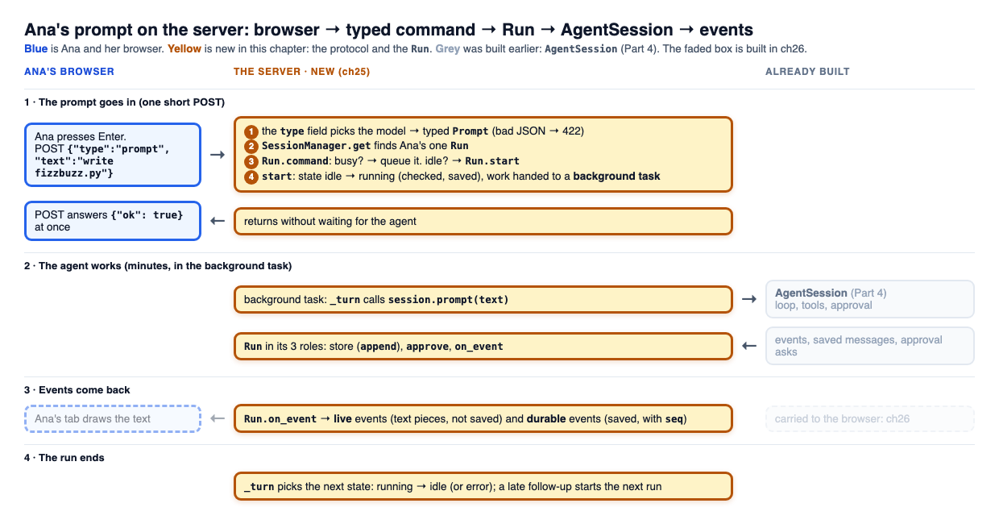
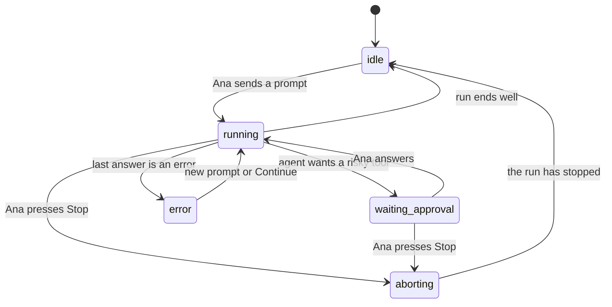

# 25 Part 5 · The server run

**Goal:** Run a session on a server with a typed protocol.

**Builds on:** [24 The CLI](24-cli.md), [17 Sessions](17-session.md), [08 Events and abort](08-events-abort.md) · **Next:** [26 Transport](26-transport.md)

<a id="problem"></a>

## Ana in a browser tab

In [24](24-cli.md) you ran the agent in a terminal: one person, one screen, one Python program. Now picture a team. Ana opens a browser tab and types "write `fizzbuzz.py`". The agent works for two minutes. She sees the text stream in, answers an approval for `bash`, then closes her laptop. An hour later she opens the tab again and wants to see the whole story.

The server must do things the CLI never had to. It serves many users and many sessions at once, not one person. It talks to a browser, not a terminal, so every command (a prompt, an abort, an approval) arrives as a separate HTTP request with a JSON body. A run takes minutes, much longer than a web request should stay open. And the two sides are written in two languages: the server in Python, the browser in TypeScript.

In one sentence: **the server run is the CLI of [24](24-cli.md), once per conversation.** The CLI connects one `AgentSession` ([17](17-session.md)) to one terminal; the server keeps many conversations, and each one has its own object that connects its `AgentSession` to a browser tab. The agent itself does not change. This chapter builds two things for it. The **[protocol](glossary.md#protocol)** is the fixed list of typed messages between browser and server; its one job is to say exactly which messages exist and what is inside each one. The **[Run](glossary.md#run)** is one server object per conversation; its one job is to own that conversation's `AgentSession` and know at every moment what it is doing, its **[run state](glossary.md#run-state)** (like `idle` or `running`).

Do not mix it up with an agent [run](glossary.md#run-agent) ([07](07-agent-loop.md)): the `Run` lives as long as the conversation and starts many agent runs, one per prompt.

Moving events to the browser, reconnecting after a reload and the approval answer are [26 Transport](26-transport.md); saving everything and logging in are [27 Store and auth](27-store-auth.md). In the map of [23](23-part-5-system.md), this chapter is block 4 (Load run) and block 6 (Command).



*Read it top to bottom: Ana's JSON (blue) becomes a typed `Command`, `SessionManager` finds her `Run`, and `Run.start` hands the work to a background task that runs the grey `AgentSession`. Its events come back to `Run.on_event`, which turns them into protocol events; carrying those to the browser is [26](26-transport.md).*

The rest of the chapter first shows how the server plugs into `AgentSession`, then follows Ana's prompt along this picture. Each step meets one of the problems above:

1. **Read the JSON.** Every command comes as a JSON body; one typo must not crash the server.
2. **Start the agent, reply "got it" right away.** A run takes minutes, but the HTTP request that carried the prompt must get its reply in a moment; the agent's answer comes later, as events.
3. **A new line while the agent works.** Ana may send more; there must never be two agent loops on one session.
4. **Know the state.** To decide that, the `Run` must always know what it is doing.
5. **Same types in the browser.** Python and TypeScript must agree on every message.

<a id="the-run"></a>

## How does the server plug into the AgentSession?

`AgentSession` does not decide three things by itself; the app that creates it must give them: **where to save** each message (the store), **who to ask** before a risky tool (the approval function), and **who gets the events** (the listener). The CLI gave a JSONL file, a question in the terminal, and a printer ([24](24-cli.md)).

The server gives all three from one object, the **`Run`**. A `Run` is one server object per conversation: it creates Ana's `AgentSession`, plugs itself into those three places, and also keeps track of what the session is doing now (its state, later in this chapter). There is exactly one `Run` per session, so every request for Ana's session (a prompt, then an abort) reaches the same object.

| Slot of `AgentSession` | CLI | Server `Run` |
|---|---|---|
| the store ([17](17-session.md)) | `JsonlStore` | `Run.append`: saves into the server's log |
| the approval function ([10](10-hooks-approval.md)) | asks in the terminal | `Run.approve`: sets the state to `waiting_approval` and waits for the browser's answer |
| the event listener ([08](08-events-abort.md)) | `LinePrinter` / `Chat` | `Run.on_event`: turns events into protocol events |

That is the whole link: the library does not know a server exists.

**Who finds the Run.** Every route for a session asks `SessionManager.get(user, sid)`. It checks that Ana owns the session, and returns her open `Run`, or opens it from the saved log. The `Run` lives on after the request that made it.

Real code: [server.py](../../apps/server/src/simp_server/server.py).

<a id="protocol-models"></a>

## Read Ana's JSON

Now follow Ana's prompt into this `Run`. It arrives as a JSON body in an HTTP request, so the server must first turn it into a command it can trust. If it just read the body as a dict, a typo would break it badly: `{"txt": "hi"}` instead of `{"text": "hi"}` gives a `KeyError` deep in the code and a 500 error, and the browser never learns what went wrong.

The server keeps one **form** for each kind of message the browser may send. There are eight kinds, called **commands**: prompt, steer, follow-up, abort, approve, compact, continue and plan mode. Each form lists its fields, and every JSON body names its form in a `type` field.

Ana's body is checked like this:

```text
{"type": "prompt", "text": "write fizzbuzz.py"}
  -> type is "prompt", so use the prompt form: one field, text, a string
  -> Prompt(text="write fizzbuzz.py")
```

If something is wrong, for example `"txt"` instead of `"text"`, the server answers at once with a 422 that says `txt` is not allowed and `text` is missing. The bad body never reaches the `Run`, and nothing is dropped in silence.

In Python, each form is a Pydantic class in `protocol.py`, and the `type` field picks the class (Pydantic calls it a **[discriminator](glossary.md#discriminator)**).

Real code: [protocol.py](../../apps/server/src/simp_server/protocol.py) (the command forms) and [server.py](../../apps/server/src/simp_server/server.py).

## Start the agent, reply "got it" right away

Ana's prompt is now a trusted `Prompt`. The problem now: her agent will work for two minutes, but the POST that carried the prompt must answer at once; a request held open that long is cut by proxies and browsers. So the command goes to `Run.command()`, which calls `start()`, and `start()` puts the agent work in a background task and returns at once, so the POST answers `{"ok": true}` in a moment while the agent works on. This is the same idea as the REPL in [24 · How can I type while the agent works?](24-cli.md#how-can-i-type-while-the-agent-works): do not wait for the run, hand it to the [event loop](glossary.md#event-loop).

While the agent works, every session event reaches `Run.on_event`, which turns it into a protocol event: a live event for each piece of streaming text, a durable event for each saved message. Sending them to Ana's tab is [26](26-transport.md).

Here is Ana's prompt from start to end. When the work ends, the `Run` goes back to `idle`, or to `error` if the last answer was an error:

```text
POST {"type":"prompt", ...}   -> Prompt(text="write fizzbuzz.py")
SessionManager.get            -> Ana's Run, state idle
Run.start                     -> idle -> running (saved), task started
POST answers {"ok": true}       (the agent still works)
... session events -> Run.on_event -> live text, saved messages ...
the agent's run ends well  -> running -> idle (saved)
```

Real code: `Run.start` and `Run.on_event` in [server.py](../../apps/server/src/simp_server/server.py).

<a id="the-title-call"></a>

## A new line while the agent works

The agent now works in the background, and the input in Ana's tab stays open. So she may send another line, or click Send twice, while the agent still works. Only the first one starts a run; the other is queued, because the `Run` checks its state before it starts anything. Without this, Ana could click "send" twice, both requests would call `session.prompt()`, and two agent loops would write into one message list.

`Run.command()` handles every command. "Busy" means the state is `running`, `waiting_approval` or `aborting`:

| Command | Not busy | Busy |
|---|---|---|
| `Prompt`, `FollowUp` | start a run | queue it as a follow-up ([09](09-steering.md)) |
| `Steer` | start a run | queue it as a steer |
| `Abort` | nothing | go to `aborting` and stop the session |

So while the agent works, a new line is queued, never a second loop. How the queue looks on the wire is [26 · The command queue](26-transport.md#the-command-queue).

Real code: `Run.command` in [server.py](../../apps/server/src/simp_server/server.py).

<a id="run-state-machine"></a>

## The Run's state

The table above asked one question: is the `Run` busy? The answer is its state. A `Run` is always in one of five states:

| State | Meaning |
|---|---|
| `idle` | nothing is running; a prompt starts a run |
| `running` | the agent is working |
| `waiting_approval` | the agent waits for Ana to allow or deny a tool |
| `aborting` | Ana pressed Stop; the run is ending |
| `error` | the last run ended with an error; Ana can continue or send a new prompt |

Only some moves between states are legal, so a wrong one is caught at once.

Start at `idle` and follow Ana's prompt. Each arrow says what moves the `Run`:



Ana's normal path is the first line: `idle → running → idle`, with a short trip to `waiting_approval` when she approves `bash`. Stop and errors are the side paths. These legal moves are written in one table, `TRANSITIONS`, next to the protocol (it also allows two rare moves for failures, not drawn here).

Every change goes through one method (`set_state`), which does three things:

1. Check the move against the table, and raise if it is not there (`check_transition`). So a wrong move, like `idle` straight to `waiting_approval`, fails at once on the server with a clear message, not as a strange state in the UI.
2. Store the new state.
3. Save it as a durable `RunState` event. So a tab that comes back reads the current state from the log.

Real code: `TRANSITIONS`, `check_transition` in [protocol.py](../../apps/server/src/simp_server/protocol.py); `Run.set_state` in [server.py](../../apps/server/src/simp_server/server.py).

<a id="gen_protocol--protocolgents"></a>

## The same types in the browser

So far everything happened on the server. The last problem from the list is on the other side: Ana's tab must send exactly the commands the server reads, and read exactly the events it sends. Without a shared definition, someone renames a Python field, the browser still sends the old name, and the server rejects it, or worse, the browser reads a field that is no longer there and shows nothing.

A script, `gen_protocol.py`, generates the TypeScript types (`protocol.gen.ts`) from the same Python classes. The web client ([30](30-web-client.md)) imports them, so a renamed Python field breaks the browser build at once, not Ana's screen later. With `--check`, the script only fails if the file is out of date, so the tests catch a forgotten update.

Real code: [gen_protocol.py](../../apps/server/src/simp_server/gen_protocol.py).

## How does the server start?

Everything above lives in one server process. `simp-server run` starts the real server; `simp-server fake` starts a fake one with a scripted run and no model, for tests ([31](31-system-tests-deploy.md)).

Real code: function `main` in [apps/server/src/simp_server/\_\_main\_\_.py](../../apps/server/src/simp_server/__main__.py).

**Builds on:** [24 The CLI](24-cli.md), [17 Sessions](17-session.md), [08 Events and abort](08-events-abort.md) · **Next:** [26 Transport](26-transport.md)
