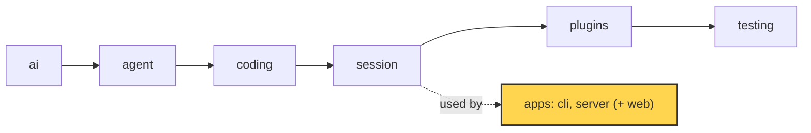
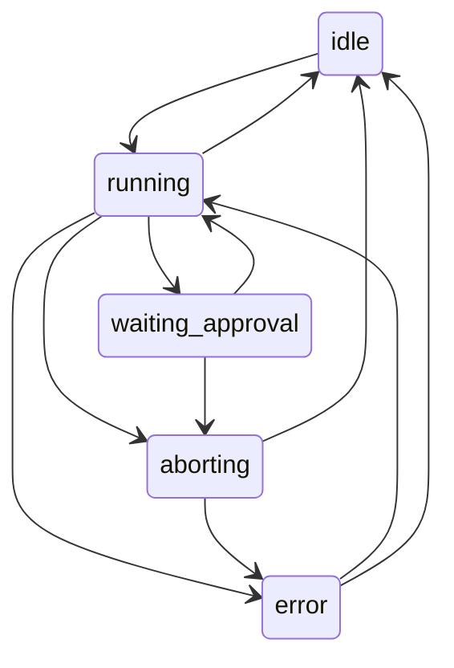

# 25 Part 5 · The server run

**Goal:** Run a session on a server with a typed protocol.

**Builds on:** [24 The CLI](24-cli.md), [17 Sessions](17-session.md), [08 Events and abort](08-events-abort.md) · **Next:** [26 Transport](26-transport.md)

## Where we are



*This chapter starts the `server` app (marked). It uses the `session` layer from the outside.*

Big picture of Part 5: [part-5-system](23-part-5-system.md).

Code in this chapter (commit `2fc2776`):

- `apps/server/src/simp_server/protocol.py` — the protocol models, `Snapshot`, `TRANSITIONS`, `check_transition`
- `apps/server/src/simp_server/server.py` — `Run`, `SessionManager`
- `apps/server/src/simp_server/gen_protocol.py` — writes `protocol.gen.ts`
- `apps/server/src/simp_server/__main__.py` — `main`
- `apps/server/tests/test_protocol.py` — the protocol tests

## Problem

In [24](24-cli.md) you ran the agent in a terminal: one person, one screen, one Python program. Now picture a team. Ana opens a browser tab and types "write `fizzbuzz.py`". The agent works for two minutes. She sees the text stream in, answers an approval for `bash`, then closes her laptop. An hour later she opens the tab again and wants to see the whole story.

This chapter builds two things. A **[protocol](glossary.md#protocol)** is the fixed list of messages that go between server and browser. A **[Run](glossary.md#run)** is one server object per conversation: it owns the `AgentSession` ([17](17-session.md)), turns its events into protocol messages, and keeps one clear **[run state](glossary.md#run-state)**, a name like `idle` or `running`. Do not mix it up with an agent [run](glossary.md#run-agent) ([07](07-agent-loop.md)): the `Run` lives as long as the conversation, and it starts many agent runs, one per prompt.

## Starting point: 24's `run()`, behind a web request

[24](24-cli.md#the-question-goes-to-agentsession) built print mode. Its heart makes one `AgentSession` ([17](17-session.md)) and prints its events ([08](08-events-abort.md)):

```text
store = JsonlStore(file "<sid>.jsonl" in session_dir(cwd))
session = AgentSession(model, tools, store,
                       messages = store.load(),
                       get_api_key = env_api_key(model),
                       approve = none IF -y ELSE ask)
session sends each event to a new LinePrinter
WHEN Ctrl-C comes: call session.abort()
```

Real code: [apps/cli/src/simp_cli/__init__.py](../../apps/cli/src/simp_cli/__init__.py), function `run`.

The server is a second front door to this same `AgentSession`. The simplest move is to put this code inside an HTTP handler: run `session.prompt(text)`, wait, and return the messages. Ana's story breaks it.

The **long run** hangs the request for minutes, proxies and browsers time out, and Ana sees no live text, because no `LinePrinter` is there to get the events. With **two prompts at once**, if Ana sends a second prompt while the first still runs, both call `session.prompt()`, and two loops share one message list. With a **loose body**, the handler gets any dict, so `{"txt": "hi"}` gives a `KeyError` and a 500, and nothing tells the browser which shapes exist. Worse, the browser is TypeScript and the server is Python, so a renamed field breaks one side in silence. The **reload** loses the answer of the running request, with no way to say "give me what I missed". And **approval** ([10](10-hooks-approval.md)) cannot work: `ask` reads the terminal, and the request is blocked, so Ana has no way to send "allow".

This chapter fixes the long run, two prompts at once and the loose body. It owns the **messages** and the **Run's state**. [26 Transport](26-transport.md) then moves them over the wire and fixes the reload and approval: the `seq` counter, replay after a reconnect, the command queue and the approval answer. [27 Store and auth](27-store-auth.md) saves the log and loads a session again.

## Real design

The server lives in `apps/server/src/simp_server/`. We follow Ana's prompt from the moment it reaches the server: the JSON is read as a typed message, the server finds the `Run` for her session, the `Run` moves through its states while the agent works, the events go out, and a side call names the session. Then the browser gets the same message types, and last we see how the server process starts.

### Protocol models

Ana presses Enter, and the browser sends `{"type": "prompt", "text": "write fizzbuzz.py"}`. What does the server do with this JSON? It must not trust a loose dict, so it reads it as a typed message.

`apps/server/src/simp_server/protocol.py` is the single source of truth for the wire. Every message is a Pydantic model, and they all share one base:

```text
BASE MODEL _M for every message:
    unknown field         -> error           // extra="forbid"
    fields with a default -> "required" in the schema
```

Real code: [apps/server/src/simp_server/protocol.py](../../apps/server/src/simp_server/protocol.py), class `_M`.

We use Pydantic because one class gives us checking on the way in, JSON on the way out, and a JSON Schema for TypeScript. `extra="forbid"` turns `{"type": "prompt", "txt": "hi"}` into a clear error, not a silent drop. The second rule sounds backwards, but think of the server's output: when the server sends a model, every field with a default is filled in, so it is always in the JSON. Marking it "required" lets TypeScript trust that it is there, with no `?` and no `undefined` checks.

Every model has a `type` field with one fixed value, like `type: Literal["prompt"] = "prompt"`. That field is the **[discriminator](glossary.md#discriminator)**: one field whose value says which model the JSON is.

```text
Command = ONE OF Prompt, Steer, FollowUp, Abort, Approve,
                 Compact, Continue, SetPlanMode
          (pick which one by the "type" field)
```

Real code: [apps/server/src/simp_server/protocol.py](../../apps/server/src/simp_server/protocol.py), `Command`.

So Ana's JSON goes in, Pydantic reads `type`, checks only the `Prompt` model, and gives `Prompt(text="write fizzbuzz.py")`.

`Prompt` is one **command**, a message from the browser. The others each map to a session feature you already know: steering and follow-up ([09](09-steering.md)), abort ([08](08-events-abort.md)), approval ([10](10-hooks-approval.md)), compaction ([20](20-compaction.md)) and plan mode ([22](22-profiles-plugins.md)).

Before any command, the browser and the server shake hands. The browser sends `Hello(protocol_version=...)`, and `check_hello` answers with a `Hello`, or a `HelloError` that lists the supported versions (`SUPPORTED_VERSIONS = {1}`). So an old tab learns at once that the server changed.

In the other direction, the server sends **server events**, of two kinds. A **[durable event](glossary.md#durable-event)** is saved and has a `seq` number, a counter with one value per event ([26](26-transport.md) owns it).

A **[live event](glossary.md#live-event)** is a streaming piece of text, like the words of an answer as they come. It has no `seq` and is not saved, because the full text is saved later in the `AssistantMessage` and `ToolResult` events.

One more message tells a tab that connects (or comes back) "where we are now", including text still streaming: the **[snapshot](glossary.md#snapshot)**.

The full list of event names and every `Snapshot` field is in [ref-objects · Server protocol messages](ref-objects.md#server-protocol-messages).

### The Run

The prompt is now a typed `Prompt`. Which object runs it? It must be one that lives longer than the request, and only one per conversation, so two prompts cannot start two loops.

`apps/server/src/simp_server/server.py` has `class Run`. Its docstring: "AgentSession + durable protocol log + in-flight buffers." Every HTTP route asks `SessionManager.get(user, sid)` for the `Run` of a session. On first use it loads the saved log, opens the sandbox and makes one `Run`; after that it returns the same `Run` from `self.runs`. So two requests for one session always reach the same object.

The constructor builds an `AgentSession`. Look for `this Run` below: the `Run` passes itself in three places.

```text
session = new AgentSession(model,
              store       = this Run,             // Run has append()
              env         = env,
              stream_fn   = guarded_stream,       // budget check, see 23
              get_api_key = the manager's key for this model,
              approve     = this Run's approve,
              messages    = the saved history,
              plugins     = redact_secrets, plan_mode + the profile's plugins,
              plugin_config = redact_secrets gets the manager's API keys)
session sends each event to this Run's on_event
```

`stream_fn` and `env` come from later chapters: `guarded_stream` checks the money budget before each model call ([28](28-limits.md)), and `env` is the sandbox ([29](29-docker-sandbox.md)). `redact_secrets` and `plan_mode` are always on. API keys must never reach the model, so the server hands its own keys to `redact_secrets` through `plugin_config` and they are always hidden. The web UI has a plan-mode switch, so the plugin must always be there for that switch to work.

Real code: [apps/server/src/simp_server/server.py](../../apps/server/src/simp_server/server.py), method `Run.__init__`.

So the `Run` is the session's `SessionStore` ([17](17-session.md)), its approval callback ([10](10-hooks-approval.md)) and an event subscriber ([08](08-events-abort.md)). That is the whole link between the library and the server: the library does not know a server exists. What `approve` and `on_event` do is [26](26-transport.md).

### Run state machine

The `Run` has Ana's prompt. Before it starts the work, it changes its state from `idle` to `running`. Why keep a state at all? Because Ana can press "abort" twice, or answer an approval that is already gone, and the server must know what is allowed *now*.

The run state is one of five names, and the legal moves live in one table next to the models:

```text
RunStateName = ONE OF "idle", "running", "waiting_approval", "aborting", "error"

TRANSITIONS (from -> allowed next states):
    idle             -> running
    running          -> waiting_approval, aborting, idle, error
    waiting_approval -> running, aborting
    aborting         -> idle, error
    error            -> running, idle

FUNCTION check_transition(old, new):
    IF new is not in TRANSITIONS[old]:
        RAISE error "bad run_state transition old -> new"
```

Real code: [apps/server/src/simp_server/protocol.py](../../apps/server/src/simp_server/protocol.py), `TRANSITIONS` and function `check_transition`.



With the table, a wrong move like `idle -> waiting_approval` raises at once, on the server. Without it, the UI would just show a strange state and nobody would know why. One move is missing on purpose: after a server restart, the saved state can still say `running` with no loop behind it, and [27 · recover](27-store-auth.md#recover) jumps straight to `error` without the table.

The state is one field, `self.info.run_state`. A run is **busy** when the state is `running`, `waiting_approval` or `aborting`. Every change goes through one method:

```text
FUNCTION set_state(s):
    check_transition(current state, s)      // raises on a bad move
    run_state = s
    SEND durable event RunState(state = s)  // saved, with a seq
```

Real code: [apps/server/src/simp_server/server.py](../../apps/server/src/simp_server/server.py), method `Run.set_state`.

So every change is checked, and every change is in the log. When Ana's tab comes back, it reads the state from the log.

How does the `Run` start Ana's prompt without making the request wait? `start()` sets `running`, then puts the work in a background task and returns:

```text
FUNCTION start(text, fresh = true):
    IF fresh: run_start = now               // the run budget clock (23)
    set_state("running")
    run_id = 8 random hex chars             // for the logs
    IF text is a function: fn = text        // e.g. Compact passes session.compact
    ELSE:                  fn = "call session.prompt(text)"   // called later, in the task
    start _run(fn) as a background task     // do not wait for it
```

Real code: [apps/server/src/simp_server/server.py](../../apps/server/src/simp_server/server.py), method `Run.start`.

The background task runs `_run(fn)`, which calls `_turn(fn)`. `_turn` runs `fn`; if `fn` raises, the error becomes an error `Notice` (a durable event with a short message for the user).

When `fn` ends, `_turn` picks the next state. After an abort it clears the steer and follow-up queues ([09](09-steering.md)), goes to `idle` and adds a "run aborted" notice. If the last assistant message has `stop_reason == "error"`, it goes to `error`. Otherwise it goes to `idle`, and if a follow-up came in after the loop stopped, it starts the next run at once.

`_run` wraps `_turn` in a `finally`. If the run is still busy there (a crash, a failed store write, a cancel), it writes `RunState(error)` and a "run stopped unexpectedly" notice. So a session is never stuck "running" after a crash.

Here is Ana's prompt on an idle run:

```text
POST Prompt("write fizzbuzz.py")        state idle
  set_state("running")                  check idle -> running: ok
  log: RunState(state="running")        seq 1 (a new session)
  background task starts, POST returns  (the long run is fixed)
... the agent writes fizzbuzz.py, events go out (21) ...
  _turn ends, last stop_reason="stop"
  set_state("idle")                     check running -> idle: ok
  log: RunState(state="idle")           seq N  (the saved messages in between took seq 2 .. N-1)
```

This also fixes two prompts at once: text that comes in while the run is busy never calls `start()` again; [26 · The command queue](26-transport.md#the-command-queue) queues it as a steer or follow-up. One `Run`, one loop.

While the agent works, each session event reaches `Run.on_event`, which turns it into a protocol event: a live event for streaming text, a durable event for each saved message. Sending them to Ana's tab is [26](26-transport.md).

### The title call

One of those saved messages is the first assistant answer. If the session has no title yet, `Run` starts `title_task`, a background task running `_title()`. It makes one extra small model call with `TITLE_PROMPT` ("Name this coding session in 3 to 6 words..."), records its usage like any call ([28](28-limits.md)), saves the answer with `store.set_title` and sends a durable `SessionTitle` event (`type: "session_title"`). If the call fails, the title just stays empty. This is the **[title call](glossary.md#title-call)** that [28](28-limits.md) and [31](31-system-tests-deploy.md) refer to.

### gen_protocol → protocol.gen.ts

Ana's prompt is done on the server side. One part of the loose body is left: the browser is TypeScript, so how does it get the same types, and stop breaking in silence when someone renames a Python field?

We generate the TypeScript types from the same models. `protocol.py` has a root model only for this job:

```text
MODEL Protocol:      // used only to make the schema; pulls every wire type into one document
    hello:       Hello
    hello_error: HelloError
    event:       ServerEvent
    command:     Command
    session:     SessionInfo
```

Real code: [apps/server/src/simp_server/protocol.py](../../apps/server/src/simp_server/protocol.py), class `Protocol`.

`json_schema()` turns it into one **[JSON Schema](glossary.md#json-schema)** document. A helper `_untitle` drops per-field titles; without it, the tool would make one named TS type per field, and the file would be full of tiny types.

`apps/server/src/simp_server/gen_protocol.py` pipes that schema into the `json-schema-to-typescript` tool through `npx` (Node's "download and run a tool" command; we use a ready tool rather than write our own):

```text
FUNCTION generate():
    cmd = npx json-schema-to-typescript@15
              with a banner comment "Generated from ... protocol.py. Do not edit"
              and --unreachableDefinitions    // also emit types nothing points to
    RUN cmd, with json_schema() as its input
    RETURN what it prints (the TypeScript text)    // fails if the tool fails
```

Real code: [apps/server/src/simp_server/gen_protocol.py](../../apps/server/src/simp_server/gen_protocol.py), function `generate`.

Run as a script, it writes `apps/web/src/protocol.gen.ts`. With `--check`, it only compares and exits with an error if the file is stale. The web client ([30](30-web-client.md)) imports these types, so if you rename a Python field, the TS build fails, and the two sides cannot drift.

### Starting the server

We followed one prompt through a running server. How does the server process start in the first place? `apps/server/src/simp_server/__main__.py` looks at the first word of the command. `simp-server run` starts the real server in `server.py`. The other words (`seed`, `passwd`, `users`, `revoke`, `rotate`, `backup`, `pause`, `resume`) are admin commands from [27](27-store-auth.md) and [28](28-limits.md), and `build-sandbox` builds the sandbox image ([29](29-docker-sandbox.md)). Anything else runs a fake server (`fake.py`) that plays a scripted run with no model, so the web client and its browser tests ([30](30-web-client.md), [31](31-system-tests-deploy.md)) can run with no API key and no cost.

Real code: [apps/server/src/simp_server/__main__.py](../../apps/server/src/simp_server/__main__.py), function `main`.

**Builds on:** [24 The CLI](24-cli.md), [17 Sessions](17-session.md), [08 Events and abort](08-events-abort.md) · **Next:** [26 Transport](26-transport.md)

