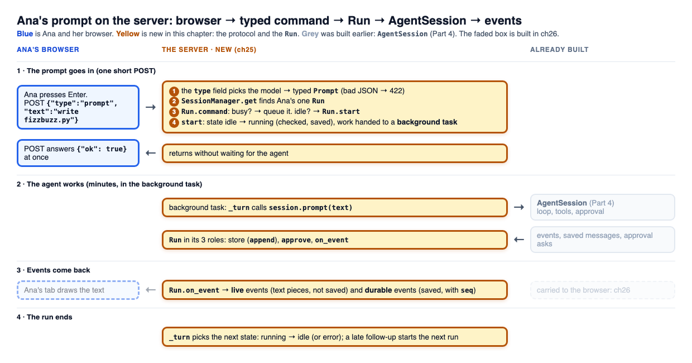
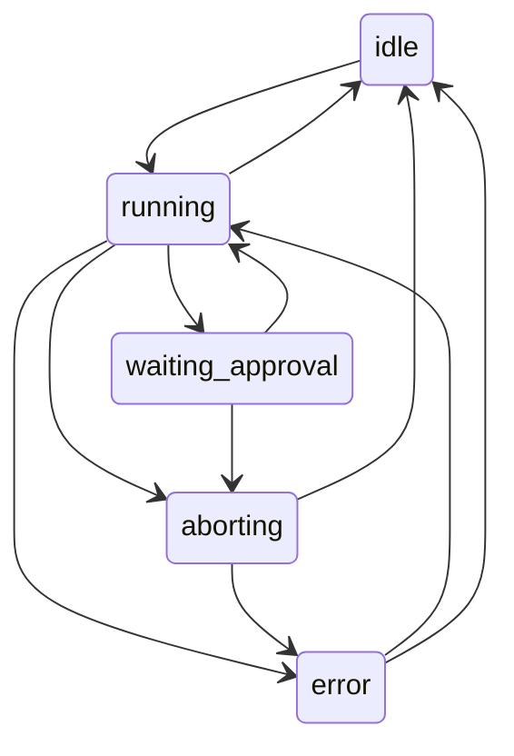

# 25 Part 5 · The server run

**Goal:** Run a session on a server with a typed protocol.

**Builds on:** [24 The CLI](24-cli.md), [17 Sessions](17-session.md), [08 Events and abort](08-events-abort.md) · **Next:** [26 Transport](26-transport.md)

<a id="problem"></a>

## Ana in a browser tab

In [24](24-cli.md) you ran the agent in a terminal: one person, one screen, one Python program. Now picture a team. Ana opens a browser tab and types "write `fizzbuzz.py`". The agent works for two minutes. She sees the text stream in, answers an approval for `bash`, then closes her laptop. An hour later she opens the tab again and wants to see the whole story.

The server must do things the CLI never had to. It serves many users and many sessions at once, not one person. It talks to a browser, not a terminal, so every command (a prompt, an abort, an approval) arrives as a separate HTTP request with a JSON body. A run takes minutes, much longer than a web request should stay open. And the two sides are written in two languages: the server in Python, the browser in TypeScript.

Like the CLI, the server is only a front door to the same `AgentSession` ([17](17-session.md)); it adds no agent behaviour. This chapter builds two things for it. The **[protocol](glossary.md#protocol)** is the fixed list of typed messages between browser and server; its one job is to say exactly which messages exist and what is inside each one. The **[Run](glossary.md#run)** is one server object per conversation; its one job is to own that conversation's `AgentSession` and know at every moment what it is doing, its **[run state](glossary.md#run-state)** (like `idle` or `running`).

Do not mix it up with an agent [run](glossary.md#run-agent) ([07](07-agent-loop.md)): the `Run` lives as long as the conversation and starts many agent runs, one per prompt.

Moving events to the browser, reconnecting after a reload and the approval answer are [26 Transport](26-transport.md); saving everything and logging in are [27 Store and auth](27-store-auth.md). In the map of [23](23-part-5-system.md), this chapter is block 4 (Load run) and block 6 (Command).


*Yellow is this chapter. Grey blocks are built in other chapters; the numbers are the blocks of [23](23-part-5-system.md).*



*Read it top to bottom: Ana's JSON (blue) becomes a typed `Command`, `SessionManager` finds her `Run`, and `Run.start` hands the work to a background task that runs the grey `AgentSession`. Its events come back to `Run.on_event`, which turns them into protocol events; carrying those to the browser is [26](26-transport.md).*

The rest of the chapter follows Ana's prompt along this picture, one question at a time.

<a id="protocol-models"></a>

## How does the server trust the JSON?

**The problem.** Every command arrives as a JSON body from a browser. If the server just reads it as a dict, a typo breaks it badly: `{"txt": "hi"}` instead of `{"text": "hi"}` gives a `KeyError` deep in the code and a 500 error, and the browser never learns what went wrong.

**The fix: one typed class per kind of message.** The protocol (`protocol.py`) lists every message the browser may send, as a Pydantic class. Every body has a `type` field, and the server uses it to pick the one class to check against (this field is the **[discriminator](glossary.md#discriminator)**). A message from the browser is a **command**, and there are eight:

```python
Command = Annotated[Union[Prompt, Steer, FollowUp, Abort, Approve, Compact, Continue, SetPlanMode],
                    Field(discriminator="type")]
```

Each one maps to a session feature you already know: prompt, steering and follow-up ([09](09-steering.md)), abort ([08](08-events-abort.md)), approval ([10](10-hooks-approval.md)), compaction ([20](20-compaction.md)), continue and plan mode ([22](22-profiles-plugins.md)).

**Ana's prompt.** When she presses Enter, the browser POSTs to `/api/sessions/{sid}/commands`:

```text
{"type": "prompt", "text": "write fizzbuzz.py"}
  -> type is "prompt", so check it against Prompt
  -> Prompt(text="write fizzbuzz.py")
```

**Two rules for every class:**

- **Unknown fields are an error.** `{"type": "prompt", "txt": "hi"}` is rejected with a clear 422 answer that says `txt` is not allowed and `text` is missing. Nothing is dropped in silence.
- **Fields with a default are always sent.** When the server sends a message to the browser, every field is in the JSON, even if it still has its default. So the browser never has to check for a missing field. (Technically, the schema marks these fields "required", which looks odd for a field with a default; this is the reason.)

**A version check first.** When Ana's tab opens, it sends a `Hello` with its protocol version. The server answers `Hello`, or a `HelloError` with the versions it supports, so an old tab learns at once that the server has changed.

Messages from the server to the browser are **server events**, and they come in two kinds. A **[durable event](glossary.md#durable-event)** (a saved user message, an assistant message, a run state change) is saved and has a `seq` number, one per event. A **[live event](glossary.md#live-event)** is a streaming piece of text; it has no `seq` and is not saved, because the full text is saved later in the durable message. One more event, the **[snapshot](glossary.md#snapshot)**, tells a tab that connects "where we are now". How events, `seq` and the snapshot are used is [26](26-transport.md); the full list of event names is in [ref-objects · Server protocol messages](ref-objects.md#server-protocol-messages).

Real code: [apps/server/src/simp_server/protocol.py](../../apps/server/src/simp_server/protocol.py), class `_M`, `Command`, `check_hello`; `post_command` in [server.py](../../apps/server/src/simp_server/server.py).

<a id="gen_protocol--protocolgents"></a>

## How do browser and server keep the same types?

The TypeScript types are generated from the same Python models, so there is only one place to change. Without this, someone renames a Python field, the browser still sends the old name, and the server rejects it, or worse, the browser reads a field that is no longer there and shows nothing.

`protocol.py` has one extra model, `Protocol`, that is used only for this: it holds one of each wire type (hello, command, event, session info), so Pydantic can turn all of them into one **[JSON Schema](glossary.md#json-schema)** document. `gen_protocol.py` gives that schema to a ready tool, `json-schema-to-typescript`, and writes the result to `apps/web/src/protocol.gen.ts`. With `--check` it only compares and fails if the file is out of date, so a test run catches a forgotten update. The web client ([30](30-web-client.md)) imports these types, so a renamed Python field breaks the TypeScript build at once, not the user's screen later.

Real code: class `Protocol` in [protocol.py](../../apps/server/src/simp_server/protocol.py); function `generate` in [gen_protocol.py](../../apps/server/src/simp_server/gen_protocol.py).

<a id="the-run"></a>

## Which object runs Ana's prompt?

Her session's `Run`. There is exactly **one `Run` per session**, so two requests for the same session (a prompt, then an abort) always reach the same object.

**Who finds it.** Every route for a session asks `SessionManager.get(user, sid)`:

1. Check that this user owns this session (404 if not).
2. If the `Run` is already open, return it.
3. Otherwise open it: open the sandbox, read the saved log, build a `Run` from it, and call `recover()`, which tidies up a run that a server crash left busy ([27](27-store-auth.md#recover)). Keep it in the manager's `runs` dict.

The `Run` lives on after the request that made it. But not forever: there is a cap on open sessions, and when it is full, the manager closes the idle `Run` that was used least recently (or answers 503 if none is idle).

**How it plugs into the session.** The `Run` builds its own `AgentSession` and fills three slots, the same slots the CLI filled ([24](24-cli.md)):

| Slot of `AgentSession` | CLI | Server `Run` |
|---|---|---|
| the store ([17](17-session.md)) | `JsonlStore` | `Run.append`: saves into the server's log |
| the approval function ([10](10-hooks-approval.md)) | asks in the terminal | `Run.approve`: sets the state to `waiting_approval` and waits for the browser's answer |
| the event listener ([08](08-events-abort.md)) | `LinePrinter` / `Chat` | `Run.on_event`: turns events into protocol events |

That is the whole link: the library does not know a server exists. The `Run` also passes in things from later chapters: a money check before each model call ([28](28-limits.md)), the sandbox ([29](29-docker-sandbox.md)), and the `redact_secrets` and `plan_mode` plugins, always on ([22](22-profiles-plugins.md)).

Real code: `Run.__init__` and `SessionManager.get` in [server.py](../../apps/server/src/simp_server/server.py).

<a id="run-state-machine"></a>

## What states can a Run be in, and why keep them?

A `Run` is always in one of five states:

| State | Meaning |
|---|---|
| `idle` | nothing is running; a prompt starts a run |
| `running` | the agent is working |
| `waiting_approval` | the agent waits for Ana to allow or deny a tool |
| `aborting` | Ana pressed Stop; the run is ending |
| `error` | the last run ended with an error; Ana can continue or send a new prompt |

The state answers "what is allowed now?". Ana can press Stop twice, or answer an approval that is already gone, and the server must know what to do. So only some moves between states are legal.

The legal moves live in one table, `TRANSITIONS`, next to the models:



Every change goes through one method (`set_state`), which does three things:

1. Check the move against the table, and raise if it is not there (`check_transition`). So a wrong move, like `idle` straight to `waiting_approval`, fails at once on the server with a clear message, not as a strange state in the UI.
2. Store the new state.
3. Save it as a durable `RunState` event. So a tab that comes back reads the current state from the log.

Two places set `error` directly, without the table, on purpose: the safety net that closes a run whose background task failed, and [27 · recover](27-store-auth.md#recover), because after a server restart the saved state can still say `running` with no loop behind it.

Real code: `TRANSITIONS`, `check_transition` in [protocol.py](../../apps/server/src/simp_server/protocol.py); `Run.set_state` in [server.py](../../apps/server/src/simp_server/server.py).

## How does a prompt get to the server without waiting minutes?

`Run.start()` puts the agent work in a background task and returns at once, so the POST answers `{"ok": true}` in a moment while the agent works on. This is the same idea as the REPL in [24 · How can I type while the agent works?](24-cli.md#how-can-i-type-while-the-agent-works): do not wait for the run, hand it to the [event loop](glossary.md#event-loop). Here it matters even more, because an HTTP request that stays open for two minutes is cut by proxies and browsers, and Ana would see nothing until the end.

What `start()` does:

1. Set the state to `running`.
2. Pick the work: for a prompt, `session.prompt(text)`; for `Compact` or `Continue`, the session's `compact` or `continue_`.
3. Start that work as a background task (`_turn`) and return.

When the work ends, `_turn` picks the next state:

- **Ana pressed Stop:** clear the steer and follow-up queues ([09](09-steering.md)), go to `idle`, add a "run aborted" notice.
- **The last answer was an error:** go to `error`.
- **Otherwise:** go to `idle`. If a follow-up came in after the loop stopped, start the next run at once, inside the same money budget ([28](28-limits.md)).

If the work raised an exception, it is saved as an error notice first. And a last safety net (a `finally`) catches the case where `_turn` itself fails (a failed save, a cancel) and leaves the session busy: it writes `error` and a "run stopped unexpectedly" notice.

While the agent works, every session event reaches `Run.on_event`, which turns it into a protocol event: a live event for each piece of streaming text, a durable event for each saved message. Sending them to Ana's tab is [26](26-transport.md).

Here is Ana's prompt from start to end:

```text
POST {"type":"prompt", ...}   -> Prompt(text="write fizzbuzz.py")
SessionManager.get            -> Ana's Run, state idle
Run.start                     -> idle -> running (saved), task started
POST answers {"ok": true}       (the agent still works)
... session events -> Run.on_event -> live text, saved messages ...
_turn ends, last stop_reason "stop" -> running -> idle (saved)
```

Real code: `Run.start`, `Run._run`, `Run._turn`, `Run.on_event` in [server.py](../../apps/server/src/simp_server/server.py).

<a id="the-title-call"></a>

One saved message has a side job. When an assistant answer is saved and the session has no title yet, the `Run` starts one more background task, the **[title call](glossary.md#title-call)**: a small model call that asks for a 3 to 6 word name for Ana's first prompt, records its usage like any call ([28](28-limits.md)), saves the title and sends a durable `SessionTitle` event. If it fails, the title stays empty. Real code: `Run._title` in [server.py](../../apps/server/src/simp_server/server.py).

## What if two prompts come at once?

Only the first one starts a run; the other is queued, because the `Run` checks its state before it starts anything. Without this, Ana could click "send" twice, both requests would call `session.prompt()`, and two agent loops would write into one message list.

`Run.command()` handles every command. "Busy" means the state is `running`, `waiting_approval` or `aborting`:

| Command | Not busy | Busy |
|---|---|---|
| `Prompt`, `FollowUp` | start a run | queue it as a follow-up ([09](09-steering.md)) |
| `Steer` | start a run | queue it as a steer |
| `Abort` | nothing | go to `aborting` and stop the session (once; a second Stop does nothing) |
| `Compact`, `Continue` | start that work | refused: 409 |
| `Approve` | refused: 409 if no approval with that call id is waiting | |
| `SetPlanMode` | turn plan mode on or off, at any time | |

The queues have a limit: when they are full, a new message gets a 429. So one `Run` has at most one loop. How the queue looks on the wire is [26 · The command queue](26-transport.md#the-command-queue).

Real code: `Run.command` and `Run.busy` in [server.py](../../apps/server/src/simp_server/server.py).

## How does the server start?

One command, `simp-server`, does several jobs. The first word picks the job:

| Command | What it does |
|---|---|
| `simp-server run` | start the real server |
| `simp-server seed`, `passwd`, `users`, `revoke`, `rotate`, `backup` | manage users and data ([27](27-store-auth.md)) |
| `simp-server pause`, `resume` | pause and resume all model calls ([28](28-limits.md)) |
| `simp-server build-sandbox` | build the sandbox image ([29](29-docker-sandbox.md)) |
| anything else, e.g. `simp-server fake` | a fake server that plays a scripted run with no model |

The fake server lets the web client and its browser tests ([30](30-web-client.md), [31](31-system-tests-deploy.md)) run with no API key and no cost.

Real code: function `main` in [apps/server/src/simp_server/\_\_main\_\_.py](../../apps/server/src/simp_server/__main__.py).

**Builds on:** [24 The CLI](24-cli.md), [17 Sessions](17-session.md), [08 Events and abort](08-events-abort.md) · **Next:** [26 Transport](26-transport.md)
