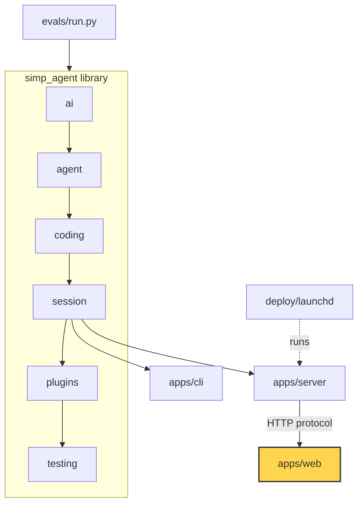

# 25 Part 5 · Web client

**Goal:** Build the browser UI on the protocol.

**Builds on:** [24-docker-sandbox](24-docker-sandbox.md) · **Next:** [26-system-tests-deploy](26-system-tests-deploy.md)



*This chapter builds `apps/web` (marked).*

## Problem

After chapters 20 to 24, the server can run a session for a user. It sends events out and takes commands in. But only a program can talk to it. A person in a browser cannot yet type "write `fizzbuzz.py`" and watch the answer appear.

A browser client sounds easy: open a stream, print what comes in. Three facts make it hard:

1. **The stream breaks.** Wi-Fi drops. The laptop sleeps. The user presses reload in the middle of a long answer. When the client connects again, it must not show a word twice, and it must not skip a word.
2. **The stream needs a token.** Every call to the server needs an `Authorization: Bearer <token>` header ([22](22-store-auth.md)). The browser's built-in `EventSource` cannot send headers.
3. **Many event kinds change one screen.** Text deltas, finished messages, tool output, approval requests, run state, title, plan mode. If each one changes the page in its own way, the screen will drift from the truth.

## Naive version

The simplest idea: use `EventSource` and append every text delta to a string.

```ts
// naive.ts — runs in a browser page with <div id="out">
const sid = "abc123";
let text = "";
const out = document.getElementById("out")!;

const es = new EventSource(`/api/sessions/${sid}/events`); // no way to add a token header
es.onmessage = (m) => {
  const ev = JSON.parse(m.data);
  if (ev.type === "text_delta") {
    text += ev.delta;                 // trust every delta
    out.textContent = text;
  }
  if (ev.type === "assistant_message") {
    text = "";                        // message done, clear the bubble
    out.textContent = ev.text;
  }
};
es.onerror = () => {
  // EventSource reconnects by itself,
  // but it does not know which words we already have.
};
```

Run the fizzbuzz task with this. It breaks in three ways:

1. **401 on the first call.** The server wants a token. `EventSource` has no `headers` option, so this never even starts. Putting the token in the URL would leak it into logs.
2. **Duplicate words after a reconnect.** Say the client has `"Let me w"` and the line drops. On reconnect the server sends the live state again. `text += ev.delta` adds `"rite"` on top of words it may already have. The user sees `"Let me wLet me write"`.
3. **One screen, many writers.** Tool output, approvals and run state need their own `if` blocks that each poke the page. There is no single place that says "this is the state of the chat".

## Step by step: from naive to real

We fix the three breaks one by one.

**Step 1 — use `fetch`, so we can send the token.** `EventSource` cannot set headers. `fetch` can:

```ts
const r = await fetch(`/api/sessions/${sid}/events`, {
  headers: { Authorization: `Bearer ${getToken()}` },
});
```

Why: the server needs the header, and a token in the URL would leak into logs.

**Step 2 — read the stream by hand.** An SSE event ends with a blank line. Keep a buffer and cut at each `\n\n`:

```ts
buf += value;
while ((i = buf.indexOf("\n\n")) >= 0) { /* cut one event, JSON.parse its data: lines */ }
```

Why: a network chunk can stop in the middle of an event. The buffer holds the rest.

**Step 3 — reconnect with a resume point.** Loop forever. Send the last `seq` we applied:

```ts
headers: { "Last-Event-ID": String(lastSeq()) }
```

Why: the server then sends only what we missed. Wait 1 s, 2 s, 4 s ... up to 10 s between tries.

**Step 4 — one reducer for all events.** Put every change in one pure function. Skip durable events we already have:

```ts
if ("seq" in ev) {
  if (ev.seq <= s.lastSeq) return s;
  s = { ...s, lastSeq: ev.seq };
}
```

Why: one place says what the chat is. A repeated event does nothing.

**Step 5 — check the offset of each delta.** Deltas have no `seq`. They have an `offset`:

```ts
export function appendAt(cur: string, offset: number, delta: string): string {
  return offset === cur.length ? cur + delta : cur;
}
```

Why: a repeated delta (dup) or a skipped one (gap) does not fit the end of the text, so it is dropped.

**Step 6 — let the snapshot replace live state.** On each connect the server sends a `snapshot`:

```ts
inFlight: ev.in_flight, pending: ev.pending_approval, runState: ev.run_state,
```

Why: it does not add to the bubble. It replaces it. So any dropped gap is fixed. This leads into the real code below.

## Real design

The web app is React + Vite in `apps/web/`. Four ideas carry it:

- `subscribe()` in `api.ts`: a small **[SSE](glossary.md#sse)** client built on `fetch`.
- `reduce()` in `state.ts`: one pure function that turns events into state.
- `appendAt()` in `state.ts`: an offset check that drops dup and gap deltas.
- `App.tsx` and `Chat.tsx`: wire the two together and draw the state.

Types like `Protocol` and `PendingApproval` come from `apps/web/src/protocol.gen.ts`, generated from the server's protocol ([20](20-server-run.md)). Files: `main.tsx` (mount), `api.ts` (HTTP, token, `subscribe()`), `state.ts` (`ChatState`, `reduce()`, `appendAt()`, `canContinue()`), `App.tsx` (login, session list, wiring), `Chat.tsx` (drawing), `Files.tsx` (workspace files).

### fetch-based SSE

`api.ts` first wraps `fetch` once, so every call carries the token:

```ts
export const getToken = () => localStorage.getItem("simp.token") ?? "";

async function call(path: string, init: RequestInit = {}): Promise<Response> {
  const r = await fetch(path, { ...init, headers: { Authorization: `Bearer ${getToken()}`, ...init.headers } });
  if (r.status === 401) throw new AuthError("invalid token");
  if (!r.ok) throw new Error(`${r.status} ${await r.text()}`);
  return r;
}
```

A 401 becomes an `AuthError`. The app catches that one error type and logs the user out. Any other error is just an error.

Then `subscribe()` reads the event stream with this same `call()`. The comment in the code says why:

```ts
/**
 * EventSource-like SSE client over fetch (EventSource cannot send Authorization).
 * Reconnects forever with Last-Event-ID = the last durable seq applied; the server answers with the missed
 * durable events, then a snapshot, then live.
 */
export function subscribe(
  sid: string, lastSeq: () => number, onEvent: (ev: ServerEvent) => void,
  onStatus: (s: ConnStatus) => void, onAuthError: () => void,
): () => void {
```

The body is a loop. Each turn of the loop is one connection:

```ts
const r = await call(`/api/sessions/${sid}/events`, {
  signal: ctl.signal, headers: { "Last-Event-ID": String(lastSeq()) },
});
const reader = r.body!.pipeThrough(new TextDecoderStream()).getReader();
let buf = "";
for (;;) {
  const { value, done } = await reader.read();
  if (done) break;
  buf += value;
  let i;
  while ((i = buf.indexOf("\n\n")) >= 0) {
    const data = buf.slice(0, i).split("\n").filter((l) => l.startsWith("data:")).map((l) => l.slice(5).trim()).join("\n");
    buf = buf.slice(i + 2);
    if (data) {
      const ev = JSON.parse(data) as ServerEvent;
      if (ev.type === "snapshot") { onStatus("live"); attempt = 0; }
      onEvent(ev);
    }
  }
}
```

Points to notice:

- **SSE framing by hand.** An SSE event ends with a blank line (`\n\n`). The code keeps a buffer, cuts at each `\n\n`, and joins the `data:` lines. A network chunk can end in the middle of an event; the buffer holds the rest until the next chunk. This is about 15 lines. No library needed.
- **`Last-Event-ID` is the resume point.** `lastSeq` is a function, not a number. So each new connection asks the reducer for the newest **[durable event](glossary.md#durable-event)** it has applied. The server ([21](21-transport.md)) sends every durable event after that, then a **[snapshot](glossary.md#snapshot)**, then live events.
- **Status.** `ConnStatus` is `"connecting" | "live" | "reconnecting"`. The status becomes `live` only when the snapshot arrives, because only then is the screen up to date. `Chat.tsx` shows it in the header.

When the stream ends or throws, the loop waits and tries again:

```ts
} catch (e) {
  if (e instanceof AuthError) return onAuthError();
}
if (!ctl.signal.aborted) {
  onStatus("reconnecting");
  await new Promise((ok) => setTimeout(ok, Math.min(1000 * 2 ** attempt, 10000)));
}
```

The wait doubles each try (1 s, 2 s, 4 s ...) up to 10 s. `attempt` resets to 0 when a snapshot arrives. A bad token stops the loop for good: retrying cannot fix it. `subscribe` returns `() => ctl.abort()`, so the caller can close the stream.

### The reducer (state.ts)

All chat state lives in one object, `ChatState`, in `apps/web/src/state.ts`:

```ts
export interface ChatState {
  lastSeq: number;
  runState: RunState["state"];
  items: Item[];
  inFlight: InFlight;
  toolOutputs: Record<string, string>; // live output per call_id
  results: Record<string, ToolResult>;
  decisions: Record<string, ApprovalResolved["decision"]>;
  pending: PendingApproval | null;
  title: string;
  planMode: boolean;
}
```

`items` holds finished things: user messages, assistant messages and notices. `inFlight` holds the assistant message that is still streaming. That split matters: finished messages never change, and the in-flight bubble is rebuilt from deltas.

A **[reducer](glossary.md#reducer)** is a pure function `(state, event) -> new state`. It does not touch the page or the network. `reduce()` starts with the dedupe rule for durable events:

```ts
export function reduce(s: ChatState, ev: ServerEvent): ChatState {
  if ("seq" in ev) {
    if (ev.seq <= s.lastSeq) return s; // durable event already applied
    s = { ...s, lastSeq: ev.seq };
  }
  switch (ev.type) {
    case "user_message":
      return { ...s, items: [...s.items, { kind: "user", seq: ev.seq, text: ev.text }] };
    case "assistant_message":
      return { ...s, items: [...s.items, { kind: "assistant", seq: ev.seq, msg: ev }], inFlight: emptyInFlight() };
```

Durable events have a `seq`. If the client already has that `seq`, the event is ignored. So the server can safely send an event twice. When the full `assistant_message` arrives, the in-flight bubble is cleared: the finished message takes its place.

The other cases follow the same pattern. `approval_request` sets `pending`. `approval_resolved` stores the decision and clears `pending`. `run_state` sets `runState`. A `notice` with text `"plan mode on"` or `"plan mode off"` also flips `planMode` (plan mode is from [18](18-profiles-plugins.md)). `compaction` becomes a notice like `Context compacted (… → … tokens)` (compaction is from [16](16-compaction.md)).

The `snapshot` case is the reconnect fix:

```ts
case "snapshot":
  // The snapshot is the truth for everything live: replace the in-flight bubble and live tool output.
  return {
    ...s, lastSeq: Math.max(s.lastSeq, ev.last_seq), runState: ev.run_state, pending: ev.pending_approval,
    title: ev.title, planMode: ev.plan_mode,
    inFlight: ev.in_flight, toolOutputs: { ...s.toolOutputs, ...ev.in_flight.tool_outputs },
  };
```

The snapshot does not add to the in-flight text. It **replaces** it. After a reload, the bubble shows exactly what the server has, and later deltas continue from there.

`App.tsx` connects the stream to the reducer:

```ts
const apply = (ev: ServerEvent) => {
  ref.current = reduce(ref.current, ev);
  setState(ref.current);
  ...
};
return subscribe(sid, () => ref.current.lastSeq, apply, setConn, onLogout);
```

The state is kept in a ref as well as in React state. The ref gives `subscribe` the newest `lastSeq` at once, without waiting for React to re-render. The effect returns the close function from `subscribe`, so switching session closes the old stream. `apply` also refreshes the session list on `run_state`, `snapshot` and `session_title`, and can show a browser notification when a run waits for approval, ends or fails.

### appendAt

Durable events have `seq`. Deltas (`text_delta`, `thinking_delta`, `tool_output`) do not. They are too many and too small to store. Instead each delta carries an `offset`: the position in the full text where it starts. The client uses one tiny rule:

```ts
/** Append `delta` only when it starts exactly at the end of `cur`; anything else is a dup or a gap. */
export function appendAt(cur: string, offset: number, delta: string): string {
  return offset === cur.length ? cur + delta : cur;
}
```

Take the fizzbuzz answer. The bubble holds `"Let me"` (length 6).

- Delta `offset 6, " write"` → fits. New text `"Let me write"`.
- Same delta again, `offset 6` → length is now 12, not 6. Dropped. No dup.
- Delta `offset 20, "..."` → we are missing 12..20. Dropped. No gap filled with wrong text. The next snapshot will fix it.

The text and thinking cases add one more check for a new message:

```ts
case "text_delta":
case "thinking_delta": {
  let f = s.inFlight;
  if (f.msg_id !== ev.msg_id) {
    if (ev.offset !== 0) return s; // a new message must start at 0
    f = { ...emptyInFlight(), msg_id: ev.msg_id };
  }
  const key = ev.type === "text_delta" ? "text" : "thinking";
  return { ...s, inFlight: { ...f, [key]: appendAt(f[key], ev.offset, ev.delta) } };
}
```

A delta for a new `msg_id` starts a fresh bubble only if its offset is 0. `tool_output` uses the same `appendAt`, keyed by `call_id`.

### Drawing the state

`Chat.tsx` only reads `ChatState` and sends commands. It never changes state itself. Every button calls `api.command(sid, c)`, for example `{ type: "set_plan_mode", enabled: !state.planMode }`, `{ type: "compact" }` or `{ type: "continue" }`. The server runs the command; the result comes back as events; the reducer updates the state; React redraws. One direction only.

Two small details:

- `canContinue(state)` shows a **Continue** button when the run state is `error`, or when it is `idle` and the last item is a notice that starts with `interrupted:` (a server restart cut the run).
- Markdown is drawn with `react-markdown`. Images are never loaded; they become links. The comment says why: a prompt-injected model could leak data through an image URL like ``.

`Files.tsx` uses `api.files`, `api.download` and `api.upload` to browse the session's workspace. It is a plain list; there is no event stream for files.

## Test

The reducer has unit tests in `apps/web/src/state.test.ts` (vitest). But the real promise of this chapter, "reload and nothing is lost or doubled", needs a real browser and a real server. That is the Playwright test in `apps/web/e2e/app.spec.ts`.

`apps/web/e2e/serve.sh` starts a fresh server with a fake model: `simp-server run --port 8767 --fake-llm`, with `SIMP_FAKE_DELAY=0.05` so streaming is slow enough to interrupt. This fake model plays the same role as `FakeProvider` ([02](02-fake-provider.md)): deterministic answers, no API key. When asked `"slow"`, it streams the words `w0` to `w39`.

`apps/web/e2e/app.spec.ts::"reload mid-stream continues with no gaps or dups; pending approval restored"`:

```ts
test("reload mid-stream continues with no gaps or dups; pending approval restored", async ({ page }) => {
  await login(page);
  await say(page, "slow");
  await expect(page.locator(".streaming .md")).toContainText("w3 ");
  await page.reload();
  await expect(last(page)).toHaveText(Array.from({ length: 40 }, (_, i) => `w${i}`).join(" "), { timeout: 15000 });
  await say(page, "tool");
  await expect(page.locator(".approval-card")).toBeVisible();
  await page.reload();
  await page.click(".approval-card button:text('Allow')");
  await expect(last(page)).toContainText("Tool said: hi-from-tool");
});
```

What it checks:

- The page reloads while the answer is half streamed (after `w3`). All client state is gone. The new page connects, gets durable events and a snapshot, then live deltas.
- The final message must be **exactly** `w0 w1 ... w39`. One duplicate word or one missing word fails the test. This is `appendAt` and the snapshot working together.
- A pending approval survives a reload too. The snapshot carries `pending_approval`, so the **Allow** button comes back, and clicking it finishes the tool call.

Run it:

```sh
make e2e        # runs: cd apps/web && pnpm e2e
```

The unit tests run with `cd apps/web && pnpm test`.

## Why this way

> **Server is the truth; the client is a pure reducer.** The client never guesses. Durable events are deduped by `seq`, deltas by `offset`, and the snapshot replaces all live state on every connect. So any order of reconnects ends in the same screen. `fetch` is used instead of `EventSource` because only `fetch` can send the `Authorization` header; the cost is about 15 lines of SSE parsing and a hand-written retry loop. A dropped gap delta is not repaired at once; the screen waits for the next snapshot or the final `assistant_message`.

## Exercises

1. Do it on paper. The bubble is `"Hi"`. Apply these deltas in order with `appendAt`: `(2, " there")`, `(2, " there")`, `(30, "!")`. What is the text after each one?
2. In `state.test.ts` style, write a test: call `reduce` twice with the same `user_message` event (same `seq`). Check that `items` has length 1.

## Recap

- `subscribe()` is SSE over `fetch`, so it can send the token. It reconnects forever with `Last-Event-ID` = last applied `seq`, with backoff up to 10 s.
- `reduce()` is the only place that changes chat state. It skips durable events it has already seen.
- `appendAt()` appends a delta only if `offset` equals the current length. Dups and gaps are dropped.
- The `snapshot` event replaces the in-flight bubble, live tool output, pending approval, title and plan mode.
- `Chat.tsx` reads state and sends commands. It never changes state directly.
- The e2e test reloads mid-stream and checks the answer has no gaps or dups.

**Builds on:** [24-docker-sandbox](24-docker-sandbox.md) · **Next:** [26-system-tests-deploy](26-system-tests-deploy.md)

