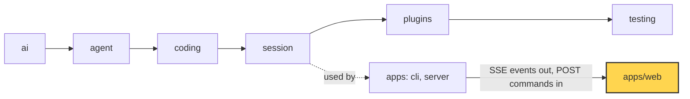

# 25 Part 5 · Web client

**Goal:** Build the browser UI on the protocol.

**Builds on:** [24 Docker sandbox](24-docker-sandbox.md) · **Next:** [26 System tests and deploy](26-system-tests-deploy.md)

## Where we are



*This chapter builds the browser app `apps/web` (marked). The server and the library do not change.*

Big picture of Part 5: [part-5-system](19-0-part-5-system.md).

Code in this chapter (commit `2fc2776`):

- `apps/web/src/api.ts` — `api`, `subscribe`, `getToken`, `AuthError`
- `apps/web/src/state.ts` — `ChatState`, `reduce`, `appendAt`, `canContinue`
- `apps/web/src/App.tsx`, `apps/web/src/Chat.tsx`, `apps/web/src/Files.tsx` — the screens
- `apps/web/src/protocol.gen.ts` — protocol types made from the server ([20](20-server-run.md))
- `apps/web/src/state.test.ts` — unit tests for the reducer

## Problem

After chapters 20 to 24, the server is ready. It keeps Ana's and Bob's sessions on disk ([22](22-store-auth.md)), stops runaway runs ([23](23-limits.md)) and runs their `bash` commands in a box ([24](24-docker-sandbox.md)). But only a program can talk to it. Ana wants to open a browser page, type "write `fizzbuzz.py`", and watch the answer appear word by word.

Recall what the server gives a client ([20](20-server-run.md), [21](21-transport.md)). Events come out on one long HTTP response in the [SSE](glossary.md#sse) format, and commands go in as POST calls. There are two kinds of events. A [durable event](glossary.md#durable-event) such as `user_message`, `assistant_message`, `tool_result` or `run_state` is saved and has a number, `seq`, that grows by one each time. A [live event](glossary.md#live-event) (a "delta") such as `text_delta`, `thinking_delta` or `tool_output` is a small piece of text. It is not saved and has no `seq`. Instead it has an [offset](glossary.md#offset): the place in the full text where the piece starts. The full text is saved later, inside the durable `assistant_message` or `tool_result`.

A browser client sounds easy: open the stream and print what comes in. Three facts make it hard. First, the stream needs Ana's [Bearer token](glossary.md#bearer-token) in an `Authorization` header ([22](22-store-auth.md)), and the browser's built-in SSE reader, `EventSource`, cannot send headers. Second, the stream breaks: Wi-Fi drops, the laptop sleeps, Ana presses reload in the middle of a long answer. When the page connects again it must not show a word twice and must not skip one. Third, many event kinds change the same screen: text, finished messages, tool output, approval requests, run state, title and plan mode. If each one changes the page in its own way, the screen slowly drifts away from the truth on the server.

## Naive version

The simplest idea: use `EventSource` and add every text delta to a string.

```ts
// naive.ts — runs in a browser page with <div id="out">
const sid = "abc123";
let text = "";
const out = document.getElementById("out")!;

const es = new EventSource(`/api/sessions/${sid}/events`); // no way to add a token header
es.onmessage = (m) => {
  const ev = JSON.parse(m.data);
  if (ev.type === "text_delta") {
    text += ev.delta;                 // trust every delta
    out.textContent = text;
  }
  if (ev.type === "assistant_message") {
    text = "";                        // message done, clear the bubble
    out.textContent = ev.text;
  }
};
```

Run the fizzbuzz task with this and it breaks in three ways, one for each fact above. It gets a 401 on the first call, because `EventSource` has no way to send the token, and putting the token in the URL would leak it into server logs. If it did connect, a reconnect would break the text: the page has `"Let me w"`, the line drops, and on reconnect `EventSource` cannot tell the server which events it already has, so the same deltas can arrive again and `text +=` adds them twice (`"Let me wLet me w..."`). And every other event kind (tool output, approvals, run state) needs its own `if` that pokes the page, with no single place that says "this is the state of the chat".

## Step by step: from naive to real

We fix the three breaks in five small steps. The real code for each is in the next section.

1. **Read the stream with `fetch` instead of `EventSource`.** `fetch` can send the token header. The price is that we must cut the stream into events ourselves: an SSE event ends with a blank line, so we keep a buffer and cut at each blank line. This fixes the 401.
2. **Reconnect in a loop, and say where we stopped.** Each new connection sends the `seq` of the newest durable event the page has. The server then sends only the durable events we missed, then a snapshot (step 5), then live events. We wait a little longer after each failed try.
3. **Put every change in one pure function, the reducer.** It takes the old state and one event and returns the new state. A durable event whose `seq` is not bigger than the last one we applied is skipped. This fixes "many writers" and part of the duplicates.
4. **Check the offset of each delta.** Add a delta only if it starts exactly at the end of the text we have. A repeated delta or one after a missing piece does not fit, so it is dropped. This fixes the rest of the duplicates.
5. **Let the snapshot replace live state.** On every connect the server sends a `snapshot`: the in-flight text, live tool output, pending approval, run state, title and plan mode as they are now. The reducer replaces its live state with it instead of adding to it. After a reload, the page starts from exactly what the server has.

## Real design

The web app is React + Vite in `apps/web/`. We follow Ana from the moment she opens the page to the moment the answer is on the screen, and name each file when its piece first appears. Types such as `ServerEvent` and `PendingApproval` come from `protocol.gen.ts`, which is made from the server's own types ([20](20-server-run.md)), so the client and the server cannot disagree about an event's fields.

### 1. Ana logs in: calls with a token (api.ts)

The login form posts the name and password to `/api/login` (or `/api/signup` for a new user) and stores the returned token in `localStorage`. `api.ts` then wraps `fetch` once, so every call carries the token:

```ts
export const getToken = () => localStorage.getItem("simp.token") ?? "";

async function call(path: string, init: RequestInit = {}): Promise<Response> {
  const r = await fetch(path, { ...init, headers: { Authorization: `Bearer ${getToken()}`, ...init.headers } });
  if (r.status === 401) throw new AuthError("invalid token");
  if (!r.ok) throw new Error(`${r.status} ${await r.text()}`);
  return r;
}
```

A 401 becomes its own error type, `AuthError`. The app catches that one type and logs the user out. Any other error is just shown as an error.

### 2. Ana picks a session (App.tsx)

`App.tsx` shows the session list (loaded with `api.sessions()`) and the chat for the chosen session. When Ana picks the fizzbuzz session, the page must start listening to its events. To do that, `App.tsx` calls `subscribe()` inside a React `useEffect`, which runs when the session id changes:

```ts
const apply = (ev: ServerEvent) => {
  ref.current = reduce(ref.current, ev);
  setState(ref.current);
  ...
};
return subscribe(sid, () => ref.current.lastSeq, apply, setConn, onLogout);
```

`apply` is the one place where events enter the page: it runs the reducer (section 5 below) and saves the result. The state is kept twice: in React state, to redraw the page, and in `ref` (a `useRef`, a box whose value React does not copy). React state is updated later, at the next redraw. The ref is updated at once, so when `subscribe` reconnects it reads the true newest `lastSeq`. The effect returns the close function from `subscribe`, so switching to another session closes the old stream. `apply` also refreshes the session list on `run_state`, `snapshot` and `session_title`.

<a id="fetch-based-sse"></a>
### 3. The page listens: SSE over fetch (subscribe)

`subscribe()` reads the event stream with the same `call()`. Its comment says the whole plan:

```ts
/**
 * EventSource-like SSE client over fetch (EventSource cannot send Authorization).
 * Reconnects forever with Last-Event-ID = the last durable seq applied; the server answers with the missed
 * durable events, then a snapshot, then live.
 */
export function subscribe(
  sid: string, lastSeq: () => number, onEvent: (ev: ServerEvent) => void,
  onStatus: (s: ConnStatus) => void, onAuthError: () => void,
): () => void {
```

The body is a loop, and each turn of the loop is one connection:

```ts
const r = await call(`/api/sessions/${sid}/events`, {
  signal: ctl.signal, headers: { "Last-Event-ID": String(lastSeq()) },
});
const reader = r.body!.pipeThrough(new TextDecoderStream()).getReader();
let buf = "";
for (;;) {
  const { value, done } = await reader.read();
  if (done) break;
  buf += value;
  let i;
  while ((i = buf.indexOf("\n\n")) >= 0) {
    const data = buf.slice(0, i).split("\n").filter((l) => l.startsWith("data:")).map((l) => l.slice(5).trim()).join("\n");
    buf = buf.slice(i + 2);
    if (data) {
      const ev = JSON.parse(data) as ServerEvent;
      if (ev.type === "snapshot") { onStatus("live"); attempt = 0; }
      onEvent(ev);
    }
  }
}
```

The inner `while` is step 1. A network chunk can end in the middle of an event, so the buffer keeps the rest until the next chunk comes. Each full event is cut at `\n\n`, and its `data:` lines are joined and parsed as JSON. That is all of SSE the client needs, about 15 lines, with no library.

The `Last-Event-ID` header is step 2. `lastSeq` is a function, not a number, so every new connection asks for the newest `seq` at that moment, not the one from when `subscribe` was first called. The server's side of this is in [21 · Replay](21-transport.md#replay-after-then-snapshot-then-live).

The connection status, `ConnStatus`, is `"connecting" | "live" | "reconnecting"`. It becomes `live` only when the snapshot arrives, because only then is the screen up to date. `Chat.tsx` shows it in the header.

When the stream ends or throws, the loop waits and tries again:

```ts
} catch (e) {
  if (e instanceof AuthError) return onAuthError();
}
if (!ctl.signal.aborted) {
  onStatus("reconnecting");
  await new Promise((ok) => setTimeout(ok, Math.min(1000 * 2 ** attempt, 10000)));
}
```

`attempt` counts the tries (it is the counter of the outer `for` loop), so the waits are 1 s, 2 s, 4 s, 8 s, then 10 s at most. A snapshot sets `attempt` back to 0, so after a good connection the first wait is short again. A bad token stops the loop for good, because retrying cannot fix it. `subscribe` returns `() => ctl.abort()`, so the caller can close the stream.

### 4. Ana types a question (Chat.tsx)

`Chat.tsx` draws the chat and holds the input box. When Ana presses Enter, it sends one command with the same `call()`, through `api.command(sid, c)`, which posts to `/api/sessions/{sid}/commands`:

```ts
send(!busy ? { type: "prompt", text: t } : queue ? { type: "follow_up", text: t } : { type: "steer", text: t });
```

If no run is going, the text starts a new run (`prompt`). If a run is going, it is queued for later (`follow_up`) or sent into the current run (`steer`). The POST returns at once. The page does not add Ana's message to the screen itself: the answer, and even her own message, come back as events on the stream that `subscribe` already holds open.

<a id="the-reducer-statets"></a>
### 5. Events arrive: the reducer (state.ts)

All chat state lives in one object, `ChatState`. The four fields that matter most:

```ts
export interface ChatState {
  lastSeq: number;                 // newest durable seq applied
  items: Item[];                   // finished messages and notices
  inFlight: InFlight;              // the message still streaming
  pending: PendingApproval | null; // approval the user must answer
  // ... six more
}
```

All ten fields are listed in [Reference · ChatState](ref-objects.md#web-client-chatstate). `items` holds finished things: user messages, assistant messages and notices. `inFlight` holds the assistant message that is still streaming. The split matters because finished messages never change, while the in-flight bubble is built from deltas.

A **[reducer](glossary.md#reducer)** is a pure function `(state, event) -> new state`. It does not touch the page or the network, so the same events always give the same screen. `reduce()` starts with step 3, the skip rule for durable events:

```ts
export function reduce(s: ChatState, ev: ServerEvent): ChatState {
  if ("seq" in ev) {
    if (ev.seq <= s.lastSeq) return s; // durable event already applied
    s = { ...s, lastSeq: ev.seq };
  }
  switch (ev.type) {
    case "user_message":
      return { ...s, items: [...s.items, { kind: "user", seq: ev.seq, text: ev.text }] };
    case "assistant_message":
      return { ...s, items: [...s.items, { kind: "assistant", seq: ev.seq, msg: ev }], inFlight: emptyInFlight() };
```

The rule is needed because the server can send the same durable event twice: an event saved while a reconnect is being set up can come once in the replay and once on the live queue. With the rule, the second copy does nothing. When the full `assistant_message` arrives, the in-flight bubble is cleared and the finished message takes its place in `items`.

The other cases follow the same pattern. A `tool_result` is stored in `results`, keyed by its `call_id`, so the screen can show it under the tool call. `approval_request` sets `pending`. `approval_resolved` stores the decision in `decisions` and clears `pending`, but only if it is for the same `call_id`. `run_state` sets `runState`. A `notice` with text `"plan mode on"` or `"plan mode off"` also flips `planMode` (plan mode is from [18](18-profiles-plugins.md)). `compaction` becomes a notice like `Context compacted (… → … tokens)` (compaction is from [16](16-compaction.md)).

The `snapshot` case is step 5:

```ts
case "snapshot":
  // The snapshot is the truth for everything live: replace the in-flight bubble and live tool output.
  return {
    ...s, lastSeq: Math.max(s.lastSeq, ev.last_seq), runState: ev.run_state, pending: ev.pending_approval,
    title: ev.title, planMode: ev.plan_mode,
    inFlight: ev.in_flight, toolOutputs: { ...s.toolOutputs, ...ev.in_flight.tool_outputs },
  };
```

The **[snapshot](glossary.md#snapshot)** does not add to the in-flight text. It replaces it. After a reload, the bubble shows exactly what the server has, and later deltas continue from there. Tool output is merged, not replaced: the snapshot holds only the tools still running, so the output of tools that already finished must stay on the screen.

<a id="appendat"></a>
### 6. Deltas fit together: appendAt

A delta has no `seq`, only an `offset`. The client uses one tiny rule:

```ts
/** Append `delta` only when it starts exactly at the end of `cur`; anything else is a dup or a gap. */
export function appendAt(cur: string, offset: number, delta: string): string {
  return offset === cur.length ? cur + delta : cur;
}
```

Take the fizzbuzz answer. The bubble holds `"Let me"`, which has length 6. A delta `(6, " write")` fits, and the text becomes `"Let me write"`. The same delta again does not fit, because the length is now 12, not 6, so it is dropped and there is no duplicate. A delta `(20, "...")` means the piece from 12 to 20 is missing, so it is dropped too, rather than showing text with a hole in it. These two cases are the [gap / dup delta](glossary.md#gap--dup-delta). During a run, the hole is filled when the full `assistant_message` arrives and replaces the bubble. After a reconnect, the snapshot fills it.

The text and thinking cases add one more check, for the start of a new message:

```ts
case "text_delta":
case "thinking_delta": {
  let f = s.inFlight;
  if (f.msg_id !== ev.msg_id) {
    if (ev.offset !== 0) return s; // a new message must start at 0
    f = { ...emptyInFlight(), msg_id: ev.msg_id };
  }
  const key = ev.type === "text_delta" ? "text" : "thinking";
  return { ...s, inFlight: { ...f, [key]: appendAt(f[key], ev.offset, ev.delta) } };
}
```

A delta for a new `msg_id` starts a fresh bubble only if its offset is 0. If the first piece of a new message was lost, the page waits for the full message instead of showing the middle of it. `tool_output` uses the same `appendAt`, with one text per `call_id` in `toolOutputs`. It needs no new-message check, because each tool call has its own key and starts from an empty string.

### 7. The page draws it (Chat.tsx)

`Chat.tsx` only reads `ChatState` and sends commands; it never changes the state itself. Every button calls `api.command(sid, c)`, for example `{ type: "set_plan_mode", enabled: !state.planMode }`, `{ type: "compact" }` or `{ type: "continue" }`. The server runs the command, the result comes back as events, the reducer updates the state, and React redraws. Data goes one way only, so the screen always matches the server. The **Continue** button shows when `canContinue(state)` is true: the run state is `error`, or it is `idle` and the last item is a notice that starts with `interrupted:` (a server restart cut the run).

Markdown is drawn with `react-markdown`, with one change: images are never loaded, they become plain links. The comment in `Chat.tsx` says why. A model that read a harmful file could be tricked into writing ``, and loading that image would send data to a stranger.

`Files.tsx` lets Ana browse, download and upload files in the session folder with `api.files`, `api.download` and `api.upload`. Files do not change word by word like the chat, so a plain list loaded on request is enough; there is no event stream for files.

## Test

The reducer has unit tests in `apps/web/src/state.test.ts` (vitest). They feed events to `reduce()` and check the state, which is easy because the reducer is pure: no page and no server are needed. The tests cover the three fixes. For deltas, they check that `appendAt` drops dups and gaps, that a new `msg_id` starts only at offset 0, and that thinking, tool output and old durable events are handled the same way. For the snapshot, they check that it replaces the bubble, that live deltas then continue with no gap or dup, and that a pending approval comes back after a reload. They also check that title and plan mode come from the snapshot and then from live events, and that Continue is offered after an `interrupted:` notice or an error but not after a later event.

Run them with `cd apps/web && pnpm test`.

These tests check the reducer alone. The full promise, "reload the page and nothing is lost or doubled", needs a real browser and a real server. That test is in [26 · End-to-end tests with Playwright](26-system-tests-deploy.md#end-to-end-tests-with-playwright).

## Why this way

> **Server is the truth; the client is a pure reducer**, so any order of reconnects ends in the same screen. `fetch` is used instead of `EventSource` because only `fetch` can send the `Authorization` header; the cost is about 15 lines of SSE parsing and a hand-written retry loop. A dropped delta is not repaired at once; the screen waits for the final `assistant_message` or the next snapshot.

## Exercises

1. Do it on paper. The bubble is `"Hi"`. Apply these deltas in order with `appendAt`: `(2, " there")`, `(2, " there")`, `(30, "!")`. What is the text after each one?
2. In `state.test.ts` style, write a test: call `reduce` twice with the same `user_message` event (same `seq`). Check that `items` has length 1.

## Recap

Ana now has a browser page. `subscribe()` reads SSE over `fetch`, so it can send her token, and it reconnects forever with `Last-Event-ID` set to the last applied `seq`, waiting up to 10 s between tries. `reduce()` is the only place that changes chat state: it skips durable events it already has, `appendAt()` drops delta dups and gaps, and the `snapshot` replaces all live state on each connect. `Chat.tsx` only reads the state and sends commands, and `state.test.ts` checks the reducer. Next, [26](26-system-tests-deploy.md) tests the whole system in a real browser and shows how to deploy it.

**Builds on:** [24 Docker sandbox](24-docker-sandbox.md) · **Next:** [26 System tests and deploy](26-system-tests-deploy.md)

