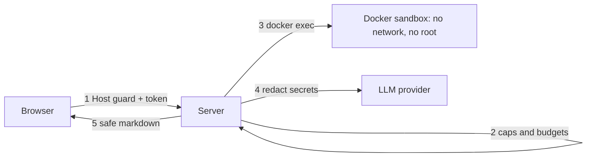

# 26 — Security model and known gaps

> **Who this is for:** an operator who wants to know what simp-agent protects, and what it does not.
> **What you need first:** [22 Users and accounts](22-users.md), [23 Sandboxes](23-sandboxes.md), [24 Money and limits](24-money.md). Words: [access token](glossary.md#access-token), [sandbox](glossary.md#sandbox), [session](glossary.md#session).
> **What you will learn:** the threats the server is built for, the protections that exist, and a dated list of gaps you must cover yourself.
> **Code paths covered:** `apps/server/src/simp_server/server.py` (`host_guard`, `authenticate`, `Account`, `signup`), `apps/server/src/simp_server/store.py` (`sha`, `hash_password`), `apps/server/src/simp_server/sandboxes/docker.py`, `packages/simp_agent/src/simp_agent/plugins/redact_secrets.py`, `apps/web/src/Chat.tsx`.
> **Verified at commit:** `ad5a9bd` (read from code; nothing was attacked or run in this check).

**Back:** [25 Day-to-day ops](25-ops.md) · **Next:** [27 Troubleshooting](27-troubleshooting.md)

## 1. The goal: a small trusted team on one machine

simp-agent is built for a few people you know, on one machine, behind a tunnel or on your own network. It is **not** built for strangers on the open internet. This is the honest frame for everything below.

The main danger is not a person. It is the **agent itself**: a model that runs shell commands, and reads text (web pages, files, repos) that can try to trick it. So most protections limit what a command can do.

## 2. What is protected

### 2.1 Tokens and passwords
- Every session, file and event-stream call needs `Authorization: Bearer <token>`. No valid token gives `401`. Only `signup` and `login` are open (they have their own checks).
- The server stores only the **sha256** of a token, never the token. A copy of the database does not give out working tokens. A token is shown once (see [22](22-users.md)).
- Passwords are stored with **scrypt** and a random salt. Login takes the same time whether or not the user exists. The sign-up code is compared in constant time.
- Sign-up input has caps (name 64, password 1024 characters), so one request cannot make scrypt or the database costly. Passwords need 8 or more characters.
- Revoke or rotate stops the old token at once; the user's open streams close soon after, not instantly ([22](22-users.md)).

### 2.2 The Host guard (DNS rebinding)
A web page on another site can trick your browser into talking to `127.0.0.1`. This is called DNS rebinding. The server checks the `Host` header of every request and answers `403 bad host` unless it is in `allowed_hosts` (default `localhost` and `127.0.0.1`). If you reach the server by another name, add it in [21](21-configuration.md). Use names without the port. An IPv6 address like `[::1]` does not work with this check.

The server listens on `127.0.0.1` by default, so only your own machine can reach it. If you set `host = "0.0.0.0"`, you remove that first shield, and the gaps in section 3 (no TLS, no rate limit) become real. Do that only behind a tunnel or firewall.

### 2.3 The Docker sandbox
With `DockerSandbox`, each session gets its own container ([23](23-sandboxes.md)). The `docker run` flags are:

| Flag | What it does |
|---|---|
| `--network none` (default) | The container has no network. A command cannot send your files out or fetch tools. |
| `--user 1000:1000` | Not root. |
| `--cap-drop ALL`, `no-new-privileges` | No Linux powers, and no way to gain them. |
| `--read-only` + small `/tmp` | Only `/work` (the session folder) and a 64 MB `/tmp` can be written. |
| `--pids-limit`, `--memory`, `--cpus` | Limits (defaults 256, 1g, 1) against fork bombs and memory hogs. |

`LocalSandbox` has none of this. The server refuses a second user while it is the sandbox, unless you set `allow_local_sandbox` ([23](23-sandboxes.md)).

### 2.4 Caps
Small limits keep one client from hurting the others: at most 20 queued messages per session (`429`), file uploads up to 50 MiB by default (`413`), and money budgets ([24](24-money.md)). Open sessions and idle time are capped in [21](21-configuration.md).

### 2.5 No remote images in the web UI
Markdown from the model is shown in the browser. A remote image would make your browser fetch a URL chosen by the model, which can leak data in the URL. The web UI shows an image as a plain link `[image: alt] url` and does not load it. If you click the link, it opens in a new tab: that is your choice, not automatic.

### 2.6 Secret redaction
The `redact_secrets` plugin is always on in the server. It replaces known secrets with `[REDACTED]` in tool output and in what is sent to the LLM: the server's own keys, values of environment variables whose names contain `KEY`, `TOKEN`, `SECRET` or `PASSWORD`, and common key shapes (`sk-…`, JWT, AWS `AKIA…`, GitHub `ghp_…`). This is a net with holes: a secret in another shape, or split in pieces, is not caught. Environment values shorter than 8 characters are ignored.

### 2.7 Files stay inside the workspace
The file API and the tools resolve every path and refuse one that leaves the session folder, including `..` and symlinks. Downloads are sent as `application/octet-stream`, so the browser saves a file instead of showing it as a web page. With `LocalSandbox` this check is the only wall.

### 2.8 No cross-site reads
The server sets no CORS rules, so other web sites cannot read its replies. The cost: a web UI served from another origin will not work.

## 3. Known gaps (as of 2026-10-12)

Date: **2026-10-12**, commit `ad5a9bd`. Check [ROADMAP](../ROADMAP.md) for newer news. A gap is not a bug: it is a thing the server does not do, so you must cover it.

| Gap | What it means for you | What to do now |
|---|---|---|
| **No login rate limit** | Someone can guess passwords or the sign-up code as fast as the server answers (scrypt makes each try slow, not impossible). | Keep the server off the open internet; use a long sign-up code; set no code when not signing up. |
| **No TLS** | The server speaks plain HTTP. Tokens and chat travel in clear text. | Reach it only on localhost, or through a tunnel/proxy that adds HTTPS. ROADMAP says "tunnel handles it". |
| **No OIDC / single sign-on** | Only tokens and passwords. No company login, no 2FA. | Keep the team small; revoke leavers ([22](22-users.md)). |
| **No sandbox egress allowlist** | The network is all or nothing. With `network = "none"` the agent cannot reach package sites; with a network it can reach everything. | Keep `none`. An allowlist is "Later" in ROADMAP. |
| **LocalSandbox is not a sandbox** | Commands run as the server user. | One user only, or use Docker ([23](23-sandboxes.md)). |
| **Budgets are soft** | Money can pass a limit ([24](24-money.md)). | Set limits at the provider too. |
| **Prompt injection** | Text the model reads can steer it. Docker limits the damage but does not stop the model being fooled. | No network, small budgets, read the tool calls. |
| **Secrets in files** | Redaction does not scan files in the workspace, only text passing through. | Do not put real keys in a workspace. |
| **Docker is not a VM** | A container shares the host kernel. Own isolation (Firecracker/gVisor) is Stage 5 in ROADMAP. | Do not run hostile users. |
| **No security headers** | The server sends no CSP, `nosniff` or `X-Frame-Options`. | Put a proxy in front if you need them. |
| **No audit trail for people** | Logs ([25](25-ops.md)) show runs, not a full record of who did what. | Add your own review if you need one. |
| **Backups are not encrypted** | Backup files hold the database and sessions in clear. | Keep the folder private (`chmod 700`). |

## 4. A short checklist for an operator
1. Docker sandbox on, `network = "none"`.
2. Server on `127.0.0.1`, or behind a tunnel with HTTPS.
3. `allowed_hosts` has only the names you really use.
4. A long sign-up code, or none.
5. Budgets set here and at the provider.
6. Tokens revoked when someone leaves.

---

**Built on by:** [27 Troubleshooting](27-troubleshooting.md).
**Builds on:** [22 Users and accounts](22-users.md), [23 Sandboxes](23-sandboxes.md), [24 Money and limits](24-money.md), [25 Day-to-day ops](25-ops.md).
