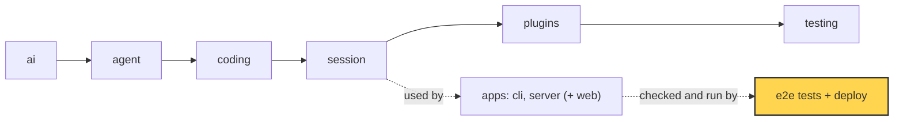

# 26 Part 5 · System tests and deploy

**Goal:** Test the whole system and run it on one machine.

**Builds on:** [25 Web client](25-web-client.md) · **Next:** [27 Choices, limits and extending](27-limits-choices-extend.md)

## Where we are



*This chapter adds the part around the apps (marked): browser tests with a fake model, logs, backups, and a service on one machine.*

Big picture of Part 5: [part-5-system](19-0-part-5-system.md).

Code in this chapter (commit `2fc2776`):

- `apps/server/src/simp_server/fakellm.py` — `stream` (the fake model)
- `apps/web/e2e/serve.sh`, `apps/web/e2e/app.spec.ts`, `apps/web/e2e/accounts.spec.ts`, `apps/web/e2e/admin.spec.ts`, `apps/web/playwright.config.ts` — the end-to-end tests
- `apps/server/src/simp_server/fake.py`, `apps/web/e2e/fake_reload.py` — an older fake server and its manual check
- `apps/server/src/simp_server/ops.py` — `JsonFormatter`, `setup_logging`, `backup`
- `deploy/launchd/com.simp.server.plist`, `deploy/launchd/com.simp.backup.plist` — the macOS services
- `apps/server/tests/test_ops.py` — the logging and backup tests

## Problem

At the end of [25](25-web-client.md), Ana opens the browser, types "write `fizzbuzz.py`", and watches the answer stream in. The server runs her `AgentSession` from [13](13-session.md) inside a server [Run](glossary.md#run) ([20](20-server-run.md); one Run object lives for the whole session, while each prompt inside it is one agent [run](glossary.md#run-agent) from [05](05-agent-loop.md)), streams the same events from [06](06-events-abort.md) ([21](21-transport.md)), saves the same messages ([22](22-store-auth.md)), checks her budget ([23](23-limits.md)) and runs `bash` in a container, a swap for the env of [09](09-exec-env.md) ([24](24-docker-sandbox.md)). Each of these pieces has its own unit tests. Two questions are still open.

The first is: **do the pieces work together?** A unit test for the transport never clicks a button in a real browser. A bug can hide between the web client and the server, for example a word shown twice after Ana reloads the page. We want tests that act like Ana, end to end. But a real model is a bad partner for such a test. It costs money, it is slow, and it writes different words every time, so a test cannot say "the answer must be `Echo: hello`".

The second is: **does the server stay alive?** The server runs on one Mac for Ana and Bob. If the Mac reboots, the server is gone until someone starts it by hand. If the disk dies, all users, sessions and workspaces are gone. And when something goes wrong at night, the admin needs logs that a program can search.

So the chapter has two halves. The first half tests the whole system with a fake model. The second half runs it as a service, with logs and backups.

## Test the whole system

### Starting point: 25's app, and 04's fake model

At the end of [25](25-web-client.md) we have the web client talking to the server. Each server Run wraps one `AgentSession` from [13](13-session.md), and the server builds that session with `stream_fn=self.guarded_stream`, which wraps `mgr.stream_fn` (by default `ai.stream`, the real model). We also have a fake model already: [04](04-label-test.md) built `FakeProvider`, a `stream_fn` that plays [scripted replies](glossary.md#scripted-reply).

If we test the app as it is, with the real model, the test is slow, costs money, and fails at random, because the model never writes the same words twice. We need a test partner that is **[deterministic](glossary.md#deterministic)**: same input, same output, every time. The model is the only part with this problem. The store, auth, budget and tools give the same result for the same input. So we swap only the `stream_fn`, as in 04, and keep everything else real. `FakeProvider` plays replies in a fixed order, but in a browser test the user decides what to type, so the server needs a fake that answers based on the message.

### FakeLLM: a model that always says the same thing

`apps/server/src/simp_server/fakellm.py` has it:

Real code: [fakellm.py](../../apps/server/src/simp_server/fakellm.py) — `stream`

```text
FUNCTION stream(model, ctx, api_key):
    last = the last message in ctx
    IF the system prompt starts with "Name this coding session":
        answer "Fake title"
    ELSE IF last is a tool result:
        answer "Tool said: " + the tool output
    ELSE IF last starts with "tool":
        answer "Running a command." AND ask for tool bash "echo hi-from-tool"
    ELSE IF last starts with "slow":
        answer "w0 ", "w1 " ... "w39 "         // 40 chunks, wait is 3 × the delay
    ELSE:
        answer "Echo: " + last
```

The rules are checked from top to bottom, and the first match wins. Each rule exists for one kind of test. The plain echo tests normal streaming. A message that starts with "tool" makes a `bash` call, so a test can see the approval card ([08](08-hooks-approval.md)) and a real tool result. A message that starts with "slow" streams 40 chunks, three times slower, which gives a test time to reload the page, press Stop, or steer while the run is busy. The first rule answers the [title call](glossary.md#title-call); it is the only rule that looks at the system prompt, not the last message.

FakeLLM then yields the same events a real provider yields ([03](03-parse.md), and the server sends them on as the events of [06](06-events-abort.md)): `start`, `thinking_delta`, some `text_delta`, `done`. It sends a `thinking_delta` too, so the web client's "thinking" area is also tested. The wait between chunks comes from `SIMP_FAKE_DELAY` (default `0.05` seconds).

The server picks it with one flag in `apps/server/src/simp_server/server.py`:

Real code: [server.py](../../apps/server/src/simp_server/server.py) — `main`

```text
ADD CLI flag --fake-llm                   // "deterministic scripted model (e2e)"
...
IF --fake-llm: LOAD stream from fakellm
START uvicorn with create_app(settings, fake stream IF --fake-llm ELSE ai.stream)
```

Everything else is the real server: real store, real auth, real budget, real tools. That is the point. The code we want to test is the code around the model.

### End-to-end tests with Playwright

An **[end-to-end test](glossary.md#end-to-end-test)** (e2e test) drives the real app from the outside, like a user. We use [Playwright](glossary.md#playwright), a tool that controls a real browser. `make e2e` runs `pnpm e2e` in `apps/web`, which is `playwright test`. Before any test runs, the config `apps/web/playwright.config.ts` starts two servers:

```ts
  webServer: [
    { command: "sh e2e/serve.sh", url: "http://127.0.0.1:8767/docs", reuseExistingServer: false },
    { command: "SIMP_SERVER=http://127.0.0.1:8767 pnpm exec vite --port 5198 --strictPort", url: "http://127.0.0.1:5198" },
  ],
```

The second line is the Vite dev server for the web client ([25](25-web-client.md)). The first is our real server, started by `apps/web/e2e/serve.sh`:

```sh
export SIMP_SERVER_HOME=/tmp/simp-e2e SIMP_FAKE_DELAY=0.05
rm -rf "$SIMP_SERVER_HOME" && mkdir -p "$SIMP_SERVER_HOME"
printf 'signup_code = "e2e-code"\nallow_local_sandbox = true\n[profiles.fake]\napi = "fake"\nmodel = "fake"\nprice_in = 10000\nprice_out = 0\n[budget]\nuser_day_usd = 1\nrun_usd = 1\n' > "$SIMP_SERVER_HOME/settings.toml"
uv run simp-server seed --name e2e > "$SIMP_SERVER_HOME/token"
exec uv run simp-server run --port 8767 --fake-llm
```

The script deletes old data and writes a small `settings.toml`. The server still needs a [profile](glossary.md#profile) ([18](18-profiles-plugins.md)), so there is one called `fake`; its names do not matter, because `--fake-llm` replaces the stream anyway. Its price is very high and the budget is $1, so the budget test ([23](23-limits.md)) can hit the limit after a few messages. `allow_local_sandbox = true` means the tests do not need Docker ([24](24-docker-sandbox.md)). Then it seeds one user ([22](22-store-auth.md)), saves the token to a file, and starts the server with `--fake-llm`.

`reuseExistingServer: false` and `rm -rf` are on purpose. Old sessions or old budget use from a past run would change the results, so every run starts empty.

The tests are in `apps/web/e2e/`: `app.spec.ts`, `accounts.spec.ts` and `admin.spec.ts`. `app.spec.ts` has small helpers. `login` reads the token from `/tmp/simp-e2e/token`, signs in and opens a new session. `say` types a message and presses Enter. `last` finds the newest assistant message.

The test that matters most for the web client is the reload test. It is the "Ana presses reload in the middle of an answer" case from [25](25-web-client.md):

```ts
test("reload mid-stream continues with no gaps or dups; pending approval restored", async ({ page }) => {
  await login(page);
  await say(page, "slow");
  await expect(page.locator(".streaming .md")).toContainText("w3 ");
  await page.reload();
  await expect(last(page)).toHaveText(Array.from({ length: 40 }, (_, i) => `w${i}`).join(" "), { timeout: 15000 });
  await say(page, "tool");
  await expect(page.locator(".approval-card")).toBeVisible();
  await page.reload();
  await page.click(".approval-card button:text('Allow')");
  await expect(last(page)).toContainText("Tool said: hi-from-tool");
});
```

The test sends "slow" and waits until `w3` is on screen. Then it reloads, so all client state is gone. The new page connects again and gets the missed durable events, then the snapshot, then live deltas, as in [25](25-web-client.md). The final message must be **exactly** `w0 w1 ... w39`: one word twice or one word missing fails the test. This checks that the snapshot and the `appendAt` offset rule work together. The second half does the same for an approval. The snapshot carries the pending approval, so after the reload the **Allow** button comes back, and clicking it finishes the tool call.

### A note on fake.py

The repo has a second, older fake: `apps/server/src/simp_server/fake.py`. It is a small FastAPI app with the **same HTTP API** as the real server, but no agent, no store and no auth. It plays back a recorded `SCRIPT` (thinking, text, one `ls -la` tool call, a final answer). It was built so the web client could be written before the real server was ready, and the real server still imports its `sse` helper. You start it with `simp-server fake` (`__main__.py` sends any word it does not know to `fake.main`). `apps/web/e2e/fake_reload.py` is a manual reload check against it. No `make e2e` test uses it; FakeLLM replaced it because it tests the real server.

## Run it on one machine

Now the tests pass, so we turn to the second question: does the server stay alive?

### Starting point: 25's server, started by hand

At the end of [25](25-web-client.md), someone starts the server by hand in a terminal. Logs are plain text lines on stderr. There is no backup. If the Mac reboots, the server stays down. We fix these three things in order: logs, backups, then a service that starts by itself.

### JSON logs

The server writes logs while Ana and Bob work. A plain text line like `run started` is easy to read, but hard to search: which run, which user? `apps/server/src/simp_server/ops.py` makes every log line one JSON object on stderr. `JsonFormatter` keeps the time, level and message, plus any extra fields the caller passed:

Real code: [ops.py](../../apps/server/src/simp_server/ops.py) — `JsonFormatter.format`

```text
d = { ts: record time, level: record level, msg: record message }
FOR EACH field IN the record:
    IF field is not a normal LogRecord field (_STD): ADD it to d
```

Python's `logging` puts many fields on each record (file name, line number, thread...). `_STD` is the list of those normal fields, so only your own extras, like `run_id` or `user`, are added. Now a tool like `jq` can find every line of one run. The server calls `ops.setup_logging()` when it starts, and passes `log_config=None` to uvicorn so uvicorn does not replace our JSON handler with its own.

### First try: copy the data folder

For backups, the simplest idea is to copy the server's data folder (`~/.simp-server`, from [22](22-store-auth.md)).

Sketch of the first try (not in the repo):

```text
MAKE a new folder "home"
OPEN database home/simp.db in WAL mode     // same as the server
CREATE table t, ADD row 42, COMMIT         // db stays open: the server is running
WRITE home/.env = "OPENAI_API_KEY=secret"

COPY the whole folder to "copy", but SKIP *-wal and *-shm files

PRINT the file names in "copy"             // .env is in the backup
TRY to read row 42 from copy/simp.db
IF it fails: PRINT "broken backup"
```

It breaks in two ways. First, the database copy can be wrong. In [WAL mode](glossary.md#wal), SQLite first writes new data to a side file, `simp.db-wal`, and moves it into `simp.db` later. Until then, `simp.db` alone does not have it. Here even the `CREATE TABLE` is still only in the side file, so the copy has no table at all. Copying the `-wal` file too is not safe either, because the server may write to it in the middle of the copy. Second, it copies secrets. The `.env` file with API keys goes into every backup, and backups often end up in less safe places than the server.

### ops.backup: a safe copy

`backup(data_dir, dest, keep=0)` writes one `.tar.gz` file named by the time:

Real code: [ops.py](../../apps/server/src/simp_server/ops.py) — `backup`

```text
IF data_dir/simp.db exists:
    snap = a temp file
    ASK SQLite: copy simp.db into snap       // safe while the server runs
    ...
    ADD snap to the tar as "simp.db"
FOR EACH name IN ("settings.toml", "workspaces", "sandboxes"):
    IF data_dir/name exists: ADD it to the tar
```

This fixes both bugs. For the database, `sqlite3.Connection.backup` is SQLite's own [online backup](glossary.md#online-backup). It reads one consistent copy, including the data still in the WAL file, while the server keeps the database open. For secrets, it does not copy the whole folder. It copies an **[allow list](glossary.md#allow-list)**: the database, `settings.toml`, `workspaces` and `sandboxes`. `.env` is not on the list, so it can never go in, even if someone adds more secret files later.

Then it removes old backups:

```text
IF keep > 0:                                  // names sort by time
    FOR EACH old file IN (simp-*.tar.gz sorted, except the newest keep):
        DELETE old
```

Names like `simp-20260101-000000.tar.gz` sort by time as plain text, so no date parsing is needed. The pattern only matches `simp-*.tar.gz`, so other files in the folder are safe.

From the command line, it is `simp-server backup --to DIR --keep N`. To restore, the repo `README.md` says: stop the server, delete any old `simp.db-wal` and `simp.db-shm` (SQLite would replay an old WAL onto the restored database), unpack the tar into `~/.simp-server`, and start the server again.

### launchd: run it as a service on a Mac

[launchd](glossary.md#launchd) is the macOS service manager. It starts programs at login, restarts them if they die, and runs jobs on a timer. You describe a job in a `.plist` file (an XML file of keys and values). `deploy/launchd/` has two.

`com.simp.server.plist` keeps the server running. These are the keys that matter:

```xml
    <string>/usr/bin/env</string><string>uv</string><string>run</string><string>--project</string><string>__REPO__</string>
    <string>simp-server</string><string>run</string><string>--port</string><string>8766</string>
  ...
    <key>SIMP_SANDBOX</key><string>docker</string>
    <key>PATH</key><string>__HOME__/.local/bin:/opt/homebrew/bin:/usr/local/bin:/usr/bin:/bin</string>
  ...
  <key>RunAtLoad</key><true/>
  <key>KeepAlive</key><true/>
  <key>StandardErrorPath</key><string>__HOME__/.simp-server/server.log</string>
  <key>StandardOutPath</key><string>__HOME__/.simp-server/server.log</string>
```

`RunAtLoad` starts the server when the file is loaded, for example at login, and `KeepAlive` starts it again if it crashes. That answers "the Mac rebooted". `SIMP_SANDBOX=docker` makes the real service use the Docker sandbox ([24](24-docker-sandbox.md)), not the local one the tests use. `PATH` is set by hand, because launchd does not read your shell profile and would not find `uv` or `docker`. Both output streams go to `server.log`, so that is where the JSON log lines land.

`com.simp.backup.plist` runs the backup every night:

```xml
    <string>simp-server</string><string>backup</string><string>--to</string><string>__HOME__/.simp-server/backups</string><string>--keep</string><string>14</string>
  ...
  <key>StartCalendarInterval</key>
  <dict><key>Hour</key><integer>3</integer><key>Minute</key><integer>0</integer></dict>
```

At 03:00 every day it makes a backup and keeps the newest 14. `__REPO__` and `__HOME__` are placeholders. The repo `README.md` shows a small loop that replaces them with `sed`, copies both files to `~/Library/LaunchAgents/`, and runs `launchctl load` on each.

We fake only the model, not the system: FakeLLM plugs into the same `stream_fn` slot as a real provider, so the e2e tests run the real server, store and tools. For deploy we chose the smallest thing that works on one machine (SQLite backup, a tar file, an allow list, launchd); [27](27-limits-choices-extend.md) says where this stops.

**Builds on:** [25 Web client](25-web-client.md) · **Next:** [27 Choices, limits and extending](27-limits-choices-extend.md)
