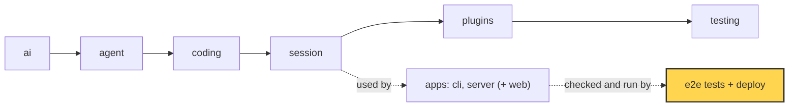

# 26 Part 5 · System tests and deploy

**Goal:** Test the whole system and run it on one machine.

**Builds on:** [25 Web client](25-web-client.md) · **Next:** [27 Choices, limits and extending](27-limits-choices-extend.md)

## Where we are



*This chapter adds the part around the apps (marked): end-to-end tests, backups and a service on one machine.*

Big picture of Part 5: [part-5-system](part-5-system.md).

Code in this chapter (commit `2fc2776`):

- `apps/server/src/simp_server/fakellm.py` — `stream` (the fake model)
- `apps/server/src/simp_server/fake.py` — `Hub`, `create_app`, `SCRIPT` (a whole fake server)
- `apps/web/e2e/serve.sh`, `apps/web/e2e/app.spec.ts`, `apps/web/e2e/accounts.spec.ts`, `apps/web/e2e/admin.spec.ts`, `apps/web/e2e/fake_reload.py`, `apps/web/playwright.config.ts` — the end-to-end tests
- `apps/server/src/simp_server/ops.py` — `JsonFormatter`, `setup_logging`, `backup`
- `deploy/launchd/com.simp.server.plist`, `deploy/launchd/com.simp.backup.plist` — the macOS services
- `apps/server/tests/test_ops.py` — the logging and backup tests

## Problem

At the end of [25](25-web-client.md) we have all the pieces. A user opens the browser, types "write fizzbuzz.py", and the server runs a session ([20](20-server-run.md)), streams events ([21](21-transport.md)), stores them ([22](22-store-auth.md)) and runs tools in a sandbox ([24](24-docker-sandbox.md)).

Each piece has its own unit tests. But three things are still missing:

1. **A real model is a bad test partner.** It costs money, it is slow, and it gives a different answer each time. A test that says "the answer must be `Echo: hello`" cannot work with it.
2. **Nobody tests the pieces together.** A unit test for the transport does not click a button in a real browser. A bug between the web client and the server can hide.
3. **Nobody keeps the server alive.** If the laptop reboots, the server is gone. If the disk dies, all users, sessions and workspaces are gone.

The chapter has two parts, in this order:

- **Part A: test the whole system** — a fake model, then browser tests on top of it.
- **Part B: run it on one machine** — logs and backups, then launchd to keep it running.

## Part A: test the whole system

### Naive version: test with the real model

The first idea: start the real server, open a browser, ask the real model "write fizzbuzz.py", and check the answer. It is slow, costs money, and fails at random, because the model never writes the same words twice. We need something that is **[deterministic](glossary.md#deterministic)**: same input, same output, every time.

The model is the only part with this problem. The store, auth and tools give the same result every time. So we fake only the model.

### FakeLLM: a model that always says the same thing

In [04](04-label-test.md) we learned that the agent never calls a model directly. It calls a `stream_fn`. So the server can take a fake one. `apps/server/src/simp_server/fakellm.py`:

Real code: [fakellm.py](../../apps/server/src/simp_server/fakellm.py) — `stream`

```text
FUNCTION stream(model, ctx, api_key):
    last = the last message in ctx
    IF system prompt starts with "Name this coding session":
        answer "Fake title"
    ELSE IF last is a tool result:
        answer "Tool said: " + the tool output
    ELSE IF last starts with "tool":
        answer "Running a command." AND ask for tool bash "echo hi-from-tool"
    ELSE IF last starts with "slow":
        answer "w0 ", "w1 " ... "w39 "         // 40 chunks
    ELSE:
        answer "Echo: " + last
```

Rules are checked from top to bottom. The first match wins. It only looks at the last message. Each rule exists for one kind of test:

- **Echo** for a normal streaming answer.
- **"tool ..."** makes a `bash` call, so the test can see an approval card ([08](08-hooks-approval.md)) and a real tool result.
- **"slow ..."** streams 40 chunks with a longer wait. This gives the test time to reload the page, press Stop, or steer while the run is busy.
- **"Name this coding session"** answers the title request with `"Fake title"`.

Then it yields the same events a real provider yields: `start`, `thinking_delta`, some `text_delta`, `done`. The wait between chunks comes from `SIMP_FAKE_DELAY` (default `0.05` seconds).

How does the server use it? One flag in `apps/server/src/simp_server/server.py`:

Real code: [server.py](../../apps/server/src/simp_server/server.py) — `main`

```text
ADD CLI flag --fake-llm                   // "deterministic scripted model (e2e)"
...
IF --fake-llm: LOAD stream from fakellm
START uvicorn with create_app(settings, fake stream IF --fake-llm ELSE ai.stream)
```

Everything else is the **real** server: real store, real auth, real budget, real tools. Only the model is fake, because the model is the only part that is slow, costs money, and is random. Everything we want to test is the code around it.

### fake.py: an older, whole fake server

The repo has a second fake, `apps/server/src/simp_server/fake.py`. It is a small FastAPI app with the **same HTTP API** as the real server, but no agent at all. It plays back a recorded `SCRIPT` (thinking, text, one `ls -la` tool call, a final answer). It was built so the web client ([25](25-web-client.md)) could be written before the real server was ready. No test in this chapter uses it.

How do you start it? `apps/server/src/simp_server/__main__.py` looks at the first word. `run`, `seed`, `backup` and the other admin words (`passwd`, `users`, `revoke`, `rotate`, `pause`, `resume`) go to the real server. Any other word, like `simp-server fake`, goes to `fake.main`. The script `apps/web/e2e/fake_reload.py` is a manual check against it.

So we have two fakes at two levels:

| | `fake.py` | `fakellm.py` |
|---|---|---|
| What is fake | the whole server | only the model |
| Uses store, auth, sandbox | no | yes |
| Started by | `simp-server fake` | `simp-server run --fake-llm` |
| Used by | manual checks, early web work | `make e2e` |

### End-to-end tests with Playwright

An **[end-to-end test](glossary.md#end-to-end-test)** (e2e test) drives the real app from the outside, like a user. We use [Playwright](glossary.md#playwright), a tool that controls a real browser.

`make e2e` runs `cd apps/web && pnpm e2e`, which is `playwright test`. The config `apps/web/playwright.config.ts` starts two servers before the tests:

```ts
  webServer: [
    { command: "sh e2e/serve.sh", url: "http://127.0.0.1:8767/docs", reuseExistingServer: false },
    { command: "SIMP_SERVER=http://127.0.0.1:8767 pnpm exec vite --port 5198 --strictPort", url: "http://127.0.0.1:5198" },
  ],
```

The first is the real server. `apps/web/e2e/serve.sh` makes a fresh home every time:

```sh
export SIMP_SERVER_HOME=/tmp/simp-e2e SIMP_FAKE_DELAY=0.05
rm -rf "$SIMP_SERVER_HOME" && mkdir -p "$SIMP_SERVER_HOME"
printf 'signup_code = "e2e-code"\nallow_local_sandbox = true\n[profiles.fake]\napi = "fake"\n...' > "$SIMP_SERVER_HOME/settings.toml"
uv run simp-server seed --name e2e > "$SIMP_SERVER_HOME/token"
exec uv run simp-server run --port 8767 --fake-llm
```

It deletes old data, writes a small `settings.toml` (one fake profile, tiny budget), seeds one user, and starts the server with `--fake-llm`. `allow_local_sandbox = true` means no Docker is needed for the tests ([24](24-docker-sandbox.md)). The second server is the Vite dev server for the web client.

`reuseExistingServer: false` is on purpose: every run starts empty.

The tests are in `apps/web/e2e/`: `app.spec.ts`, `accounts.spec.ts` and `admin.spec.ts`. `app.spec.ts` has small helpers: `login` reads the token from `/tmp/simp-e2e/token`, signs in and opens a new session; `say` types a message and presses Enter; `last` finds the newest assistant message.

The test that matters most for the web client ([25](25-web-client.md)) is the reload test. When asked `"slow"`, FakeLLM streams the words `w0` to `w39`, slowly enough to interrupt. `"reload mid-stream continues with no gaps or dups; pending approval restored"`:

```ts
test("reload mid-stream continues with no gaps or dups; pending approval restored", async ({ page }) => {
  await login(page);
  await say(page, "slow");
  await expect(page.locator(".streaming .md")).toContainText("w3 ");
  await page.reload();
  await expect(last(page)).toHaveText(Array.from({ length: 40 }, (_, i) => `w${i}`).join(" "), { timeout: 15000 });
  await say(page, "tool");
  await expect(page.locator(".approval-card")).toBeVisible();
  await page.reload();
  await page.click(".approval-card button:text('Allow')");
  await expect(last(page)).toContainText("Tool said: hi-from-tool");
});
```

What it checks:

- The page reloads while the answer is half streamed (after `w3`). All client state is gone. The new page connects, gets durable events and a snapshot, then live deltas.
- The final message must be **exactly** `w0 w1 ... w39`. One duplicate word or one missing word fails the test. This is `appendAt` and the snapshot working together.
- A pending approval survives a reload too. The snapshot carries `pending_approval`, so the **Allow** button comes back, and clicking it finishes the tool call.

## Part B: run it on one machine

### Naive version: copy the data folder

For backups, the simplest idea is to copy the data folder.

Naive sketch (not in the repo):

```text
MAKE a new folder "home"
OPEN database home/simp.db in WAL mode     // same as the server
CREATE table t, ADD row 42, COMMIT         // db stays open: the server is running
WRITE home/.env = "OPENAI_API_KEY=secret"

COPY the whole folder to "copy", but SKIP *-wal and *-shm files

PRINT the file names in "copy"             // .env is in the backup
TRY to read row 42 from copy/simp.db
IF it fails: PRINT "broken backup"
```

It looks fine, but it breaks in two ways:

1. **The database copy can be wrong.** In [WAL mode](glossary.md#wal), SQLite first writes new rows to a side file (`simp.db-wal`). The main file gets them later. A plain file copy of `simp.db` alone can miss rows, or even the table. Copying the `-wal` file too is not safe either: the server may write to it in the middle of the copy.
2. **It copies secrets.** The `.env` file with API keys goes into every backup. Backups often go to less safe places than the server.

### ops.py: logs and backup

`apps/server/src/simp_server/ops.py` has two jobs for a long-lived server.

**JSON logs.** `setup_logging` sends every log line to stderr as one JSON object. `JsonFormatter` keeps `ts`, `level`, `msg`, plus any extra fields you pass:

Real code: [ops.py](../../apps/server/src/simp_server/ops.py) — `JsonFormatter.format`

```text
d = { ts: record time, level: record level, msg: record message }
FOR EACH field IN the record:
    IF field is not a normal LogRecord field (_STD): ADD it to d
```

`_STD` is the set of normal `LogRecord` fields, so only your own extras (like `run_id`) are added. The server calls `ops.setup_logging()` right before `uvicorn.run`.

**Backup.** `backup(data_dir, dest, keep=0)` writes one `.tar.gz` file named by time:

Real code: [ops.py](../../apps/server/src/simp_server/ops.py) — `backup`

```text
IF data_dir/simp.db exists:
    snap = a temp file
    ASK SQLite: copy simp.db into snap       // safe while the server runs
    ...
    ADD snap to the tar as "simp.db"
FOR EACH name IN ("settings.toml", "workspaces", "sandboxes"):
    IF data_dir/name exists: ADD it to the tar
```

This fixes both naive bugs:

1. **Safe database copy.** `sqlite3.Connection.backup` is SQLite's own [online backup](glossary.md#online-backup). It reads a consistent copy, including rows still in the WAL file, while the server keeps the database open. We write the copy to a temp folder first, then put it in the tar.
2. **No secrets.** It does not copy the whole folder. It copies an **[allow list](glossary.md#allow-list)**: the database, `settings.toml`, `workspaces` and `sandboxes`. `.env` is not on the list, so it never goes in.

Then old backups are removed:

Real code: [ops.py](../../apps/server/src/simp_server/ops.py) — `backup`

```text
IF keep > 0:                                  // names sort by time
    FOR EACH old file IN (simp-*.tar.gz sorted, except the newest keep):
        DELETE old
```

Names like `simp-20260101-000000.tar.gz` sort by time as plain text. The glob only matches `simp-*.tar.gz`, so other files in the folder are safe.

From the command line: `simp-server backup --to DIR --keep N`. To restore, stop the server and unpack the tar into the data folder.

### launchd: run it as a service on a Mac

[launchd](glossary.md#launchd) is the macOS service manager. It starts programs at login, restarts them if they die, and runs jobs on a timer. You tell it what to do with a `.plist` file. `deploy/launchd/` has two.

`com.simp.server.plist` runs the server:

```xml
    <string>/usr/bin/env</string><string>uv</string><string>run</string><string>--project</string><string>__REPO__</string>
    <string>simp-server</string><string>run</string><string>--port</string><string>8766</string>
  ...
    <key>SIMP_SANDBOX</key><string>docker</string>
  ...
  <key>RunAtLoad</key><true/>
  <key>KeepAlive</key><true/>
  <key>StandardErrorPath</key><string>__HOME__/.simp-server/server.log</string>
```

- `RunAtLoad` starts it when loaded (for example at login).
- `KeepAlive` restarts it if it crashes.
- `SIMP_SANDBOX=docker` makes the real service use the Docker sandbox ([24](24-docker-sandbox.md)).
- stderr goes to `server.log`. That is where the JSON log lines land.
- `PATH` is set by hand, because launchd does not load your shell profile, so it would not find `uv` or `docker`.

`com.simp.backup.plist` runs the backup every night:

```xml
    <string>simp-server</string><string>backup</string><string>--to</string><string>__HOME__/.simp-server/backups</string><string>--keep</string><string>14</string>
  ...
  <key>StartCalendarInterval</key>
  <dict><key>Hour</key><integer>3</integer><key>Minute</key><integer>0</integer></dict>
```

At 03:00 every day, keep the last 14 backups. `__REPO__` and `__HOME__` are placeholders: you replace them with your real paths before you load the files.

## Test

Two kinds of tests check this chapter.

**The e2e suite.** Run `make e2e`. Here is one real test, `"tool call: Allow shows the result, Deny is reported"` in `apps/web/e2e/app.spec.ts`:

```ts
test("tool call: Allow shows the result, Deny is reported", async ({ page }) => {
  await login(page);
  await say(page, "tool please");
  await page.click(".approval-card button:text('Allow')");
  await expect(last(page)).toContainText("Tool said: hi-from-tool");
  await expect(page.locator(".tool.done")).toHaveCount(1);
  await say(page, "tool again");
  await page.click(".approval-card button:text('Deny')");
  await expect(badge(page)).toHaveText("idle");
  await expect(page.locator(".tool").last()).toContainText("Decision: deny");
});
```

Follow it through the whole system. `"tool please"` starts with `tool`, so FakeLLM asks for `bash` with `echo hi-from-tool`. The server pauses for approval and the browser shows a card. The test clicks Allow. The real tool runs, the result goes back to FakeLLM, and FakeLLM answers `"Tool said: hi-from-tool"`. One test touches the web client, transport, approval, the tool runner and the session. Then it checks the Deny path too.

Other tests in the same file cover streaming, reload, Stop, steering, files, budget and more. All of them need a deterministic model.

**The ops tests.** `apps/server/tests/test_ops.py` has three tests:

- `test_json_log_line` logs with `extra={"run_id": "r1", "session": "s1"}` and checks that the JSON line has them.
- `test_backup_and_restore` is the naive version's bug, turned into a test. It opens a WAL database, inserts `42`, and leaves the connection **open** ("backup must work while the server holds the db"). It also writes `.env`. Then it checks that `.env` is not in the tar, `settings.toml` and `workspaces/s1/a.txt` are, and that the restored database still returns `(42,)`.
- `test_backup_keeps_newest` makes 5 old backups and one `other.txt`, runs `backup(..., keep=3)`, and checks that only the 3 newest `simp-*` files and `other.txt` remain.

Run them with `uv run pytest apps/server/tests/test_ops.py`.

> **Why this way**
>
> We fake only the model, not the system. FakeLLM plugs into the same `stream_fn` slot as a real provider, so the e2e tests run the real server, store and tools. The tests are fast, free and the same every time, and they still catch bugs between the real parts.
>
> For deploy we chose the smallest thing that works on one machine: SQLite's own backup, a tar file, an allow list, and launchd. No container platform, no cloud. [27](27-limits-choices-extend.md) talks about where this stops.

## Exercises

1. Run `ops.backup` on a folder with a `.env` file and a `settings.toml`. Print `tarfile.open(f).getnames()`. Which file is missing, and why?
2. Add a rule to `fakellm.py`: a message that starts with `upper` answers with the text in capital letters. Which `elif` order do you need so that tool results still work?

## Recap

- `fakellm.py` is a deterministic `stream_fn`. `simp-server run --fake-llm` runs the real server with it.
- `fake.py` is a whole fake server with the same API that replays a script. It helped build the web client early.
- `make e2e` starts a fresh server (`serve.sh`) and the web client, then Playwright clicks through real user flows.
- The reload test reloads mid-stream and checks the answer is exactly `w0 … w39`, and that a pending approval comes back.
- `ops.backup` uses SQLite's online backup, copies an allow list (no `.env`), and keeps the newest N files.
- `ops.setup_logging` writes one JSON object per log line.
- Two launchd files keep the server alive and back it up every night at 03:00.

**Builds on:** [25 Web client](25-web-client.md) · **Next:** [27 Choices, limits and extending](27-limits-choices-extend.md)

