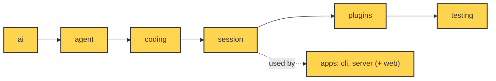
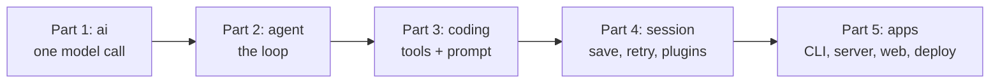

# 27 Choices, limits and extending

**Goal:** Know why it is built this way, where it stops, and how to grow it.

**Builds on:** [26 System tests and deploy](26-system-tests-deploy.md) · **Next:** —

## Where we are



*This chapter looks at the whole system (everything marked).*

Code in this chapter (commit `2fc2776`). Nothing new is added to the repo; the chapter points back to this existing code:

- `packages/simp_agent/src/simp_agent/ai/__init__.py` — `register_provider`, `is_retryable`, `is_context_overflow`
- `packages/simp_agent/src/simp_agent/agent/__init__.py` — `AgentTool`
- `packages/simp_agent/src/simp_agent/agent/compaction.py` — the `ponytail:` notes on compaction
- `packages/simp_agent/src/simp_agent/session/__init__.py` — `PluginAPI`
- `packages/simp_agent/src/simp_agent/plugins/__init__.py` — `build_plugins`
- `apps/server/src/simp_server/server.py` — `Sandbox`, `Store`, `Auth`
- `evals/tasks/fizzbuzz.toml` — the fizzbuzz eval task

## Problem

At the end of [26](26-system-tests-deploy.md), the whole system works. Ana types "write `fizzbuzz.py`" in her browser ([25](25-web-client.md)), the server runs her session ([20](20-server-run.md)), `bash` runs in a container ([24](24-docker-sandbox.md)), a budget stops a runaway loop ([23](23-limits.md)), and browser tests check it all with a fake model ([26](26-system-tests-deploy.md)). Nothing new needs to be built for the job we set in [00](00-overview.md).

Now Bob asks for something new. He wants a `count_lines` tool, so the model can ask "how long is `fizzbuzz.py`?" without reading the whole file. He wants it in the terminal ([19](19-cli.md)) and in the browser. And he asks two more questions that every new reader of this code will ask: why is simp-agent built this way, and what can it **not** do yet?

These three questions belong together. If you do not know why the core is shaped as it is, and where its edges are, you will put Bob's tool in the wrong place. The core grows, the layer rule ([00](00-overview.md#the-one-rule-import-only-downward)) breaks, and tests get harder. So this last chapter first adds `count_lines` the quick way and sees where it hurts, then looks back at the choices behind the core, then at its known limits, and last adds `count_lines` again the right way.

## Naive version

Say you want a new tool: `count_lines`. It tells the model how many lines `fizzbuzz.py` has. The naive way is to build the tool by hand and pass it to the session:

```python
import asyncio
from simp_agent.agent import AgentTool
from simp_agent.ai import AssistantMessage, Model, TextContent, ToolCall
from simp_agent.session import AgentSession
from simp_agent.testing import FakeProvider

async def count_lines(args, ctx):
    return "15"

tools = [AgentTool("count_lines", "Count lines in a file", {"type": "object"}, count_lines)]

async def main():
    model = FakeProvider(
        AssistantMessage([ToolCall("c1", "count_lines", {"path": "fizzbuzz.py"})], stop_reason="tool_use"),
        AssistantMessage([TextContent("fizzbuzz.py has 15 lines")]),
    )
    s = AgentSession(Model(), tools, stream_fn=model, system_prompt="s")
    await s.prompt("How long is fizzbuzz.py?")
    print(s.messages[-1].content[0].text)

asyncio.run(main())
# fizzbuzz.py has 15 lines
```

(The tool always says `"15"` so the example stays short; a real one would read the file through `ctx`.)

This is not wrong. For a tool that every session always needs, passing it in `tools` is exactly what the built-in coding tools do ([10](10-coding-tools.md)). But Bob's tool is an extra, and here the quick way hurts. The CLI and the server each build their own sessions, so the tool must be wired into both apps and kept the same. Bob also cannot switch it on or off by name in a profile ([18](18-profiles-plugins.md)), the way `plan_mode` is switched on. And a bare function cannot do more than answer: it cannot add a hint to the system prompt telling the model the tool exists, and it cannot save its own state in the session.

The fix is not a bigger core. The core already has sockets for this. To see why they look the way they do, we first look back at the choices behind the core.

## Real design

### Design choices

simp-agent copies many ideas from **[pi](glossary.md#pi)**, another small coding agent. The code says so often, in comments like `(pi ExtensionAPI)` and `(pi prepareArguments)`. Where simp-agent is different, it is usually because it chose to be smaller.

Every choice here was taught in an earlier chapter, so we only list them and do not explain them again: six layers checked by `test_layers.py` ([00](00-overview.md)), a fake model from day one ([04](04-label-test.md)), `stream()` that never raises ([02](02-translate-send.md)), providers that never read the environment ([01](01-pick-clean.md#1-pick-_providers-register_provider)), and append-only history ([13](13-session.md), [16](16-compaction.md)). The layer rule is the one all others rest on: a change high up cannot break anything low down. The last two choices shape how you extend the system, so they get one more look.

**The core only classifies.** In `packages/simp_agent/src/simp_agent/ai/__init__.py`:

Real code: [ai/__init__.py](../../packages/simp_agent/src/simp_agent/ai/__init__.py) — `is_context_overflow`, `is_retryable`

```text
FUNCTION is_context_overflow(error) -> yes/no
    // only looks at the error text; does nothing else
FUNCTION is_retryable(error, kind) -> yes/no
    // only answers; the session decides to retry or not
```

`ai` does not retry and does not compact. It only answers "what kind of error is this?". The `session` layer acts on the answer. So if you want a different retry policy, you change the session or the app. You never touch `ai`.

**Every slot is a small protocol.** The server's slots are in `apps/server/src/simp_server/server.py`:

```python
# ---- plugin slots ----
class Sandbox(Protocol):
    async def open(self, session_id: str) -> ExecutionEnv: ...
    async def close(self, session_id: str) -> None: ...
    async def remove(self, session_id: str) -> None: ...  # delete the workspace files (session deleted)

class Store(Protocol):  # see store.SqliteStore for the full method list
    async def open(self) -> None: ...

class Auth(Protocol):
    async def authenticate(self, request: Request) -> dict | None: ...  # user {id, name} or None
```

A slot is a **[protocol](glossary.md#protocol-python)**: a list of methods, not a base class. Any object with those methods fits. That is how `DockerSandbox` replaces `LocalSandbox` with one line in `settings.toml` ([24](24-docker-sandbox.md)).

The roadmap (`docs/ROADMAP.md`) states the rule behind all of this: *"keep the core small and stable; everything new plugs in (Sandbox, Store, Auth, provider, tool, agent plugin), so providers can be swapped without rewrites."*

### Known limits

simp-agent is small on purpose, so some features are missing. They are written down in three places. In the code, a **[ponytail comment](glossary.md#ponytail-comment)** is a `ponytail:` note that names a shortcut and its ceiling. `NOTES.md` at the repo root is the build log; its section "Not yet (present in pi, skipped here)" lists features pi has and simp-agent skipped. `docs/ROADMAP.md` is the plan for later work.

The limits fall into two groups. The first three are in the core: they touch every user, in the CLI and the server alike.

**1. Tools run one by one.** In `packages/simp_agent/src/simp_agent/agent/__init__.py`, the loop runs tool calls in a plain `for`:

Real code: [agent/__init__.py](../../packages/simp_agent/src/simp_agent/agent/__init__.py) — `agent_loop`

```text
FOR EACH call IN calls:          // one by one, no parallel run
    IF cancel is set: STOP
    run the tool, WAIT for it
```

If the model asks for three `read` calls at once, they run one after another. `NOTES.md` lists "parallel tool execution" as not done. For Ana's fizzbuzz this does not matter. In a big repo, where the model reads ten files at once, it is slower. One by one was chosen because it is simple: steering, approval and abort ([06](06-events-abort.md)–[08](08-hooks-approval.md)) only ever deal with one running tool.

**2. One huge turn cannot be compacted.** In `packages/simp_agent/src/simp_agent/agent/compaction.py`:

Real code: [agent/compaction.py](../../packages/simp_agent/src/simp_agent/agent/compaction.py) — `find_cut`

```text
FUNCTION find_cut(messages, start, keep_tokens) -> index or nothing
    RETURN the last user/assistant index whose tail fits keep_tokens
    //   (or the first one, if none fits)
    // only a user or assistant message, never a tool_result,
    //   so call/result pairs stay together
    // ponytail: no split-turn cut; one huge turn cannot be compacted
```

The cut ([16](16-compaction.md)) only lands on a user or assistant message. So if Bob runs a test that prints a huge log, and the model reads it in many tool results within one turn, there is no place to cut inside that turn. Overflow recovery ([17](17-overflow.md)) compacts once; a second overflow ends the run with the error. The roadmap lists "compaction inside one long turn" for later.

**3. Three provider APIs.** `_PROVIDERS` holds `anthropic-messages`, `openai-completions` and `openai-responses`. Others need `register_provider`, the provider socket from [01](01-pick-clean.md#1-pick-_providers-register_provider).

The other five limits are at the edges, in the server and in how it is run.

**4. One machine.** The server uses SQLite and runs on one machine with launchd ([26](26-system-tests-deploy.md)). The roadmap says Postgres, replicas and session leases are "dropped while on one machine".

**5. Budgets are soft.** The budget is checked **before** each LLM call ([23](23-limits.md)). So if Ana has $0.01 left, one more call still runs and can take her over the limit. A profile with no prices costs $0 and never hits a budget; the server only warns at startup.

**6. No rate limit on login.** The README says: *"There is no rate limit on `/api/login` and `/api/signup`: before exposing the server through a tunnel, put one in front."*

**7. `LocalSandbox` is not isolation.** Its docstring says: *"Not isolation: DockerSandbox replaces it."* The server refuses to start with `LocalSandbox` when there is more than one user in the store (`check_sandbox`), unless `allow_local_sandbox = true` is set ([24](24-docker-sandbox.md)).

**8. Missing tools and features.** No web fetch or search tool, no MCP, no skills, no memory, no sub-agents. All of these are on the roadmap as later work: "capabilities via plugins".

Notice the pattern. Only three limits are in the core, and each is a shortcut with a known fix. Most are at the edges or on the "later" list, and most later features (web fetch, MCP, sub-agents) would be new plugins, not changes to the loop. That is the point of a small core: its limits are easy to see and easy to fix in one place.

### Extend it yourself

Now back to Bob. The system has four sockets for new features, each at a different layer. Pick the one that gives you what you need and touches the least; each row below is a little more powerful than the one before.

| You want to add... | Use | Where |
|---|---|---|
| A new model API | `register_provider(api, stream_fn)` | `ai/__init__.py` |
| A new tool for every session | Pass an `AgentTool` in `tools` | `agent/__init__.py`, [10](10-coding-tools.md) |
| A tool or rule that reacts to the session | A plugin with `setup(api, config)` | `session/__init__.py`, [14](14-plugins.md) |
| A new place for files, data or users | A `Sandbox`, `Store` or `Auth` class | `server.py`, [22](22-store-auth.md), [24](24-docker-sandbox.md) |

**A new provider.** In `packages/simp_agent/src/simp_agent/ai/__init__.py`:

```text
FUNCTION register_provider(api, stream_fn):
    // stream_fn yields events and must never raise
    _PROVIDERS[api] = stream_fn
```
Real code: [ai/__init__.py](../../packages/simp_agent/src/simp_agent/ai/__init__.py) — `register_provider`

Write one async generator that yields the same events as the built-in ones ([01](01-pick-clean.md#out-the-shape-of-a-model-call), [03](03-parse.md)). It must not raise. Then set `api` in a profile to your new name.

**A plugin.** This is the fix for the [naive version](#naive-version). A **[plugin](glossary.md#plugin)** ([14](14-plugins.md)) is any object with a `name` and some optional hook methods. In `setup` it gets a **[PluginAPI](glossary.md#pluginapi)**. From `packages/simp_agent/src/simp_agent/session/__init__.py`:

```text
CLASS PluginAPI:      // what a plugin can do with its session
    FUNCTION register_tool(tool):
        remove any tool with the same name
        ADD tool to the agent's tools
    FUNCTION add_prompt_section(id, value, order = 100)   // rebuilt each turn
    ASYNC FUNCTION append_entry(type, data)               // saved state, not sent to model
    // also: unregister_tool, remove_prompt_section, send_message
```
Real code: [session/__init__.py](../../packages/simp_agent/src/simp_agent/session/__init__.py) — `PluginAPI`

`append_entry` really is never sent to the model: `build_view` in `agent/compaction.py` drops every `CustomEntry` before the request is built.

Now build `count_lines` from the [naive version](#naive-version) again, as a plugin. Only the middle part changes: the tool moves into `setup`, and the session gets `plugins=[CountLines()]` instead of `tools`.

```python
class CountLines:
    name = "count_lines"

    async def setup(self, api, config):
        api.register_tool(AgentTool("count_lines", "Count lines in a file", {"type": "object"}, count_lines))
        api.add_prompt_section("count_lines", "Use count_lines for file sizes.")

# in main(), same FakeProvider as before:
s = AgentSession(Model(), [], stream_fn=model, system_prompt="s", plugins=[CountLines()])
await s.prompt("How long is fizzbuzz.py?")
print(s.messages[-1].content[0].text)
print(model.ctxs[0].system_prompt)
# fizzbuzz.py has 15 lines
# s
#
# Use count_lines for file sizes.
```

The tool works, and the prompt line is in the first request. The plugin could also save its own state as a [custom entry](glossary.md#custom-entry). `PlanMode` in `plugins/plan_mode.py` ([18](18-profiles-plugins.md)) is a full example: it adds a prompt section, blocks `write`, `edit` and `bash`, and keeps its on/off state in a custom entry, so it survives a resume.

To turn a plugin on by name, add it to `build_plugins` in `packages/simp_agent/src/simp_agent/plugins/__init__.py`:

```text
FUNCTION build_plugins(names):
    known = map of name -> plugin class    // add your plugin here
    IF a name is not in known: RAISE ValueError
    RETURN a new plugin for each name
```
Real code: [plugins/__init__.py](../../packages/simp_agent/src/simp_agent/plugins/__init__.py) — `build_plugins`

Then both the CLI and the server can switch it on through a profile ([18](18-profiles-plugins.md)). No copy in each app.

Four habits keep the system healthy as it grows, and each one is a design choice from above put to work. Put new code in the highest layer that works: a plugin is better than a change to `agent`. Run `test_layers.py` after each change, so the layer rule holds. Test with `FakeProvider` first, then add an eval case ([12](12-evals.md)) like `evals/tasks/fizzbuzz.toml`, to see a real model use the feature. And when you take a shortcut, leave a `ponytail:` comment that names its ceiling, so the next reader finds the limit in the code and not in production.

## The whole path



You started in [01](01-pick-clean.md) with one call to a model. [Part 2](05-0-part-2-agent.md) turned it into a loop that runs tools, [Part 3](09-0-part-3-coding.md) gave the loop real coding tools and a prompt, [Part 4](13-0-part-4-session.md) made a run something you can save, resume, retry and extend, and [Part 5](19-0-part-5-system.md) put it in front of Ana and Bob. Each part only used the ones before it, which is the layer rule at the size of the whole book. To go further, read `NOTES.md` and `docs/ROADMAP.md`, pick one limit from [Known limits](#known-limits), and fix it in the highest layer that works.

**Builds on:** [26 System tests and deploy](26-system-tests-deploy.md) · **Next:** —

