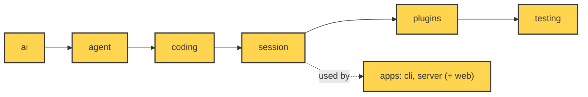

# 27 Choices, limits and extending

**Goal:** Know why it is built this way, where it stops, and how to grow it.

**Builds on:** [26 System tests and deploy](26-system-tests-deploy.md) · **Next:** —

## Where we are



*This chapter looks at the whole system (everything marked). It adds no new code.*

Code in this chapter (commit `2fc2776`). This chapter adds no code; it points back to:

- `packages/simp_agent/src/simp_agent/ai/__init__.py` — `register_provider`, `is_retryable`, `is_context_overflow`
- `packages/simp_agent/src/simp_agent/agent/__init__.py` — `AgentTool`
- `packages/simp_agent/src/simp_agent/agent/compaction.py` — the `ponytail:` notes on compaction
- `packages/simp_agent/src/simp_agent/session/__init__.py` — `PluginAPI`
- `packages/simp_agent/src/simp_agent/plugins/__init__.py` — `build_plugins`
- `apps/server/src/simp_server/server.py` — `Sandbox`, `Store`, `Auth`
- `evals/tasks/fizzbuzz.toml` — the fizzbuzz eval task

## Problem

You have built all of simp-agent. The fizzbuzz task now runs from a terminal ([19](19-cli.md)) or a browser ([25](25-web-client.md)), inside a container ([24](24-docker-sandbox.md)), with budgets ([23](23-limits.md)).

But three questions are still open:

- **Why** is it built this way, and not like other agents?
- **Where does it stop?** What does it not do, on purpose or for now?
- **How do I add a feature** without breaking the core?

If you do not know the answers, you will add features in the wrong place. The core grows. The layer rule ([00](00-overview.md#the-one-rule-import-only-downward)) breaks. Tests get harder.

This chapter answers the three questions. It uses only code you have already seen, at commit `2fc2776`.

## Naive version

Say you want a new tool: `count_lines`. It tells the model how many lines `fizzbuzz.py` has. The naive way is to build the tool by hand and pass it to the session:

```python
import asyncio
from simp_agent.agent import AgentTool
from simp_agent.ai import AssistantMessage, Model, TextContent, ToolCall
from simp_agent.session import AgentSession
from simp_agent.testing import FakeProvider

async def count_lines(args, ctx):
    return "15"

tools = [AgentTool("count_lines", "Count lines in a file", {"type": "object"}, count_lines)]

async def main():
    model = FakeProvider(
        AssistantMessage([ToolCall("c1", "count_lines", {"path": "fizzbuzz.py"})], stop_reason="tool_use"),
        AssistantMessage([TextContent("fizzbuzz.py has 15 lines")]),
    )
    s = AgentSession(Model(), tools, stream_fn=model, system_prompt="s")
    await s.prompt("How long is fizzbuzz.py?")
    print(s.messages[-1].content[0].text)

asyncio.run(main())
# fizzbuzz.py has 15 lines
```

It works for one app. It breaks when:

1. **Each app repeats it.** The CLI and the server both build sessions. You must copy the tool into both and keep the copies the same.
2. **The tool cannot react to the session.** It cannot add a line to the system prompt, block other tools, or save its own state. It is just a function.
3. **You cannot turn it on or off by name.** There is no switch in a profile ([18](18-profiles-plugins.md)).

The fix is not a bigger core. It is to use the sockets the core already has.

## Step by step: from naive to real

**Step 1: wrap the tool in a plugin.** A plugin is any object with a `name` and a `setup` method. `setup` gets a `PluginAPI` and registers the tool there, not in each app.

```text
CLASS CountLines:
    name = "count_lines"
    FUNCTION setup(api, config):
        api.register_tool(count_lines tool)   // one place, not each app
```
Real code: none yet — this is a sketch

Why: the tool now lives in one place. The session is built with `plugins=[CountLines()]`.

**Step 2: let the plugin change the prompt.** `PluginAPI` can add a section to the system prompt.

```text
// inside setup:
api.add_prompt_section("count_lines", "Use count_lines for file sizes.")
```
Real code: none yet — this is a sketch

Why: a plain function cannot do this. A plugin can, and the section is rebuilt every turn.

**Step 3: keep state in a custom entry.** `await api.append_entry(type, data)` saves data in the history. It is saved and replayed on resume, and it is never sent to the model.

Why: the plugin keeps its state after a restart. `PlanMode` does exactly this for its on/off switch.

**Step 4: turn it on by name.** Add the class to `known` in `build_plugins`.

```text
known = map of name -> plugin class    // "redact_secrets", "plan_mode", add "count_lines"
```
Real code: [plugins/__init__.py](../../packages/simp_agent/src/simp_agent/plugins/__init__.py) — `build_plugins`

Why: a profile can now list the name, and the CLI and the server both get it. No copy in each app.

**Step 5: know the limits and the choices.** Before you grow the system, learn which choices to keep and which limits are on purpose. That is the real design below.

## Real design

### Part 1: Design choices

simp-agent copies many ideas from **[pi](glossary.md#pi)**, another small coding agent. The code says so often, in comments like `(pi ExtensionAPI)` and `(pi prepareArguments)`. Where simp-agent is different, it is usually because it chose to be smaller.

Here are the main choices. Each one was taught in an earlier chapter; the link says where.

| Choice | What it means | Taught in |
|---|---|---|
| Layers, import only downward | Six folders; `test_layers.py` checks the rule | [00](00-overview.md) |
| A fake model from day one | `FakeProvider` makes every layer testable with no network | [04](04-label-test.md) |
| `stream()` never raises | Errors become an `error` event with a final message | [02](02-translate-send.md), [04](04-label-test.md) |
| Providers never read the environment | The app gives the key through `get_api_key` | [01](01-pick-clean.md#1-pick-_providers-register_provider) |
| History is append-only | Compaction adds a `CompactionEntry`; it never deletes | [13](13-session.md), [16](16-compaction.md) |
| Core only classifies errors | `is_retryable`, `is_context_overflow`; the session decides | [15](15-retry.md), [17](17-overflow.md) |
| Everything is a plugin | Store, sandbox, auth, providers, tools, agent plugins | [14](14-plugins.md), [22](22-store-auth.md) |

Two of these are worth one more look, because they shape how you extend the system.

**The core only classifies.** In `packages/simp_agent/src/simp_agent/ai/__init__.py`:

Real code: [ai/__init__.py](../../packages/simp_agent/src/simp_agent/ai/__init__.py) — `is_context_overflow`, `is_retryable`

```text
FUNCTION is_context_overflow(error) -> yes/no
    // only looks at the error text; does nothing else
FUNCTION is_retryable(error, kind) -> yes/no
    // only answers; the session decides to retry or not
```

`ai` does not retry and does not compact. It only answers "what kind of error is this?". The `session` layer acts on the answer. So if you want a different retry policy, you change the session or the app. You never touch `ai`.

**Every slot is a small protocol.** The server's slots are in `apps/server/src/simp_server/server.py`:

```python
# ---- plugin slots ----
class Sandbox(Protocol):
    async def open(self, session_id: str) -> ExecutionEnv: ...
    async def close(self, session_id: str) -> None: ...
    async def remove(self, session_id: str) -> None: ...  # delete the workspace files (session deleted)

class Store(Protocol):  # see store.SqliteStore for the full method list
    async def open(self) -> None: ...

class Auth(Protocol):
    async def authenticate(self, request: Request) -> dict | None: ...  # user {id, name} or None
```

A slot is a **[protocol](glossary.md#protocol-python)**: a list of methods, not a base class. Any object with those methods fits. That is how `DockerSandbox` replaces `LocalSandbox` with one line in `settings.toml` ([24](24-docker-sandbox.md)).

The roadmap (`docs/ROADMAP.md`) states the rule behind all of this: *"keep the core small and stable; everything new plugs in (Sandbox, Store, Auth, provider, tool, agent plugin), so providers can be swapped without rewrites."*

### Part 2: Known limits

simp-agent is small on purpose. Some features are missing. The code marks many of them with a **[ponytail comment](glossary.md#ponytail-comment)**: a `ponytail:` note that names a shortcut and its ceiling. `NOTES.md` lists more under "Not yet (present in pi, skipped here)".

Here are the real limits at this commit.

**1. Tools run one by one.** In `packages/simp_agent/src/simp_agent/agent/__init__.py`, the loop runs tool calls in a plain `for`:

Real code: [agent/__init__.py](../../packages/simp_agent/src/simp_agent/agent/__init__.py) — `agent_loop`

```text
FOR EACH call IN calls:          // one by one, no parallel run
    IF cancel is set: STOP
    run the tool, WAIT for it
```

If the model asks for three `read` calls at once, they run one after another. `NOTES.md` lists "parallel tool execution" as not done. For fizzbuzz this is fine. For a big repo, it is slower.

**2. One huge turn cannot be compacted.** In `packages/simp_agent/src/simp_agent/agent/compaction.py`:

Real code: [agent/compaction.py](../../packages/simp_agent/src/simp_agent/agent/compaction.py) — `find_cut`

```text
FUNCTION find_cut(messages, start, keep_tokens) -> index or nothing
    RETURN first kept index after start
    // only a user or assistant message, never a tool_result,
    //   so call/result pairs stay together
    // ponytail: no split-turn cut; one huge turn cannot be compacted
```

The cut ([16](16-compaction.md)) only lands on a user or assistant message. So if one turn has many large tool results, there is no place to cut inside it. Overflow recovery ([17](17-overflow.md)) compacts once; a second overflow ends the run with the error. The roadmap lists "compaction inside one long turn" for later.

**3. Three provider APIs.** `_PROVIDERS` holds `anthropic-messages`, `openai-completions` and `openai-responses`. Others need `register_provider` (see below).

**4. One machine.** The server uses SQLite and runs on one machine with launchd ([26](26-system-tests-deploy.md)). The roadmap says Postgres, replicas and session leases are "dropped while on one machine".

**5. Budgets are soft.** The budget is checked **before** each LLM call ([23](23-limits.md)). One call can still go over the limit. A profile with no prices costs $0 and never hits a budget; the server only warns at startup.

**6. No rate limit on login.** The README says: *"There is no rate limit on `/api/login` and `/api/signup`: before exposing the server through a tunnel, put one in front."*

**7. `LocalSandbox` is not isolation.** Its docstring says: *"Not isolation: DockerSandbox replaces it."* The server refuses to start with `LocalSandbox` and more than one active user, unless `allow_local_sandbox = true` is set ([24](24-docker-sandbox.md)).

**8. Missing tools and features.** No web fetch or search tool, no MCP, no skills, no memory, no sub-agents. All of these are in the roadmap as stage 4, "capabilities via plugins".

Notice the pattern. Most limits are in the apps or in "later" lists. The core loop is complete for its job. That is the point of a small core: limits are easy to see, and easy to fix in one place.

### Part 3: Extend it yourself

There are four sockets. Pick the lowest one that does the job.

| You want to add... | Use | Where |
|---|---|---|
| A new model API | `register_provider(api, stream_fn)` | `ai/__init__.py` |
| A new tool for every session | Pass an `AgentTool` in `tools` | `agent/__init__.py`, [10](10-coding-tools.md) |
| A tool or rule that reacts to the session | A plugin with `setup(api, config)` | `session/__init__.py`, [14](14-plugins.md) |
| A new place for files, data or users | A `Sandbox`, `Store` or `Auth` class | `server.py`, [22](22-store-auth.md), [24](24-docker-sandbox.md) |

**A new provider.** In `packages/simp_agent/src/simp_agent/ai/__init__.py`:

```text
FUNCTION register_provider(api, stream_fn):
    // stream_fn yields events and must never raise
    _PROVIDERS[api] = stream_fn
```
Real code: [ai/__init__.py](../../packages/simp_agent/src/simp_agent/ai/__init__.py) — `register_provider`

Write one async generator that yields the same events as the built-in ones ([01](01-pick-clean.md#the-shape-of-a-model-call), [03](03-parse.md)). It must not raise. Then set `api` in a profile to your new name.

**A plugin.** This is the fix from the steps above. A **[plugin](glossary.md#plugin)** ([14](14-plugins.md)) is any object with a `name` and some optional hook methods. In `setup` it gets a **[PluginAPI](glossary.md#pluginapi)**. From `packages/simp_agent/src/simp_agent/session/__init__.py`:

```text
CLASS PluginAPI:      // what a plugin can do with its session
    FUNCTION register_tool(tool):
        remove any tool with the same name
        ADD tool to the agent's tools
    FUNCTION add_prompt_section(id, value, order = 100)   // rebuilt each turn
    FUNCTION append_entry(type, data)                     // saved state, not sent to model
```
Real code: [session/__init__.py](../../packages/simp_agent/src/simp_agent/session/__init__.py) — `PluginAPI`

So a `count_lines` plugin can register its tool, add a prompt line, and save its own state as a [custom entry](glossary.md#custom-entry). `PlanMode` in `plugins/plan_mode.py` is a full example: it adds a prompt section, blocks `write`, `edit` and `bash`, and keeps its on/off state in a custom entry, so it survives a resume.

To turn a plugin on by name, add it to `build_plugins` in `packages/simp_agent/src/simp_agent/plugins/__init__.py`:

```text
FUNCTION build_plugins(names):
    known = map of name -> plugin class    // add your plugin here
    IF a name is not in known: RAISE ValueError
    RETURN a new plugin for each name
```
Real code: [plugins/__init__.py](../../packages/simp_agent/src/simp_agent/plugins/__init__.py) — `build_plugins`

Then both the CLI and the server can switch it on through a profile ([18](18-profiles-plugins.md)). No copy in each app.

Tools may change between turns. When they do, the agent adds a note to history, so the model knows. From `agent/__init__.py`:

Real code: [agent/__init__.py](../../packages/simp_agent/src/simp_agent/agent/__init__.py) — `_llm_turn`

```text
IF tool names changed since last turn:
    ADD UserMessage "<system-reminder>Tools added: ...; removed: ..." to history
    // so the model knows the tool list changed
```

**Rules for extending.** Keep these, and the system stays healthy:

- Put new code in the highest layer that works. A plugin is better than a change to `agent`.
- Keep the layer rule. Run `test_layers.py` after each change.
- Test with `FakeProvider` first, then add an eval case ([12](12-evals.md)), like `evals/tasks/fizzbuzz.toml`.
- When you take a shortcut, leave a `ponytail:` comment that names its ceiling.

## Test

This chapter adds no code, so it has no new test. But one existing test shows the main extend path: a plugin that adds a tool. It is `test_plugin_setup_events_and_api` in `apps/cli/tests/test_sockets.py`:

```python
async def test_plugin_setup_events_and_api():
    events = []

    class P:
        name = "p"

        async def setup(self, api, config):
            self.api, self.config = api, config
            api.register_tool(tool("extra"))

        def on_event(self, e):
            events.append(e["type"])

    p = P()
    seen = []
    s = session(DONE, seen=seen, plugins=[p], plugin_config={"p": {"k": 1}})
    await s.prompt("hi")
    assert p.config == {"k": 1} and [t.name for t in seen[0].tools] == ["extra"]
    assert "agent_start" in events and "agent_end" in events
```

What it checks:

- `P` is a plain class. It does not inherit anything. It only has `name`, `setup` and `on_event`.
- `setup` gets its own config from `plugin_config`, by plugin name.
- The tool `extra` that the plugin registers is in the very first request to the (fake) model: `seen[0].tools`.
- `on_event` sees the session events, from `agent_start` to `agent_end`.

Run it:

```sh
uv run pytest apps/cli/tests/test_sockets.py -q -k plugin_setup
```

For the other sockets, see the tests in their chapters: providers in [01](01-pick-clean.md)–[04](04-label-test.md), store in [13](13-session.md) and [22](22-store-auth.md), sandbox in [24](24-docker-sandbox.md). And run the layer test from [00](00-overview.md) after any change.

## Why this way

> **Small core, sockets, and honest limits.** simp-agent does not try to have every feature. It keeps the loop small and puts new behaviour behind small protocols: providers, tools, plugins, sandbox, store, auth. Missing features are written down (`ponytail:` comments, `NOTES.md`, `docs/ROADMAP.md`) instead of half built. The cost: some things other agents have, like parallel tools or split-turn compaction, are not here yet. The gain: each part is easy to read, to test with a fake model, and to replace without touching the rest.

## Exercises

1. Write the plugin from the Step 1 and Step 2 pseudo-code in Python. Run it with `FakeProvider`, as in the naive version. Print `model.ctxs[0].system_prompt`: is your prompt line there? (The code in this chapter was run at `2fc2776` and printed `fizzbuzz.py has 15 lines`.)
2. Pick one limit from Part 2 (for example, tools run one by one). Say which layer you would change, and which socket (if any) could do it without a core change.

## Recap

- The main choices: layers, a fake model, `stream()` never raises, providers never read env, append-only history, the core only classifies errors, and "everything is a plugin".
- Known limits at `2fc2776`: tools run one by one, one huge turn cannot be compacted, three provider APIs, one machine, soft budgets, no login rate limit, `LocalSandbox` is not isolation, and no web, MCP or sub-agent tools yet.
- To extend: `register_provider` for models, `AgentTool` for tools, a plugin with `PluginAPI` for session behaviour, and `Sandbox` / `Store` / `Auth` for the server.
- `test_plugin_setup_events_and_api` shows a plugin adding a tool with no change to the core.

**Builds on:** [26 System tests and deploy](26-system-tests-deploy.md) · **Next:** —

