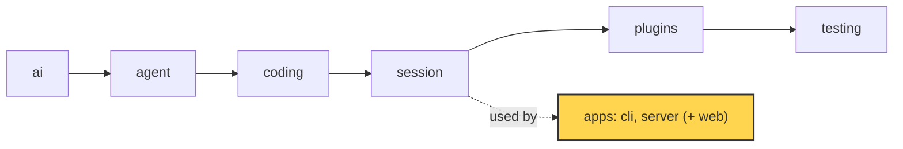

# 27 Part 5 · Store and auth

**Goal:** Save users, sessions and events durably.

**Builds on:** [26 Transport](26-transport.md) · **Next:** [28 Limits](28-limits.md)

## Where we are



*This chapter adds the `store` and `auth` of the `server` app (marked).*

Big picture of Part 5: [part-5-system](23-part-5-system.md).

Code in this chapter (commit `2fc2776`):

- `apps/server/src/simp_server/store.py` — `SqliteStore`, `sha`, `hash_password`, `check_password`
- `apps/server/src/simp_server/server.py` — `Store`, `Auth`, `StaticTokenAuth`, `DEFAULT_PLUGINS`, `Run.recover`
- `apps/server/tests/test_store.py`, `apps/server/tests/test_accounts.py` — the store and auth tests

## Problem

Go back to Ana from [26](26-transport.md#problem). Her tab now gets every event live, and it can catch up after a Wi-Fi drop. But where do the events live? So far, only in the memory of one Python process.

Now the admin restarts the server to install an update. Ana opens her tab the next morning, and her fizzbuzz chat is gone: every user, every session and every event lived in that process. Worse, the restart came while the agent was running `bash`. The last saved state still says "running", but no loop runs any more, so her tab waits forever.

Bob, Ana's colleague, uses the same server. Nothing says who sends a request, so Bob (or anyone who can reach the port) can open Ana's session and read it.

So we need two things. A **[store](glossary.md#store)**: one place on disk for users, sessions, events and cost. And **[auth](glossary.md#auth)**: a way to check who sends each request.

## Starting point: 26's Run, with the store left open

[26](26-transport.md#seq-one-counter-for-everything) ended with a `Run` that numbers each durable event and each `"msg"` row of its [`AgentSession`](17-session.md), then hands the row to the store (`server.py`, commit `2fc2776`):

```python
await self.mgr.store.add_entry(self.user_id, self.sid, self.seq, "msg", to_dict(entry))   # Run.append
await self.mgr.store.add_entry(self.user_id, self.sid, ev["seq"], ev["type"], ev)         # Run.durable
```

So far `store` is only a name. The easy fill is Python dicts with plain-text tokens (`token -> user`, `session id -> rows`). It works for one happy demo. This chapter fills in a real store, `SqliteStore`, and the auth that turns a token into a user, and keeps the same `add_entry` calls.

## Real design

We follow Ana through one day on the server: she logs in, gets a token, opens her session, asks a question while every event is saved, and then the server restarts and must recover. Each table and each setting comes in when her flow first needs it.

### scrypt passwords

**IN:** a name and a password. **OUT:** a new per-device token, or nothing.

Ana opens the web client ([30](30-web-client.md)) and types her name and password. To check them, the server needs a row for her. Rows live in one SQLite file on disk, `<data_dir>/simp.db` (`data_dir` comes from `settings.toml`; by default it is `~/.simp-server`). The first table is `users`:

```sql
users(id, name, token_sha256, password, disabled)
```

Where does Ana's row come from? It is written by `add_user`, called from the sign-up route or from the admin command `simp-server seed`. Her password is not stored as text, because anyone who copies `simp.db` could then read it. It is stored as a hash. Passwords use **[scrypt](glossary.md#scrypt)**, a slow hash from Python's `hashlib`. Each password gets a **[salt](glossary.md#salt)**: random bytes mixed into the hash, so two users with the same password get different hashes. The result goes into `users.password`:

Real code: [store.py](../../apps/server/src/simp_server/store.py) — `_scrypt`, `hash_password`, `check_password`

```text
_scrypt(password, salt):
    RETURN scrypt(password, salt, n=2**14, r=8, p=1)    // common safe cost values

hash_password(password):
    salt = 16 random bytes
    RETURN "scrypt$<salt hex>$<_scrypt(password, salt) hex>"

check_password(password, stored):
    IF no stored hash:
        _scrypt(password, dummy salt)   // same time whether or not the user exists
        RETURN false
    split stored into salt and saved_hash
    RETURN constant-time compare(_scrypt(password, salt), saved_hash)
```

Two choices here are about time. If the user does not exist, we still run scrypt once, so an attacker cannot learn which names exist by timing the answer. And `hmac.compare_digest` compares in constant time, so the time does not show how many bytes matched.

scrypt is slow on purpose, and slow code would block the [event loop](glossary.md#event-loop). So the store calls it with `asyncio.to_thread(...)`. `login` checks Ana's password and, if it matches, gives her a new token:

Real code: [store.py](../../apps/server/src/simp_server/store.py) — `SqliteStore.login`

```text
login(name, password):
    user_row = SELECT id, password FROM users WHERE name = name AND disabled = 0
    IF NOT check_password(password, stored hash or none)   // run in a thread
        RETURN nothing
    token = new random token
    INSERT into tokens (sha(token), user id, now)
    RETURN token
```

The routes are in `server.py`: `/api/signup`, `/api/login`, `/api/logout`. Sign-up is closed unless `signup_code` is set in settings, so a stranger who finds the port cannot make an account. The code is checked with `hmac.compare_digest`. The name must match `[a-z0-9_-]{2,32}` and the password needs at least `MIN_PASSWORD = 8` characters.

### Token hashes

**IN:** an HTTP request with a header. **OUT:** the user `{id, name}`, or nothing (then HTTP 401).

Ana now holds the token that `login` returned. A **[token](glossary.md#token-auth)** is a long random string. Her client sends it on every next request as `Authorization: Bearer <token>`. The server never stores the token itself. It stores only its SHA-256 hash, so a copied `simp.db` gives hashes, and a hash cannot be sent back as a token.

There are two kinds of token. The one from `login` is a **[per-device token](glossary.md#per-device-token)**: each password login makes one row in the `tokens` table, so `logout` can delete just that device.

```sql
tokens(token_sha256, user_id, created)   -- one row per device login
```

The other kind is a **[static token](glossary.md#static-token)**: one long-lived token per user, kept in `users.token_sha256`. The admin makes it on the command line with `simp-server seed --name ana`, which prints it once; `simp-server rotate --name ana` replaces it. Both kinds are hashed by `sha`:

Real code: [store.py](../../apps/server/src/simp_server/store.py) — `sha`, `SqliteStore.add_user`

```text
sha(token):
    RETURN SHA-256 hex of token

add_user(name, password = none, token = yes):
    // returns the static token (shown once); only its sha256 is stored
    // a taken name raises IntegrityError
    static_token = new random token IF token wanted, ELSE none
    INSERT user (new id, name, sha(static_token), hash_password(password) in a thread)
    RETURN static_token
```

Why is a fast hash like SHA-256 enough for tokens, when passwords need scrypt? A token is 32 random bytes, so nobody can guess it. A password can be guessed, so it gets the slow hash.

One query checks both kinds of token:

Real code: [store.py](../../apps/server/src/simp_server/store.py) — `SqliteStore.user_by_token`

```text
user_by_token(token):
    token_hash = sha(token)
    user_row = SELECT id, name FROM users
               WHERE disabled = 0
                 AND (token_sha256 = token_hash  OR  id has a row in tokens with token_sha256 = token_hash)
    RETURN user_row, or nothing
```

Note `disabled = 0`. The admin command `revoke` sets `disabled = 1`, clears the static token and deletes all device tokens. `rotate` deletes device tokens, sets a new static token and turns the user back on. In both cases every old token stops working at once.

Who calls this query on each request? The server does not hard-code one class for it. `server.py` defines two small interfaces, `Auth` (it must have `authenticate(request)`, which returns the user or nothing) and `Store` (it must have `open()`), and picks the class for each by name from `DEFAULT_PLUGINS`:

Real code: [server.py](../../apps/server/src/simp_server/server.py) — `DEFAULT_PLUGINS`

```python
DEFAULT_PLUGINS = {"sandbox": "simp_server.server:LocalSandbox", "store": "simp_server.store:SqliteStore",
                   "auth": "simp_server.server:StaticTokenAuth"}
```

We call these three names **[server slots](glossary.md#server-slot)**. They are not the agent plugins of [18](18-plugins.md): a slot is one class the server needs, and you swap it by naming another class. This chapter fills `store` and `auth`; [29](29-docker-sandbox.md) fills `sandbox`. `StaticTokenAuth`, the default class in the `auth` slot, is the bridge from HTTP to `user_by_token`:

Real code: [server.py](../../apps/server/src/simp_server/server.py) — `StaticTokenAuth.authenticate`

```text
authenticate(request):
    header = request header "authorization"
    IF header starts with "Bearer ":
        RETURN store.user_by_token(rest of header)
    RETURN nothing
```

### Loading a session

**IN:** the user and a session id. **OUT:** a `Run` in memory, with the same history as before the restart.

Now the server knows the request is from Ana, and she opens her fizzbuzz session. The session itself is one row in the `sessions` table (owner, title, profile, sandbox), written by `add_session`:

```sql
sessions(id, user_id, ...)   -- one row per session
```

How do we stop Bob from opening it? Every table except `users` has a `user_id` column, and every read of a session, its entries or its usage has `user_id` in its `WHERE`:

Real code: [store.py](../../apps/server/src/simp_server/store.py) — `SqliteStore.get_session`

```text
get_session(user_id, sid):
    session_row = SELECT sessions WHERE id = sid AND user_id = user_id
    RETURN session_row, or nothing
```

Example: Ana owns session `s1`. Bob sends a request for `s1`. The query runs with Bob's id, finds no row, and the server answers 404. There is no special "is this yours?" check to forget; it is in the SQL. (The few queries that look up a user, like `user_by_token` and `login` above, have no user yet, so they search by token or name.)

The session's history lives in the next table. Every saved message and event is one row in `entries`:

```sql
entries(session_id, user_id, seq, type, json)   -- one row per message or event
```

A row is one of two kinds, and both share **one** `seq` counter per session ([26 · seq](26-transport.md#seq-one-counter-for-everything)). Core messages (`type = "msg"`) are what the model sees. Durable protocol events ([25](25-server-run.md)), with `type` set to the event type like `run_state`, are what clients see.

`SessionManager.get` finds the session row (scoped by user), reads its entries and builds a `Run` ([25](25-server-run.md)). The `env` it passes is the place where tools run, from the `sandbox` slot. Before it returns, it waits for `recover()`, which closes a run that died while busy; for Ana's finished session it does nothing.

Real code: [server.py](../../apps/server/src/simp_server/server.py) — `SessionManager.get`

```text
row = store.get_session(user id, sid)      // none -> HTTP 404
IF sid not in runs:
    runs[sid] = new Run(row, env, store.entries(user id, sid))
    WAIT for runs[sid].recover()
```

`Run.__init__` splits the rows back:

Real code: [server.py](../../apps/server/src/simp_server/server.py) — `Run.__init__`

```text
messages = [from_dict(e.data) FOR e in entries IF e.type is "msg"]   // history for AgentSession
log      = [e.data FOR e in entries IF e.type is not "msg"]          // the event log of 21
run_state = state of the last run_state event in log, or "idle"
seq       = seq of the last entry, or 0
```

Example. The saved rows of Ana's finished fizzbuzz session:

```text
seq 1  run_state  running                             -> log
seq 2  msg        user "write fizzbuzz.py"           -> messages
seq 3  user_message                                   -> log
seq 4  msg        assistant (text "Done.")            -> messages
seq 5  assistant_message                              -> log
seq 6  run_state  idle                                -> log
```

After loading: 2 messages, a log of 4 events, `run_state = "idle"`, `seq = 6`. The next row gets seq 7. (`from_dict` is the [JSON round trip](ref-objects.md#going-to-json-and-back).) The code keeps the whole log in memory; that is fine for one machine.

### Saving events

**IN:** a message or an event during a run. **OUT:** one new row in `entries`, with the next `seq`.

Ana asks a new question. Each message and each durable event goes through the two `add_entry` calls from the [Starting point](#starting-point-21s-run-with-the-store-left-open) ([26 · seq](26-transport.md#seq-one-counter-for-everything) shows how `seq` grows). Both write to one table with one counter, so `Run.__init__` above can rebuild the history and the log from one read.

Each model call also writes one row to the last table, `usage` (tokens and cost, again with `user_id`). [28 Limits](28-limits.md) reads it.

### Opening the store

Now the admin restarts the server. The new process must find all of these rows again. At start, the server calls `open()` on the class in the `store` slot. `SqliteStore` uses SQLite through `aiosqlite`, a small package that wraps the standard `sqlite3` so that calls are `async` and do not block the server. `open()` creates the folder, connects to `simp.db`, turns on WAL and creates the tables if they are missing:

Real code: [store.py](../../apps/server/src/simp_server/store.py) — `SqliteStore.open`

```text
db = CONNECT to <data_dir>/simp.db
SET journal_mode = WAL
RUN SCHEMA          // CREATE TABLE IF NOT EXISTS ... for every table
```

**[WAL](glossary.md#wal)** (write-ahead log) is a SQLite mode. Readers do not wait for a writer, and a crash does not leave a half-written database. After that, `open()` updates old files. The server was built in stages, and a `simp.db` from an earlier stage has no `cost`, `password` or `disabled` column. So `open()` adds them with `ALTER TABLE`, and marks old users with no token as disabled. This way an admin can update the code and keep the same file. (All columns of the five tables: [ref-objects · Server store tables](ref-objects.md#server-store-tables).)

Why SQLite and not Postgres? The server runs on one machine ([31](31-system-tests-deploy.md)). SQLite needs no extra server process, and a backup is a copy of one file. The cost is that only one write runs at a time. For one team on one machine, writes are small and fast, so this is fine.

### recover

**IN:** a loaded `Run` whose last saved state is busy. **OUT:** a settled run: state `error`, and a valid history.

The restart in the [Problem](#problem) came while Ana's agent was running `bash`. After the restart, `SessionManager.get` loads her session as above, but the last saved `run_state` says `running`, `waiting_approval` or `aborting`, and no loop runs. And the last assistant message asks for a tool call that has no result. The model API returns an error for such a history, so even Continue would fail.

`recover()` fixes both. If the run is not busy, it does nothing. If it is busy, it closes the run in three steps. First, every `approval_request` with no `approval_resolved` gets `ApprovalResolved(decision="aborted")`. Second, every tool call in the last assistant message with no result gets an error result, `"aborted: the server restarted before this tool finished"`; it is saved as a history message (`append`) and also sent as a `ToolResult` event. Third, the state becomes `error`, and a `Notice` says `"interrupted: the server restarted during this run"`.

Real code: [server.py](../../apps/server/src/simp_server/server.py) — `Run.recover`

```text
IF not busy: RETURN
FOR EACH approval_request with no approval_resolved:
    durable ApprovalResolved(call_id, decision = "aborted")
FOR EACH tool call in the last assistant message with no tool result:
    result_msg = ToolResultMessage(call id, tool, "aborted: the server restarted before this tool finished", is_error = true)
    ADD result_msg to session messages; append(result_msg)
    durable ToolResult(call_id, tool, result_msg.content, is_error = true)
run_state = "error"   // set directly, not with set_state
durable RunState(state = "error")
durable Notice(level = "warning", text = "interrupted: the server restarted during this run")
```

Example. Ana's run asked to run `bash` (call `c2`), the tool started, and the server died. All rows in `seq` order:

```text
seq 1  run_state          running
seq 2  msg                user "write fizzbuzz.py"
seq 3  user_message
seq 4  msg                assistant, asks bash c2
seq 5  assistant_message  (bash c2)
       -- server dies, no result for c2 --
seq 6  msg                tool result c2, is_error        <- added by recover
seq 7  tool_result        c2 "aborted: ...", is_error     <- added by recover
seq 8  run_state          error                           <- added by recover
seq 9  notice             warning "interrupted: ..."      <- added by recover
```

Why `run_state` is set directly: the normal path `set_state` checks the state table ([25 · Run state machine](25-server-run.md#what-states-can-a-run-be-in-and-why-keep-them)), and that table has no `waiting_approval -> error`. A crash is the one case where it is right. When Ana opens her tab, she sees a settled session with a red error, and she can press Continue.

For many machines, you would put another class in the `store` slot.

**Builds on:** [26 Transport](26-transport.md) · **Next:** [28 Limits](28-limits.md)
