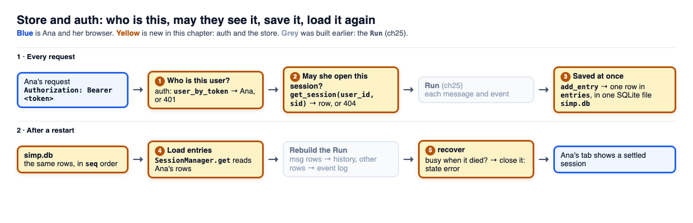

# 27 Part 5 · Store and auth

**Goal:** Save users, sessions and events durably.

**Builds on:** [26 Transport](26-transport.md) · **Next:** [28 Limits](28-limits.md)

<a id="problem"></a>

## Ana, Bob and a restart

Go back to Ana from [26](26-transport.md). Her tab gets every event live. It catches up after a Wi-Fi drop. But all of it lives only in the memory of one Python process.

Now the admin restarts the server to install an update. The next morning Ana's fizzbuzz chat is gone. Every user, session and event was in that process.

Worse, the restart came while the agent was running `bash`. The last [run state](glossary.md#run-state) (the session's label, like `idle` or `running`) said "running". But no loop runs any more, so her tab waits forever.

And Bob, Ana's colleague, uses the same server. Nothing says who sends a request. Bob can open Ana's session and read it. So can anyone who can reach the port.

In one sentence: **the server now remembers who you are and everything that happened, in one file on disk, so a restart loses nothing and Bob never sees Ana's work.** Two parts do this. The **[store](glossary.md#store)** is the one place on disk for users, sessions, events and cost. It keeps them safe across restarts. **[Auth](glossary.md#auth)** is the check at the door. It turns each request into a user, or refuses it.

In the map of [23](23-part-5-system.md), this chapter is block 3 (Auth) and the saving and loading part of block 4 (Load run).


*Yellow is this chapter. Grey blocks are built in other chapters; the numbers are the blocks of [23](23-part-5-system.md).*



*Top row: Ana's request (blue) carries a token; auth (yellow) finds her user; the store lets her open only her own sessions; every message and event of her `Run` (grey, [25](25-server-run.md)) is saved as one row in one SQLite file. Bottom row: after a restart, the same rows are read back, the `Run` is rebuilt, and `recover` closes a run that died while busy.*

The chapter follows this picture and solves four problems, in this order:

1. **Who are you?** Ana logs in once, and each later request must prove it is her.
2. **You may only see your own sessions.** Bob must never open Ana's.
3. **Nothing is lost.** Every message and event is on disk the moment it happens.
4. **A session can be loaded again exactly**, even if the server died in the middle of a run.

<a id="scrypt-passwords"></a>

## Who are you?

The first problem from the list: Ana opens the web client ([30](30-web-client.md)) and types her name and password. The server must check them, so it needs a row for Ana in a `users` table. The row is written when she signs up, or when the admin runs `simp-server seed`.

Her password is not kept as text, because anyone who copies the database file could read it. We keep a **hash** of it: a scrambled form that lets us check a password but not get it back. For passwords we use **[scrypt](glossary.md#scrypt)**, a hash that is slow on purpose. So an attacker who copies the file can try only a few guesses per second. Each password is mixed with a **[salt](glossary.md#salt)** (random bytes), so two users with the same password get different hashes.

When the password matches, `login` gives Ana a **[token](glossary.md#token-auth)**: a long random string. Her browser sends it on every later request, in the header `Authorization: Bearer <token>`. She types the password once, and the token proves who she is after that.

<a id="token-hashes"></a>

The server does not keep the token either. It keeps only its SHA-256 hash. So a copied database gives nothing that works as a token. Why is a fast hash enough here, when passwords need the slow one? A token is 32 random bytes, so nobody can guess it. A password can be guessed.

There are two kinds of token, and one query checks both. A **[per-device token](glossary.md#per-device-token)** comes from each login. It has its own row, so `logout` ends just that one device. A **[static token](glossary.md#static-token)** is one long-lived token per user. The admin makes it with `simp-server seed` and replaces it with `simp-server rotate`. When the admin runs `revoke`, the user is marked disabled and all tokens die at once.

On each request, the class in the server's `auth` slot reads the header and asks the store "whose token is this?":

```text
authenticate(request):
    token = the part after "Bearer " in the Authorization header
    RETURN store.user_by_token(token)       // {id, name}, or nothing -> HTTP 401

user_by_token(token):
    find the user that is not disabled AND whose static token hash = sha(token)
                                       OR who has a device token with hash = sha(token)
```

`auth` and `store` are two of the three **[server slots](glossary.md#server-slot)**. A slot is a named place where the server takes one class, picked by name from `DEFAULT_PLUGINS`. The defaults are `StaticTokenAuth` and `SqliteStore`. A team with its own login system would put another class in the `auth` slot. [29](29-docker-sandbox.md) fills the third slot, `sandbox`.

Real code: [store.py](../../apps/server/src/simp_server/store.py) — `hash_password`, `check_password`, `SqliteStore.login`, `sha`, `SqliteStore.user_by_token`; [server.py](../../apps/server/src/simp_server/server.py) — `StaticTokenAuth.authenticate`, `DEFAULT_PLUGINS`

> **Implementation notes**
> - scrypt runs with `n=2**14, r=8, p=1`, common safe values; the stored form is `scrypt$<salt>$<hash>`.
> - If the name does not exist, `check_password` still runs scrypt once, so the reply time does not show which names exist.
> - Hashes are compared with `hmac.compare_digest`, which takes the same time whatever bytes match.
> - scrypt is slow, so it runs in `asyncio.to_thread`; it must not block the [event loop](glossary.md#event-loop).
> - Sign-up is closed unless `signup_code` is set in settings, so a stranger who finds the port cannot make an account. Names must match `[a-z0-9_-]{2,32}`, passwords need 8 characters.

## How does Bob never see Ana's session?

Auth answered problem 1. The server now knows the request is from Bob. Problem 2 is that Bob asks for Ana's session `s1`.

We could add an "is this yours?" check to every route, but one forgotten route would leak data. Instead, every table except `users` has a `user_id` column. Every read of a session, its entries or its usage has `user_id = ?` in its SQL. So the ownership check cannot be forgotten. It is part of the query itself.

```text
get_session(user_id, sid):
    SELECT the session row WHERE id = sid AND user_id = user_id     // Bob's id + s1 -> no row -> HTTP 404
```

Bob gets 404, the same answer as for a session that does not exist. So he cannot even learn that `s1` is there. Only the few queries that find the user in the first place (`login`, `user_by_token`) search by name or token instead.

Real code: [store.py](../../apps/server/src/simp_server/store.py) — `SqliteStore.get_session`, `SqliteStore.entries`

## How is nothing lost?

Ana may now open her own session. Problem 3: every message and event of her conversation must reach the disk at once. Then a restart a second later loses nothing.

[25](25-server-run.md) and [26](26-transport.md) already left a hook for this. The `Run` (one server object per conversation) numbers each saved thing with one counter, `seq` ([26 · seq](26-transport.md#seq-one-counter-for-everything)). It hands each one to `store.add_entry`. The store writes it as one row of the `entries` table:

```text
entries(session_id, user_id, seq, type, json)     // one row per message or event
```

A row is one of two kinds, sharing that one `seq`. A **message** (`type = "msg"`) is part of the history the model sees ([17](17-session.md)). A **durable event** is a saved event for the browser, with a `type` like `run_state` or `tool_result` ([25](25-server-run.md)). Both sit in one table, in one order. So one read later gives back the whole conversation. Besides `users`, the store has four more tables: `tokens` (device tokens), `sessions` (one row per conversation), `entries`, and `usage` (tokens and cost of each model call, read by [28 Limits](28-limits.md)). Two more, `agents` and `memories`, hold what the agent remembers; they come below.

<a id="opening-the-store"></a>

All tables live in one **SQLite** file, `<data_dir>/simp.db` (by default `~/.simp-server`). At start, the server calls `open()` on the class in the `store` slot. It connects to the file and creates any missing tables. Why SQLite and not a database server like Postgres? The server runs on one machine ([31](31-system-tests-deploy.md)). SQLite needs no extra program. A backup is a copy of one file. The cost is that only one write runs at a time. That is fine for one team's small writes.

Real code: [store.py](../../apps/server/src/simp_server/store.py) — `SqliteStore.open`, `SqliteStore.add_entry`

> **Implementation notes**
> - `open()` turns on SQLite's **[WAL](glossary.md#wal)** mode: readers do not wait for a writer, and a crash does not leave a half-written file.
> - `aiosqlite` wraps the standard `sqlite3` so calls are `async` and do not block the server.
> - A `simp.db` from an older version lacks some columns (`cost`, `password`, `disabled`); `open()` adds them with `ALTER TABLE`, so an update keeps the same file. All columns: [ref-objects · Server store tables](ref-objects.md#server-store-tables).

<a id="agents-and-memories"></a>

### Agents and memories

Ana told her agent last week that she writes Python 3.12. Today she opens a new session and expects it to still know. In [22 · Memory](22-profiles-plugins.md#memory-remember-across-sessions) the notes lived in files; on the server they live in `simp.db`, so they follow Ana, not the machine.

Each user has at least one **agent** (a row in `agents`: name and persona), and each session row has an `agent_id` that says which agent runs it. The `memories` table holds the notes: one row per note, with `user_id`, `scope` and `content`. A `"global"` note (a fact about Ana) has `agent_id` NULL, so all her agents see it; an `"agent"` note (a lesson from a task) belongs to one agent. Every query has `user_id=?`, so Bob never reads Ana's notes. The `Run` reads and writes them through `DbMemoryStore` ([25](25-server-run.md#how-does-the-server-plug-into-the-agentsession)); how a memory store works is in [22](22-profiles-plugins.md#memory-remember-across-sessions), not repeated here.

Ana can also see and fix her notes herself, through REST:

| Route | Does |
|---|---|
| `GET /api/memories` | list her notes, newest first |
| `GET /api/memories/export` | the same list as a `memories.json` download |
| `PATCH /api/memories/{id}` | change a note's text (secrets are masked first) |
| `DELETE /api/memories/{id}` | delete a note |

A wrong id, or someone else's id, gets `404`.

Real code: [store.py](../../apps/server/src/simp_server/store.py) — `SqliteStore.memories`, `DbMemoryStore`; [server.py](../../apps/server/src/simp_server/server.py) — the `/api/memories` routes.

<a id="recover"></a>

## How is a session loaded again exactly?

Problem 4: after the restart, the server must rebuild Ana's `Run` from the rows of the section before. This is the bottom row of the picture.

The next morning Ana opens her tab. After the restart there is no `Run` for her session in memory. There are only the rows on disk. So her first request asks the manager for her `Run` (`SessionManager.get`, [25](25-server-run.md)). The manager builds a new one from those rows:

1. Find the session row and check that it is Ana's (as in the section before).
2. Read all its rows in `seq` order.
3. Give the message rows to a new `AgentSession` ([17](17-session.md)) as its history. Now the agent remembers the whole chat. Keep the event rows as the event log (the saved events a reconnecting tab replays, [26](26-transport.md)).
4. Take the state from the last saved state row, and go on counting `seq` from the last one.

For a session that ended well, that is all: Ana sees her chat as it was, and can go on.

Ana's session did not end well. When the server died, her agent was waiting for a `bash` call. Two things in the rows are now wrong.

First, the last state says `running`. But no agent loop runs any more, so her tab would wait forever. Second, the last assistant message asks for a `bash` call that never got a result. Models refuse a history like that, because each tool call needs its result ([02](02-pick-clean.md)). So even pressing Continue would fail.

So before the manager hands back the `Run`, it calls `recover()` to close the broken run:

```text
recover():
    IF the state is not busy: RETURN                       // a finished session: nothing to do
    every approval with no answer      -> save "aborted"
    every tool call with no result     -> save an error result "aborted: the server restarted ..."
    state = error, save a warning notice "interrupted: the server restarted during this run"
```

The end of Ana's rows, before and after `recover`:

```text
seq 4  msg                assistant, asks bash c2
seq 5  assistant_message  (bash c2)
       -- server dies, no result for c2 --
seq 6  msg                tool result c2, is_error     <- added by recover
seq 7  tool_result        c2 "aborted: ...", is_error  <- added by recover
seq 8  run_state          error                        <- added by recover
seq 9  notice             warning "interrupted: ..."   <- added by recover
```

Ana sees a settled session with a red error, and she can press Continue.

Real code: [server.py](../../apps/server/src/simp_server/server.py) — `SessionManager.get`, `Run.__init__`, `Run.recover`

> **Implementation notes**
> - "Busy" means `running`, `waiting_approval` or `aborting`.
> - `recover` sets the state directly, not with `set_state`: the state table of [25 · Run state machine](25-server-run.md#run-state-machine) has no move like `waiting_approval -> error`, and a crash is the one case where that move is right.
> - For many machines you would put another class in the `store` slot; nothing else changes.

**Builds on:** [26 Transport](26-transport.md) · **Next:** [28 Limits](28-limits.md)
