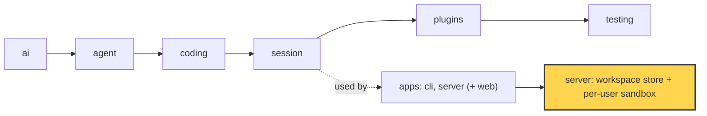

# 29a Part 5 · Workspace and per-user sandbox

**Goal:** Keep each user's files in one durable place, and give each user one computer that sees those files, starts only when needed and stops when idle.

**Builds on:** [29 Docker sandbox](29-docker-sandbox.md), [28 Limits](28-limits.md) · **Next:** [30 Web client](30-web-client.md)

## Where we are



*This chapter splits ch 29's sandbox into two parts (marked): where files live, and where commands run. The library does not change.*

Design: [docs/superpowers/2026-11-16-user-sandbox-mount-design.md](../superpowers/2026-11-16-user-sandbox-mount-design.md).

Code in this chapter (commits `79faa70`, `76d83ea`):

- `apps/server/src/simp_server/workspace.py` — `LocalStore`, `S3Store` (`mount_creds`, `restore`), `make_store`, `check_config`, `rel`
- `apps/server/src/simp_server/sandboxes/__init__.py` — `user_root`, `Compute`, `SandboxLimit`
- `apps/server/src/simp_server/sandboxes/docker.py` — `DockerSandbox` (`ensure`, `_mount`, `stop_idle`), `DockerEnv.after_tool`, `S3FS`
- `apps/server/src/simp_server/sandboxes/e2b.py` — `E2BSandbox` (`ensure`, `_mount`, `snapshot`, `_pause`, `_kill`, `start`), `E2BEnv`
- `apps/server/src/simp_server/sandboxes/repos.py` — `mirror_repos`, `restore_repos`
- `apps/server/src/simp_server/server.py` — `SandboxSync`, the Files endpoints, `sandboxes_cli`, `restore_cli`
- `apps/server/src/simp_server/devminio.py` — dev MinIO for `make minio`
- `apps/server/sandboxes/Dockerfile`, `apps/server/sandboxes/e2b_template.py` — the sandbox images

## Problem

In ch 29 every *session* got its own container, and files sat in a folder on the server. Three things break when the server moves toward real users:

1. **Cost.** Ana has five chats open. Five containers, most of them doing nothing.
2. **Cloud compute cannot see a local folder.** A sandbox at E2B runs on someone else's machine; it cannot bind-mount `~/.simp-server/workspaces`.
3. **Durability.** If compute is disposable (killed on idle), the files must not live inside it.

So we split one idea into two:

| | Workspace store | Sandbox |
|---|---|---|
| Think of it as | the **disk** | the **computer** |
| Lives | always | only while used |
| Per | user | user (shared by all their sessions) |
| Holds | the user's files (`/work`) | processes, `/home/user`, `/tmp` |
| Code | `workspace.py` | `sandboxes/docker.py`, `sandboxes/e2b.py` |

## Naive version: copy files in and out

```python
async def run_tool(user, command):
    sbx = await start_sandbox()
    for key in bucket.list(f"users/{user}/"):          # copy everything in
        await sbx.write(key, bucket.get(key))
    out = await sbx.exec(command)
    for path in await sbx.changed_files():             # copy changes back
        bucket.put(f"users/{user}/{path}", await sbx.read(path))
    await sbx.kill()
    return out
```

It breaks at once: a 2 GB video is copied on every call; a crash between `exec` and the copy-back loses work; the Files panel and the sandbox see different copies; deleting a file needs its own tracking. A sync step is a second source of truth.

## Real design

### The mount: no sync step

The sandbox does not copy the workspace; it **mounts** it at `/work`. There is one copy of each file, in the store.

- **Bind mode** (local store + Docker): `-v <data_dir>/workspaces/<user_id>:/work`. The folder *is* the store.
- **FUSE mode** (S3 store + Docker or E2B): `s3fs` mounts `bucket:/users/<user_id>` at `/work`. FUSE (filesystem in user space) is a kernel hook that hands every file operation to a program, here `s3fs`, which turns it into an HTTP call:

| In the sandbox | `s3fs` sends |
|---|---|
| `cat a.txt` (open, read) | `GET users/<id>/a.txt` |
| `echo hi > a.txt` (write, close) | `PUT users/<id>/a.txt` on close |
| `ls` | `LIST prefix=users/<id>/ delimiter=/` |
| `rm a.txt` | `DELETE users/<id>/a.txt` |

Uploads happen on close, so after each tool call `DockerEnv.after_tool` / `E2BEnv.after_tool` (called by the `SandboxSync` plugin in `server.py`) runs `sync`. The mount script is `S3FS` in `docker.py`; credentials go in on stdin, never on the command line.

**Single writer.** While a sandbox runs, all file tools of that user go through it (in bind mode, `DockerEnv` uses the host folder directly, which is the same files). Nobody else writes `/work` behind its back, so there is no merge problem. The one exception is the web Files panel (below), which writes through the store; s3fs's short stat cache (`stat_cache_expire=5`) picks the change up. Two chats of one user still share one writer and can overwrite each other: there is no lock.

```
            web Files panel
                  │ list / read / write (never starts compute)
                  ▼
   ┌──────────── workspace store ────────────┐
   │ local: <data_dir>/workspaces/<user_id>  │
   │ s3:    bucket/users/<user_id>/          │
   │   ├─ your files                         │
   │   └─ .simp/repos/<name>.git  (mirror)   │
   │      .simp/home.tar.zst      (e2b)      │
   └───────────────▲─────────────────────────┘
                   │ bind mount or FUSE (s3fs) at /work
   ┌───────────────┴──── sandbox (one per user) ────┐
   │ /work            the workspace (mounted)       │
   │ /home/user/repos git repos on local disk       │
   │ /home/user/...   libraries (.local, .npm-global)│
   │ /tmp             scratch, lost on stop         │
   └────────────────────────────────────────────────┘
        ▲ tool calls from every session of the user
```

### Lazy per-user sandbox and its lifecycle

`open(session_id, user_id)` is cheap: it creates an env object and adds the session to the user's `_Box`. No container yet. The first tool call that needs the sandbox calls `ensure(box)`, which:

1. checks limits (`Compute.check`: `max_running`, the user's `day_minutes`) and raises `SandboxLimit` with a message the agent can show;
2. starts the container (`docker run ... sleep infinity`) or creates/resumes the E2B sandbox;
3. mounts `/work` (fuse) with a fresh credential from `store.mount_creds(user_id)`;
4. restores what was lost: the home archive (E2B) and repos from their mirrors.

Then the server tick (`stop_idle`) decides:

| Event | Docker | E2B |
|---|---|---|
| unused `idle_pause_s` (600 s) | remove container | snapshot home, **pause** |
| `max_life_s` (3300 s) from start, idle | restart (fuse only: before the 1 h credential expires) | snapshot, `sync`, unmount, **kill** (Hobby 1 h cap) |
| last session of the user closes | remove | pause |
| next tool call | start again | **resume**; if `/work` is no longer mounted, remount with a fresh credential |
| server dies | containers keep running until removed | **safety net**: created with `lifecycle={"on_timeout": "pause"}`, timeout refreshed on use, so E2B pauses it itself |
| server starts | — | `start()` adopts one sandbox per user (by metadata `app=<tag>`), kills duplicates |

Nothing is paused or killed while a foreground command runs (`box.active > 0`). Background processes do not keep a sandbox alive.

How "never during a call" is enforced (fixed after review, races found in the first version):

- **Stopping state.** Pause and kill take the user's mirror lock, then the box lock, re-check `active == 0`, and set `state = "stopping"` before snapshotting. A call that arrives now waits in `ensure` and resumes the sandbox afterwards instead of being killed underneath.
- **Long calls.** While a call runs, the tick refreshes the E2B timeout, so the safety net does not pause a 20-minute build. A command lost mid-run (`SandboxLost`) is reported, **never re-run**: only calls that never started are retried.
- **Credentials.** Each box knows when its mount credential expires (`creds_until`). The tick refreshes and remounts at an idle point; a call whose timeout would outlive the credential gets a fresh mount first.
- **Budget in the tick.** `day_minutes` is checked on every tick too, not only at start: a user over budget is paused after the current call. Running slots are reserved under a lock, so concurrent starts cannot exceed `max_running`.
- **A container that disappeared** (killed by an admin, OOM) is detected from docker's error and started again on the next command.

### Where data lives

| Path | Lives in | Survives stop? |
|---|---|---|
| `/work` | the store | always |
| `/home/user/repos` | sandbox disk (Docker: named volume `simp-home-<user_id>`) | Docker: yes (volume); E2B: via pause and the **repo mirror only** (repos are never in the home archive, so an old archive cannot roll code back) |
| `/home/user/.local`, `.npm-global`, `.venvs` | sandbox disk | Docker: volume; E2B: in `/work/.simp/home.tar.zst` unless it is over `snapshot_max_mb` (then no new archive is written; libraries reinstall) |
| `/tmp` | tmpfs (Docker 256 MB) | no |

### Why repos are not on `/work`: the benchmark

Git touches many small files and calls `stat` a lot; each one is an HTTP round trip through s3fs. Measured with `apps/server/scripts/bench_git_mount.py --docker` (s3fs to MinIO on the same Mac):

| | init+add+commit, 300 files | 2000 files |
|---|---|---|
| `/work` (s3fs) | 15.0 s | 67.4 s |
| `/home/user` (local) | 0.05 s | 0.25 s |

100–300x slower with the store on the same machine; over the internet it is worse. So repos live on local disk at `/home/user/repos`, and a **repo mirror** makes them durable.

### The repo mirror

`mirror_repos` (in `repos.py`) runs one Python script inside the sandbox after each tool call. For every repo in `/home/user/repos/<name>`:

1. build a tree of the working directory with a temporary index (`git add -A` into a copy of the index, `write-tree`): uncommitted changes included, your real index untouched;
2. hash HEAD, that tree, the refs and the session id; if unchanged since last time, skip;
3. `git push --force` branches, tags and a WIP commit (`refs/simp/wip/<session_id>`) to a bare repo `/work/.simp/repos/<name>.git`, and save the remotes to `<name>.remotes.json`;
4. pack gitignored files (not `node_modules`, `.venv`, `dist`, ...; 10 MB per file, 50 MB total) into an archive; what is skipped is listed in `.simp-not-backed-up.txt`.

On a fresh sandbox, `restore_repos` clones each missing repo from its mirror, checks out the WIP tree with `read-tree -u --reset` (so files deleted in the WIP stay deleted), restores remotes and the ignored-files archive. Failures are logged, never raised: a backup must not fail the user's tool call.

Safety and concurrency of the mirror:

- git runs with `core.hooksPath=/dev/null`, `core.fsmonitor=false` and `push --no-verify`, so repo-controlled hooks never run during a backup.
- Only regular files go into the ignored-files archive (no symlinks); restore extracts member by member, and a bad member never deletes a repo that was restored.
- One mirror at a time per user (`mirror_lock`), and archives are written to a temp file then renamed, so two sessions cannot corrupt them.
- A mirror slower than 30 s continues in the background, still holding the lock; pause and kill wait for it. `<name>.status` records the last success or the error, and a stale mirror is retried before a kill.

### The Files panel goes through the store

`GET /api/sessions/{sid}/files`, `.../files/raw` (GET, PUT) call `files.list/read/write` on the store made by `workspace.make_store`. They check ownership with `mgr.get` and never call `ensure`. Browsing your files never starts (or pays for) compute, and works while the sandbox is paused. Paths go through `rel()`, which maps `/work/...` to the workspace root and refuses `..` escapes.

### Costs and limits

`Compute` (in `sandboxes/__init__.py`) meters running seconds on every tick and records them as a usage row with model `sandbox:<kind>`; cost = seconds × (cpus × `price_vcpu_s` + GiB × `price_gib_s`). E2B defaults: $0.000014 per vCPU-second, $0.0000045 per GiB-second, `day_minutes = 240`; Docker defaults to price 0 and no daily budget. The cost counts toward the user's money budget from [28](28-limits.md). `max_running = 10` caps sandboxes at once (E2B Hobby allows 20). Over a limit, the tool call fails with a plain message; chat still works.

### Restore

With the S3 store, bucket versioning is the history. `simp-server workspace-restore --user bob --at <time> [--path p]` (`S3Store.restore`) puts every object back to its version at that time and deletes objects created since. Old versions stay, so a restore can be undone too.

### Switching modes

The mode is two settings: `[workspace] store` and `[sandbox] kind` (+ `mount`). `check_config` refuses combinations that cannot work at boot:

| store | kind | mount | |
|---|---|---|---|
| `local` | `docker` | `bind` | full local (default) |
| `s3` (MinIO) | `docker` | `fuse` | test, `make minio` |
| `s3` (S3/R2) | `e2b` | `fuse` | mini production |
| `local` | `e2b` | — | refused: a cloud sandbox cannot mount a local folder |
| `s3` | `docker` | `bind` | refused: a bind mount needs a local dir |

Moving from local to s3 means copying `workspaces/<user_id>/` to `users/<user_id>/` in the bucket first. Exact settings blocks are in the README, "Sandbox and workspace".

### Security trade-offs

- FUSE in Docker needs `/dev/fuse`, `CAP_SYS_ADMIN`, AppArmor unconfined and a network. Only one `docker exec -u 0` uses root, for the mount; every command runs as uid 1000 with no capabilities and `no-new-privileges`.
- The mount credential is scoped: `mount_scope = "sts"` gets a 1 h STS credential whose policy allows only `users/<user_id>/*`. R2 has no STS, so there `mount_scope = "none"` hands the store key itself to the sandbox: trusted users only, and the server refuses it unless `dev_unscoped_mount = true`.
- Docker fuse mode gives the container a bridge network that can reach `host.docker.internal` (this machine's services). It is a test mode: the server refuses it unless `dev_fuse = true`.
- **Symlinks are refused by the file tools.** In bind mode the server touches files on the host, and a process in the container could swap a folder for a symlink between the path check and the open. So `LocalEnv` opens every path component with `O_NOFOLLOW` from the workspace root: any symlink inside the workspace is refused by `read`/`write`/`edit`/`ls` and the Files panel. `bash` inside the sandbox still follows symlinks normally.
- The E2B template has no `sudo` for `user`; every new sandbox checks this and is killed if `sudo -n true` works (otherwise the user could read the s3fs credential).
- One simp instance per Docker host and per E2B key: sandbox names (`simp-u-<user_id>`) and E2B tags are not instance-scoped.

## Worked example

Ana asks: "cut the first 10 seconds of `intro.mp4`, then commit the script change in my `site` repo". Mini production mode (S3 + E2B).

1. Ana opens the Files panel and uploads `intro.mp4`: `PUT .../files/raw` → `S3Store.write` → `PUT users/ana/intro.mp4`. No sandbox exists yet.
2. The agent calls `bash ffmpeg -ss 10 -i intro.mp4 out.mp4`. `E2BEnv._use` → `ensure`: `Compute.check` passes; Ana's sandbox was paused, so it **resumes**; `/work` is still mounted.
3. `ffmpeg` reads `/work/intro.mp4`: s3fs sends `GET`s; writing `out.mp4` ends with one `PUT` on close.
4. The agent runs `git commit -am "trim"` in `/home/user/repos/site`: local disk, fast.
5. After the call, `SandboxSync` → `after_tool`: `sync`, then `mirror_repos` pushes the new commit and a WIP ref to `/work/.simp/repos/site.git` (more PUTs).
6. Ana sees `out.mp4` in the Files panel at once: `LIST users/ana/`, no compute.
7. Ten minutes later the tick takes the mirror lock, sets the sandbox to `stopping`, snapshots the libraries in `/home/user` (not `repos/`) to `/work/.simp/home.tar.zst` and pauses. The running seconds are a `sandbox:e2b` usage row.

## Builds on / Next

**Builds on:** [29 Docker sandbox](29-docker-sandbox.md) · **Next:** [30 Web client](30-web-client.md)
