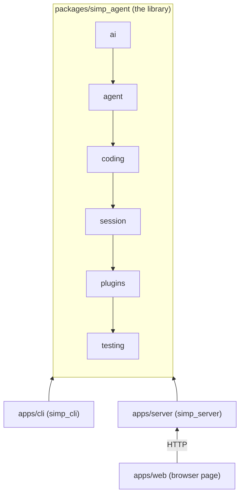
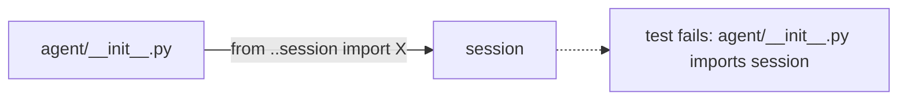

# 30 — Architecture

> **Who this is for:** a developer who wants to read or change the code.
> **What you need first:** [00 Introduction and core ideas](00-introduction.md). Words: [provider](glossary.md#provider), [agent loop](glossary.md#agent-loop), [tool](glossary.md#tool), [session](glossary.md#session), [plugin](glossary.md#plugin), [layer](glossary.md#layer).
> **What you will learn:** the six layers of the library, what each one does, how the apps sit on top, why the code is built this way, and how one test keeps the rule true.
> **Code paths covered:** `packages/simp_agent/src/simp_agent/` (one folder per layer), `packages/simp_agent/tests/test_layers.py`, `apps/cli`, `apps/server`, `apps/web`.
> **Verified at commit:** `57cabfc` (`test_layers.py` run and passing).

**Back:** [27 Troubleshooting](27-troubleshooting.md) · **Next:** [31 How one turn flows](31-turn-flow.md)

Part 2 showed how to run a server. Part 3 opens the box. This chapter is the map; the next chapters walk the roads.

## 1. The big picture

The project has one library and three apps.



Read an arrow `A --> B` as "B may use A". The rule is about direction, not neighbours: a layer may use **any** layer to its left (`session` imports `ai` directly). But `ai` may never use `agent`.

- The **library** knows how to talk to a model, run the loop, use coding tools, and keep a session. It has no terminal, no web server, no database.
- The **CLI** and the **server** are Python apps. They import the library.
- The **web** app is TypeScript. It does not import Python at all; it calls the server over HTTP.

## 2. The six layers

A **[layer](glossary.md#layer)** is one folder under `src/simp_agent/`. Each layer may import only the layers to its left:

`ai` ← `agent` ← `coding` ← `session` ← `plugins` ← `testing`

| Layer | One line (from its own docstring) | Does not import |
|---|---|---|
| `ai` | Provider-neutral messages and `stream()`, which picks a provider by `model.api`. It also defines the *shape* of a tool and a tool call, so the model can be told about tools. | everything else |
| `agent` | The generic [agent loop](glossary.md#agent-loop), a thin stateful `Agent`, the execution environment (with `LocalEnv`, which runs real commands), compaction helpers. | `coding` and up |
| `coding` | File and shell tools, the [system prompt](glossary.md#system-prompt), project [context files](glossary.md#context-file). | `session` and up |
| `session` | `AgentSession`: owns an `Agent`, adds auto-[compaction](glossary.md#compaction), overflow recovery, auto-retry, saving through a store. Uses `LocalEnv` and the coding tools as defaults when the app gives none. | `plugins`, `testing`, apps |
| `plugins` | Example [plugins](glossary.md#plugin) (`RedactSecrets`, `PlanMode`). They import only `ai`; they fit the session's hooks by shape (method names), not by import. | `testing`, apps |
| `testing` | Fakes shared by all tests: a scripted provider and a recording env. | apps |

For the exact files in each folder, open the folder or see the root [README](../../README.md#layout). This book does not copy file lists, because they change.

**Example.** `coding` builds a `bash` tool. The tool does not run commands itself; it asks an [execution environment](glossary.md#execution-environment) (defined in `agent`) to do it. So `coding` uses `agent`, never the other way. The loop in `agent` just sees "a tool"; it does not know it is a coding tool.

## 3. The apps on top

- `apps/cli` (`simp_cli`) — the terminal app ([10](10-cli.md)). It adds argparse, settings, a JSONL store for saved sessions, and the [REPL](glossary.md#repl).
- `apps/server` (`simp_server`) — the team server (Part 2, from [20](20-operator-tutorial.md)). It adds users, the database, [sandboxes](glossary.md#sandbox) and [budgets](glossary.md#budget).
- `apps/web` — the browser page ([11](11-web.md)). It talks only to the server.

The server also has its **own** plugin slots — `Sandbox`, `Store`, `Auth` (Protocols in `apps/server/src/simp_server/server.py`), chosen in the `[plugins]` table ([21](21-configuration.md)). These are a different kind from the library's agent plugins; see [36](36-server-plugins.md). Server internals: [32](32-server-inside.md).

Both Python apps work mostly through `session`'s `AgentSession`, and also import a few things from lower layers (for example message types from `ai`). The direction is always app → library. **The library never imports an app.**

## 4. Why layers?

1. **A small core at the bottom.** `ai` and `agent` hold the tricky general parts (streaming, the loop). They can be read and tested with a fake provider and a fake env, without the coding tools, sessions or any app.
2. **Everything plugs in.** New behaviour is added on top, not inside. A new model API is a provider in `ai/providers/`. A new tool is a tool object. New session behaviour is a plugin using the session hooks. A new place to run commands is a new execution environment. See 34 (providers), [35](35-tools-plugins.md) (tools and agent plugins), [36](36-server-plugins.md) (server plugins).
3. **One library, many front ends.** `session` has no terminal: input and output go through the env and the store, which the app passes in (it falls back to `LocalEnv` only when none is given). That is why the same `AgentSession` serves both the CLI and the server.
4. **Easy to test.** Lower layers have fewer things to fake. The `testing` layer sits at the top so it can fake anything below it.

The cost: sometimes you must pass a thing down as an argument (a callback, an env, a store) instead of just importing it. That is on purpose: the higher layer decides, the lower layer only receives.

## 5. How the rule is kept: `test_layers.py`

A rule that is only written down gets broken. So a test checks it on every run.

`packages/simp_agent/tests/test_layers.py`:

1. Walks every `.py` file in `src/simp_agent/`.
2. Reads its imports with Python's `ast` module (it parses the code; it does not run it). Both `from simp_agent.x import ...` and relative imports like `from ..agent import ...` count.
3. Fails if a file imports a layer to its **right**, or imports `simp_cli` / `simp_server`.



Run it:

```bash
uv run pytest packages/simp_agent/tests/test_layers.py
```

The error lists each bad import, like `agent/__init__.py imports session`. To fix it, move the code to the right layer, or pass the thing in from above.

Two details:
- Files directly in `src/simp_agent/` (outside any layer folder) may not import any layer.
- The test only checks the library. It does not check that apps avoid each other, and it does not check `apps/web` (not Python).

## 6. Where to go next

- How a message travels through `ai` → `agent` → `session`: [31 How one turn flows](31-turn-flow.md).
- What is inside the server: [32 The server inside](32-server-inside.md).
- How to add providers, tools and plugins: 34, [35](35-tools-plugins.md), [36](36-server-plugins.md) Extending.

---

**Built on by:** [31 How one turn flows](31-turn-flow.md), [32 The server inside](32-server-inside.md), [34](34-providers.md), [35](35-tools-plugins.md), [36](36-server-plugins.md) Extending.
**Builds on:** [00](00-introduction.md), [10](10-cli.md), [11](11-web.md), [20](20-operator-tutorial.md), [21](21-configuration.md), [27](27-troubleshooting.md).
