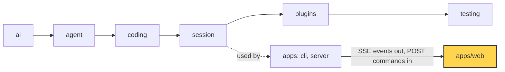
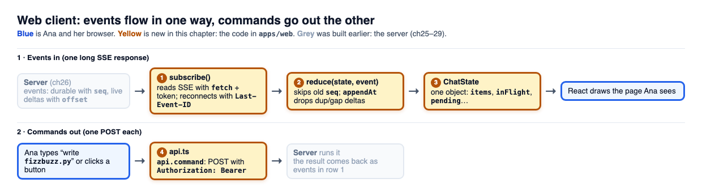

# 30 Part 5 · Web client

**Goal:** Build the browser UI on the protocol.

**Builds on:** [26 Transport](26-transport.md), [25 Protocol models](25-server-run.md#protocol-models) · **Previous:** [29 Docker sandbox](29-docker-sandbox.md) · **Next:** [31 System tests and deploy](31-system-tests-deploy.md)

## Where we are



*This chapter builds the browser app `apps/web` (marked). The server and the library do not change.*

Big picture of Part 5: [part-5-system](23-part-5-system.md).

Code in this chapter (commit `2fc2776`):

- `apps/web/src/api.ts` — `api`, `subscribe`, `getToken`, `AuthError`
- `apps/web/src/state.ts` — `ChatState`, `reduce`, `appendAt`, `canContinue`
- `apps/web/src/App.tsx`, `apps/web/src/Chat.tsx`, `apps/web/src/Files.tsx` — the screens
- `apps/web/src/protocol.gen.ts` — protocol types made from the server ([25](25-server-run.md))
- `apps/web/src/state.test.ts` — unit tests for the reducer

<a id="problem"></a>

## Ana opens a browser page

After chapters 25 to 29 the server is ready. It keeps Ana's and Bob's sessions on disk ([27](27-store-auth.md)), stops runaway runs ([28](28-limits.md)) and runs their `bash` commands in a box ([29](29-docker-sandbox.md)). But only a program like `curl` can talk to it. Ana wants to open a browser page, type "write `fizzbuzz.py`", and watch the answer appear word by word.

Recall what the server gives a client ([26](26-transport.md#sse-out-post-in)). Events come out on one long HTTP response in the [SSE](glossary.md#sse) format, and commands go in as POST calls. A [durable event](glossary.md#durable-event) such as `user_message`, `assistant_message`, `tool_result` or `run_state` is saved and has a number, `seq`, that grows by one each time. A [live event](glossary.md#live-event) (a "delta") such as `text_delta`, `thinking_delta` or `tool_output` is a small piece of text. It is not saved and has no `seq`. Instead it has an [offset](glossary.md#offset): the place in the full text where the piece starts. The full text comes later, inside the durable `assistant_message` or `tool_result`.



*Top row: events leave the server (grey), `subscribe()` reads them, `reduce()` folds each one into one `ChatState`, and React draws the page Ana sees (blue). Bottom row: when Ana types, `api.ts` posts one command with her token, and the result comes back as events in the top row. Yellow is new in this chapter.*

"Open the stream and print what comes in" sounds enough. Three facts make it hard, and the chapter solves them in this order:

1. **The browser's SSE reader cannot send the token.** The stream needs Ana's [Bearer token](glossary.md#bearer-token) in an `Authorization` header ([27](27-store-auth.md)). The built-in reader, `EventSource`, cannot send headers, so the first call gets 401. A token in the URL would leak into server logs.
2. **A reconnect gives duplicates and gaps.** Wi-Fi drops, the laptop sleeps, Ana presses reload in the middle of a long answer. If the page has `"Let me w"` and the same deltas come again, `text += delta` shows `"Let me wLet me w..."`. If a piece is lost, the text has a hole.
3. **Many event kinds drift the screen.** Text, finished messages, tool output, approvals, run state and title all change the same page. If each one pokes the page in its own way, the screen slowly drifts away from the truth on the server.

The web app is React + Vite in `apps/web/`. Types such as `ServerEvent` and `PendingApproval` come from `protocol.gen.ts`, which is made from the server's own types ([25](25-server-run.md)), so client and server cannot disagree about an event's fields.

## Every call carries Ana's token

The first problem starts at login. The login form posts the name and password to `/api/login` (or `/api/signup` for a new user) and stores the returned token in `localStorage`. `api.ts` then wraps `fetch` once, in `call()`, so every later call, including the event stream, carries the token:

```ts
export const getToken = () => localStorage.getItem("simp.token") ?? "";

async function call(path: string, init: RequestInit = {}): Promise<Response> {
  const r = await fetch(path, { ...init, headers: { Authorization: `Bearer ${getToken()}`, ...init.headers } });
  if (r.status === 401) throw new AuthError("invalid token");
  if (!r.ok) throw new Error(`${r.status} ${await r.text()}`);
  return r;
}
```

A 401 becomes its own error type, `AuthError`. The app catches that one type and logs the user out; any other error is just shown.

<a id="fetch-based-sse"></a>
<a id="the-page-listens-sse-over-fetch-subscribe"></a>

## Reading the stream without EventSource

`call()` can send the token, so the page reads the event stream with it instead of `EventSource`. When Ana picks the fizzbuzz session, `App.tsx` calls `subscribe()` (in `api.ts`), and `subscribe()` runs a loop where each turn is one connection:

```ts
const r = await call(`/api/sessions/${sid}/events`, {
  signal: ctl.signal, headers: { "Last-Event-ID": String(lastSeq()) },
});
const reader = r.body!.pipeThrough(new TextDecoderStream()).getReader();
let buf = "";
for (;;) {
  const { value, done } = await reader.read();
  if (done) break;
  buf += value;
  let i;
  while ((i = buf.indexOf("\n\n")) >= 0) {
    const data = buf.slice(0, i).split("\n").filter((l) => l.startsWith("data:")).map((l) => l.slice(5).trim()).join("\n");
    buf = buf.slice(i + 2);
    if (data) {
      const ev = JSON.parse(data) as ServerEvent;
      if (ev.type === "snapshot") { onStatus("live"); attempt = 0; }
      onEvent(ev);
    }
  }
}
```

The price of dropping `EventSource` is that we must cut the stream into events ourselves. A network chunk can end in the middle of an event, so the buffer keeps the rest until the next chunk comes. Each full event ends with a blank line (`\n\n`); its `data:` lines are joined and parsed as JSON. That is all of SSE the client needs, about 15 lines, with no library.

The second problem starts here too. Each connection sends `Last-Event-ID`: the `seq` of the newest durable event the page has. The server answers with only the durable events after it, then a [snapshot](glossary.md#snapshot) of the live state right now, then live events ([26 · Replay](26-transport.md#replay-after-then-snapshot-then-live)). `lastSeq` is a function, not a number, so every new connection asks for the newest `seq` at that moment.

When the stream ends or throws, the loop waits and tries again, longer after each failed try:

```ts
} catch (e) {
  if (e instanceof AuthError) return onAuthError();
}
if (!ctl.signal.aborted) {
  onStatus("reconnecting");
  await new Promise((ok) => setTimeout(ok, Math.min(1000 * 2 ** attempt, 10000)));
}
```

> **Implementation notes**
> - `attempt` is the counter of the outer loop, so the waits are 1 s, 2 s, 4 s, 8 s, then 10 s at most. A snapshot sets it back to 0.
> - The connection status, `ConnStatus`, is `"connecting" | "live" | "reconnecting"`. It becomes `live` only when the snapshot arrives, because only then is the screen up to date. `Chat.tsx` shows it in the header.
> - A bad token (`AuthError`) stops the loop for good, because retrying cannot fix it.
> - `subscribe` returns `() => ctl.abort()`. `App.tsx` calls it inside a React `useEffect` and returns that function, so switching to another session closes the old stream.

## One place where events change the page

The stream now hands each event to `onEvent`. That is the third problem's answer: in `App.tsx`, `onEvent` is `apply`, the only place where events enter the page:

```ts
const apply = (ev: ServerEvent) => {
  ref.current = reduce(ref.current, ev);
  setState(ref.current);
  ...
};
return subscribe(sid, () => ref.current.lastSeq, apply, setConn, onLogout);
```

`apply` runs the [reducer](glossary.md#reducer), `reduce()` from `state.ts`, and saves the result. A reducer is a pure function `(state, event) -> new state`. It does not touch the page or the network, so the same events always give the same screen.

<a id="the-reducer-statets"></a>
<a id="events-arrive-the-reducer-statets"></a>

### ChatState and the skip rule

All chat state lives in one object, `ChatState`. The four fields that matter most:

```ts
export interface ChatState {
  lastSeq: number;                 // newest durable seq applied
  items: Item[];                   // finished messages and notices
  inFlight: InFlight;              // the message still streaming
  pending: PendingApproval | null; // approval the user must answer
  // ... six more
}
```

All ten fields are listed in [Reference · ChatState](ref-objects.md#web-client-chatstate). `items` holds finished things: user messages, assistant messages and notices. `inFlight` holds the assistant message that is still streaming. The split matters because finished messages never change, while the in-flight bubble is built from deltas.

`reduce()` starts with the skip rule for durable events, which handles half of the second problem:

```ts
export function reduce(s: ChatState, ev: ServerEvent): ChatState {
  if ("seq" in ev) {
    if (ev.seq <= s.lastSeq) return s; // durable event already applied
    s = { ...s, lastSeq: ev.seq };
  }
  switch (ev.type) {
    case "user_message":
      return { ...s, items: [...s.items, { kind: "user", seq: ev.seq, text: ev.text }] };
    case "assistant_message":
      return { ...s, items: [...s.items, { kind: "assistant", seq: ev.seq, msg: ev }], inFlight: emptyInFlight() };
```

After a reconnect the replay can still hold an event the tab already shows (one connection never sends an event twice, but two connections can overlap, see [26](26-transport.md)). Its `seq` is not bigger than `lastSeq`, so the second copy does nothing. When the full `assistant_message` arrives, the in-flight bubble is cleared and the finished message takes its place in `items`.

The other durable cases follow the same pattern: each one sets one field. A `tool_result` is stored in `results` by its `call_id`, so the screen can show it under the tool call. `approval_request` sets `pending`, and `approval_resolved` stores the decision and clears `pending`. `run_state` sets `runState`.

> **Implementation notes**
> - `approval_resolved` clears `pending` only if it is for the same `call_id`.
> - `compaction` becomes a notice like `Context compacted (… → … tokens)` (from [20](20-compaction.md)); `session_title` sets `title`.
> - The state is kept twice: in React state, to redraw, and in `ref` (a `useRef`), which is updated at once, so a reconnect reads the true newest `lastSeq`. `apply` also refreshes the session list on `run_state`, `snapshot` and `session_title`.

<a id="appendat"></a>
<a id="deltas-fit-together-appendat"></a>

## Deltas fit together: appendAt

The skip rule needs a `seq`, and a delta has none, only an `offset`. The other half of the second problem is solved by one tiny rule:

```ts
/** Append `delta` only when it starts exactly at the end of `cur`; anything else is a dup or a gap. */
export function appendAt(cur: string, offset: number, delta: string): string {
  return offset === cur.length ? cur + delta : cur;
}
```

Take the fizzbuzz answer. The bubble holds `"Let me"`, which has length 6. A delta `(6, " write")` fits, and the text becomes `"Let me write"`. The same delta again does not fit, because the length is now 12, not 6, so it is dropped and there is no duplicate. A delta `(20, "...")` means the piece from 12 to 20 is missing, so it is dropped too, rather than showing text with a hole in it. These two cases are the [gap / dup delta](glossary.md#gap--dup-delta). During a run, the hole is filled when the full `assistant_message` arrives and replaces the bubble. After a reconnect, the snapshot fills it.


The text and thinking cases add one more check, for the start of a new message:

```ts
case "text_delta":
case "thinking_delta": {
  let f = s.inFlight;
  if (f.msg_id !== ev.msg_id) {
    if (ev.offset !== 0) return s; // a new message must start at 0
    f = { ...emptyInFlight(), msg_id: ev.msg_id };
  }
  const key = ev.type === "text_delta" ? "text" : "thinking";
  return { ...s, inFlight: { ...f, [key]: appendAt(f[key], ev.offset, ev.delta) } };
}
```

A delta for a new `msg_id` starts a fresh bubble only if its offset is 0. If the first piece of a new message was lost, the page waits for the full message instead of showing the middle of it. `tool_output` uses the same `appendAt`, with one text per `call_id` in `toolOutputs`. It needs no new-message check, because each tool call has its own key and starts from an empty string.

## After a reload: the snapshot replaces live state

Deltas fill holes only while the line stays up. After a reload the page has no in-flight text at all, so the server's snapshot fills it:

```ts
case "snapshot":
  // The snapshot is the truth for everything live: replace the in-flight bubble and live tool output.
  return {
    ...s, lastSeq: Math.max(s.lastSeq, ev.last_seq), runState: ev.run_state, pending: ev.pending_approval,
    title: ev.title,
    inFlight: ev.in_flight, toolOutputs: { ...s.toolOutputs, ...ev.in_flight.tool_outputs },
  };
```


The snapshot does not add to the in-flight text; it replaces it. After a reload the bubble shows exactly what the server has, and later deltas continue from there with `appendAt`. Tool output is merged, not replaced: the snapshot holds only the tools still running, so the output of tools that already finished must stay on the screen.

## Ana types, the page draws

The state is now always right, so the page only has to draw it and send commands. When Ana presses Enter, `Chat.tsx` sends one command with `api.command(sid, c)`, which posts to `/api/sessions/{sid}/commands` through the same `call()`:

```ts
send(!busy ? { type: "prompt", text: t + note } : { type: "steer", text: t + note });
```

(`note` lists any files Ana attached.) If no run is going, the text starts a new run (`prompt`). If a run is going, the text is a `steer`: it goes into the current run. There is no "queue as follow-up" choice in the web page. The server sets `steering_mode = "all"`, so every steer sent during a run reaches the model at the next turn, all together (the modes are in [09](09-steering.md#the-agent-side-two-lists-and-a-mode)). The POST returns at once. The page does not add Ana's message to the screen itself: her message and the answer come back as events on the stream `subscribe` holds open. Buttons work the same way, for example `{ type: "compact" }` or `{ type: "continue" }`. `Chat.tsx` never changes `ChatState` itself, so data goes one way only and the screen always matches the server.

### Steers show at once, as pending bubbles

One exception to "the page never adds Ana's message itself". A steer waits in the agent's list until the next turn starts ([09](09-steering.md)), and only then does the server send it back as a `user_message`. If a tool runs for a minute, Ana would see nothing for a minute and might type the same thing again. So `Chat.tsx` keeps a small local list of steers it sent and draws each one at the end of the chat as a grey bubble marked **Pending**. When the server echoes the same text back, the pending bubble hides and the real one takes its place. When the run ends, any left-over pending bubbles are dropped. If the POST fails, the bubble stays and says **Not sent**. This list is only for display; `ChatState` still comes only from the server.

### One friendly line per tool call

A tool call is drawn as a closed `<details>` block. Its `<summary>` is one short line in plain words, made by `toolLabel(call, finished)`: "Reading notes.md" while it runs, "Read notes.md" when done, "Ran \`pytest\`", "Searched the web: …", and so on. A coloured dot shows the status (running, done, error, needs approval), and a timer shows if the call took 2 seconds or more. The output is inside the block, so Ana opens it only if she wants the details. The page never shows the raw arguments; the one line says what matters. The block opens by itself only when the call waits for her approval, so the **Allow** button is never hidden.

### The Memory page

The server keeps memories per user ([27](27-store-auth.md#agents-and-memories)), using the memory plugin from [22](22-profiles-plugins.md). `Memory.tsx` lets Ana see and fix what the agent remembers about her. It opens from the **Memory** button in the side bar and shows two lists: "About you" (scope `global`) and "What the agent learned" (scope `agent`). It uses plain REST calls, not the event stream, because memories do not change word by word: `api.memories()`, `api.editMemory(id, content)`, `api.deleteMemory(id)` and `api.exportMemories()` (a `memories.json` download). Click a memory to edit it; delete asks once more ("Delete?") before it really deletes, like session delete.

> **Implementation notes**
> - **Continue** shows when `canContinue(state)` is true: the run state is `error`, or it is `idle` and the last item is a notice that starts with `interrupted:` (a server restart cut the run).
> - Markdown is drawn with `react-markdown`, but images are never loaded; they become plain links. A model that read a harmful file could be tricked into writing ``, and loading that image would send data to a stranger.
> - `Files.tsx` lets Ana browse, download and upload files in the session folder with `api.files`, `api.download` and `api.upload`. Files do not change word by word, so a plain list loaded on request is enough; there is no event stream for files.

**Builds on:** [26 Transport](26-transport.md), [25 Protocol models](25-server-run.md#protocol-models) · **Previous:** [29 Docker sandbox](29-docker-sandbox.md) · **Next:** [31 System tests and deploy](31-system-tests-deploy.md)
