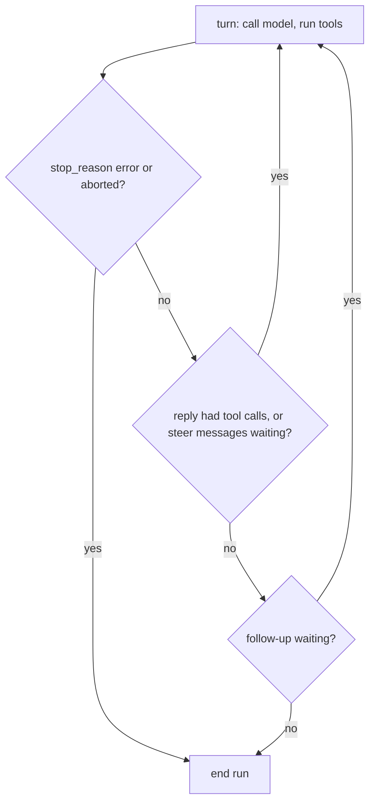
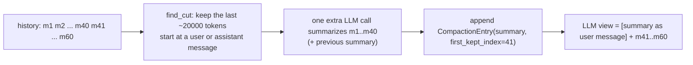

# 31 — How one turn flows

> **Who this is for:** a developer who wants to know what happens, step by step, after a user presses Enter.
> **What you need first:** [30 Architecture](30-architecture.md) (the layers). Words: [agent loop](glossary.md#agent-loop), [turn](glossary.md#turn), [message](glossary.md#message), [tool](glossary.md#tool), [session](glossary.md#session), [compaction](glossary.md#compaction), [history](glossary.md#history), [provider](glossary.md#provider), [system prompt](glossary.md#system-prompt).
> **What you will learn:** how one prompt goes through `session` → `agent` → `ai` and back; what each `stop_reason` does; how the session retries, recovers from "context too long", and compacts.
> **Code paths covered:** `packages/simp_agent/src/simp_agent/ai/__init__.py` (`stream`, `transform_messages`, `is_retryable`, `is_context_overflow`), `.../agent/__init__.py` (`agent_loop`, `_llm_turn`, `run_tool`, `Agent`), `.../agent/compaction.py`, `.../session/__init__.py` (`AgentSession`).
> **Verified at commit:** `2c2cdc7` (read from code; not stepped through in a debugger).

**Back:** [30 Architecture](30-architecture.md) · **Next:** [32 The server inside](32-server-inside.md)

Chapter 30 gave the map. This chapter walks one road: one user prompt, from the app down to the model and back. Each layer adds one job, so we go from the outside in.

## 1. The whole trip in one picture

```mermaid
sequenceDiagram
  participant App as App (CLI / server)
  participant S as AgentSession (session)
  participant A as Agent + agent_loop (agent)
  participant AI as ai.stream (ai)
  participant P as Provider (HTTP)
  App->>S: prompt("fix the test")
  S->>S: start(), plugin input / before_agent_start hooks
  S->>A: agent.prompt(text)
  loop each turn
    A->>S: prepare_next_turn(history)  [maybe compact]
    S-->>A: LLM view
    A->>AI: stream(model, Context)
    AI->>P: request
    P-->>AI: events (text, tool calls, done/error)
    AI-->>A: events + final AssistantMessage
    A->>A: run tool calls (approval, plugins, run_tool)
  end
  A-->>S: new messages
  S->>S: last is error? overflow → compact; retryable → wait, continue_()
  S-->>App: new messages (events streamed all along)
```

In words:

1. The **session** gets the prompt, runs [plugin](glossary.md#plugin) hooks, and asks its `Agent` to run. (A plugin's `input` hook may answer `handled`; then nothing more happens and `prompt()` returns `[]`.)
2. The **agent loop** does turns: ask the model, run the tools it asked for, repeat.
3. Before each model call the session may **compact** the history.
4. `ai.stream` talks to the provider and turns its reply into **events**.
5. When the loop ends with an error, the session may **recover** (compact or retry) and run again.

The app sees everything as it happens, through events (section 6).

## 2. `ai`: one model call

`ai.stream(model, context, api_key=...)` makes one call to the model. It is an async iterator of events. Three rules matter:

- **It never raises.** A problem (no key, unknown `model.api`, HTTP error) becomes an `error` event with an `AssistantMessage` whose `stop_reason="error"` and an `error` text. So callers only check `stop_reason`, never `try/except`.
- **It picks the provider by `model.api`** (`anthropic-messages`, `openai-completions`, `openai-responses`, or one added with `register_provider`).
- **It cleans the messages first** (`transform_messages`): it drops `CompactionEntry`/`CustomEntry` markers and past assistant turns that ended in `error` or `aborted`, adds a fake "No result provided" tool result for any tool call that has no result, and fixes thinking blocks for the target model. So a broken turn in history never confuses the model.

The last event is `done` or `error`, and it carries the final `AssistantMessage`. Its [stop reason](glossary.md#stop-reason) (`stop_reason`) is one of:

| `stop_reason` | Meaning |
|---|---|
| `stop` | The model finished talking. |
| `tool_use` | The model wants tools run. |
| `length` | The model hit its max output tokens; the reply is cut off. |
| `error` | Something failed. `error` has the text; `error_kind` may say `fatal`, `budget` or `policy`. |
| `aborted` | The user stopped it. |

## 3. `agent`: the loop

`agent_loop()` is the [agent loop](glossary.md#agent-loop). It adds the prompt to the history, then runs [turns](glossary.md#turn).

**One turn** (`_llm_turn` + the tool part of `agent_loop`):

1. Call `prepare_next_turn(history)`. It returns the **LLM view**: what the model will see (section 5). The history itself is not changed.
2. Add any [steer](glossary.md#steer) messages the user typed meanwhile.
3. If the tool list changed since the last turn, add a note: `<system-reminder>Tools added: …; removed: …</system-reminder>`. It goes into the history too, so a replay sees the same thing.
4. Build the [system prompt](glossary.md#system-prompt) again and call `ai.stream`. The session builds the prompt from *sections* sorted by order: the coding prompt (tool list, cwd), the project [context file](glossary.md#context-file) (loaded once, on the first prompt), and any sections plugins add. It is rebuilt every turn, so a plugin can change it between turns.
5. Add the final assistant message to the history.
6. For each tool call in it, in order:
   - ask `before_tool_call`. In the session this first runs each plugin's `tool_call` hook: a plugin may block the call, change its arguments, or raise (that also blocks: fail closed). Then, only for `bash`, `write` and `edit`, it asks the app's [tool approval](glossary.md#tool-approval) ("always" is remembered). A reason string means "no"; the result is `User denied: <reason>`.
   - else `run_tool`: find the tool, validate the arguments with its JSON schema, run it. Any problem becomes a **tool result with `is_error=True`**, not an exception. The model reads the error and can try again.
   - `after_tool_call` may change the result (plugins, e.g. hide secrets).
   - add the tool result to the history.

**When does the loop stop?**



- `error` / `aborted`: stop at once. The session decides what to do next (section 4).
- Tool calls in the reply: go again, so the model can read the results.
- No tool calls: check [follow-ups](glossary.md#follow-up). None → the run ends. This is the normal end.

### `stop_reason="length"`: tool calls are not run

If the reply was cut off by the token limit, its tool call arguments may be cut off too. Running half a `write` call could damage a file. So the loop **does not run them**. Each one gets an error result:

```
Tool call was truncated (max tokens); not executed
```

No approval is asked, no plugin hook runs, and no `tool_execution_*` events are sent for them. Then the loop **goes on** like a normal turn (the reply did have tool calls). The model sees the error and can try again, for example with a smaller edit. If a `length` reply has no tool calls, the run just ends with the cut-off text.

### Abort

`abort()` sets a cancel event. The stream is closed at once (this ends the HTTP request). Text that already arrived is kept in a message with `stop_reason="aborted"`. Tools not yet started are skipped (they get no result; `transform_messages` later fills in "No result provided"). If the abort comes during tools, one more `aborted` assistant message is added. A pending approval question is cancelled too.

The thin `Agent` class wraps the loop. It keeps the history, the steer and follow-up queues, and blocks a second `prompt()` while one runs. `continue_()` runs the loop again **with no new message**; the session uses it for recovery.

## 4. `session`: retry and overflow recovery

`AgentSession._run()` starts the agent, then looks at the **last message**. While it is an assistant message with `stop_reason="error"`:

| Error | Test | What the session does |
|---|---|---|
| Context too long | `ai.is_context_overflow(error)`: texts like "prompt is too long", "maximum context length" | **Compact once** (section 5), then `continue_()`. If compaction fails, stop. Only once per call of `prompt()`. |
| Short-lived problem | `ai.is_retryable(error, error_kind)`: 429, 5xx, "overloaded", "rate limit", network, timeout | **Wait, then `continue_()`**. Up to `max_retries` (3) times. |
| Anything else | e.g. bad key (`fatal`), [budget](glossary.md#budget) or policy | Stop. The error stays in history. |

**Backoff.** The wait doubles each time: `retry_base_delay * 2 ** (attempt - 1)`, so 2 s, 4 s, 8 s by default. An abort during the wait stops the retry. The session emits `auto_retry_start` (attempt, delay, error) before each wait and one `auto_retry_end` (success or not) at the end.

**Why `continue_()` works after an error:** the error message stays in the history (it is saved; nothing is deleted), but `transform_messages` drops it from what the model sees. So the next call looks like the failed one never happened.

**Why not retry overflow?** The same request would fail the same way. Only making the history smaller helps, so overflow is never "retryable".

## 5. Compaction (home)

[Compaction](glossary.md#compaction) makes a long history fit in the [context window](glossary.md#context-window). [13](13-working-well.md#3-long-sessions-and-compaction--both) tells users how to live with it; this is how it works.

### When

Three ways:

1. **Auto, before a turn.** The session's `prepare_next_turn` hook (`_prepare`) checks `should_compact`: tokens `> context_window - reserve_tokens` (`reserve_tokens` = 16384). If yes, it compacts **before** the model call.
2. **After overflow.** See section 4.
3. **By hand.** `AgentSession.compact()`: the CLI's `/compact` command and the server's compact message call it.

Auto (1 and 2) is on when `auto_compact=True` (the default). If auto compaction in step 1 fails, the turn still goes on with the full view; an overflow error may follow, which leads to step 2.

**How tokens are counted** (`estimate_tokens`): take the real `usage` (input + output) from the last good assistant reply, and add about 1 token per 4 characters for the messages after it. With no usable reply, count the whole view at 4 characters per token. Rough, but cheap.

### How



- `find_cut` walks back from the end until about `keep_recent_tokens` (20000) are kept, then moves the cut to a user or assistant message, never a tool result, so a tool call and its result stay together. (If no such message is early enough, it takes the first one it can, so more than 20000 tokens may be kept.)
- The old part is summarized by **one extra model call**, with a fixed format (goal, progress, decisions, next steps…). Tool results are cut to 2000 characters and tool arguments to 500 in the text sent to it; thinking is left out. A cut-off (`length`) summary counts as a failure. If there was an earlier summary, it is passed in so nothing is lost. Plugins' `context` hooks run on the old part first, so secrets do not reach the summary.
- The summary gets a list of files read and changed (from `read`, `write` and `edit` calls only; files changed by `bash` are not listed).
- A `CompactionEntry` is **appended**. Nothing is deleted: the full history stays on disk.
- From then on, `build_view` gives the model: the summary (as a user message) + messages from `first_kept_index` on.

**If it fails** (model error, or nothing to cut), `compact()` returns `False`, emits `compaction_end` with the error, and leaves the history as it was.

**Known limit:** the cut never falls between a tool call and its result. So a long tail of tool results after the last user or assistant message cannot be cut, and one huge message bigger than the window cannot be compacted (marked `ponytail:` in `find_cut`).

**Why append, not delete?** Saving is append-only (crash safe), a resumed session rebuilds the same view, and nothing is lost for debugging. The cost: the file on disk keeps growing.

## 6. Events and saving

The app never polls. It subscribes and gets events:

- from the loop: `agent_start`, `turn_start`, `message_update` (stream pieces, while the model talks), then `message_start` + `message_end` (sent together once a message is complete), `tool_execution_start` / `_update` / `_end`, `turn_end`, `agent_end`;
- from the session: `compaction_start` / `compaction_end`, `auto_retry_start` / `auto_retry_end`, `plugin_error`.

On every `message_end` the session calls `store.append(message)` right away. So after a crash the history is complete up to the last full message. (One gap: if a subscriber raises, `Agent` adds an error message without a `message_end`, so that one message is not saved.) The CLI shows these events in the terminal; the server forwards them to the browser.

## 7. Summary

- `ai` = one call, never raises, reports with `stop_reason`.
- `agent` = turns until no tool calls; tool problems become error results; `length` means "do not run the tools, go on".
- `session` = the safety net: compact before a too-big turn, compact once after overflow, retry short-lived errors with 2/4/8 s backoff, save every message.

---

**Built on by:** [32 The server inside](32-server-inside.md), 34 Extending: providers, [35 Extending: tools and agent plugins](35-tools-plugins.md).
**Builds on:** [00](00-introduction.md), [10](10-cli.md) (`/compact`), [13](13-working-well.md), [30](30-architecture.md).
