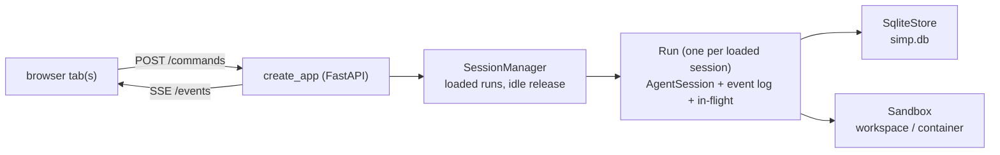
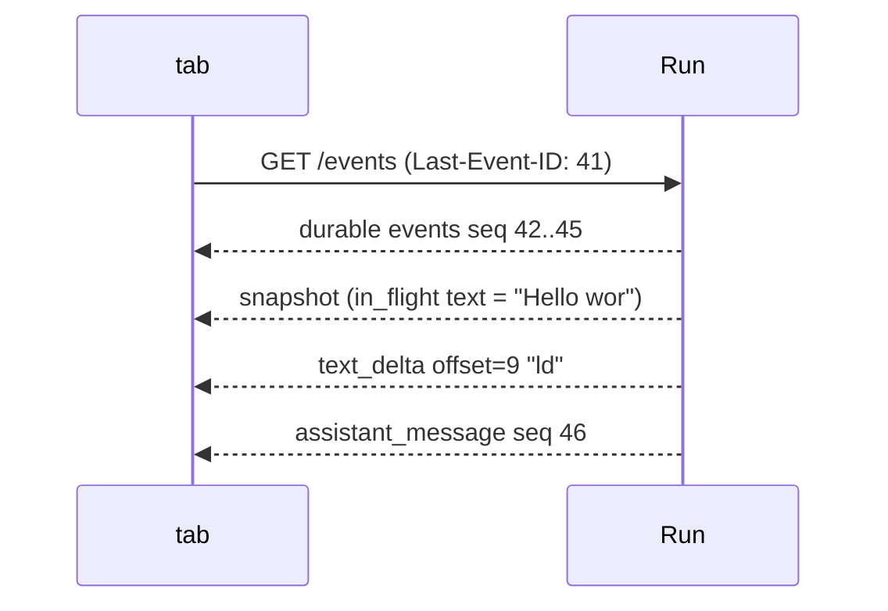

# 32 — The server inside

> **Who this is for:** a developer who wants to know how the server runs a web session, keeps it safe on disk, and talks to the browser.
> **What you need first:** [31 How one turn flows](31-turn-flow.md) (what `AgentSession` does). Words: [session](glossary.md#session), [run](glossary.md#run), [durable event](glossary.md#durable-event), [live event](glossary.md#live-event), [snapshot](glossary.md#snapshot), [sandbox](glossary.md#sandbox), [steer](glossary.md#steer), [follow-up](glossary.md#follow-up), [tool approval](glossary.md#tool-approval).
> **What you will learn:** what a `Run` is; how prompts, steers and follow-ups are queued; how SSE + POST, `seq`, offsets and the snapshot fit together; what is stored in SQLite; when a session is unloaded; why `protocol.gen.ts` exists and how the drift test guards it.
> **Code paths covered:** `apps/server/src/simp_server/server.py` (`Run`, `SessionManager`, `create_app`), `.../store.py` (`SqliteStore`), `.../protocol.py`, `.../gen_protocol.py`, `apps/server/tests/test_protocol.py` (`test_no_ts_drift`).
> **Verified at commit:** `b6f09f5` (read from code; not run).

**Back:** [31 How one turn flows](31-turn-flow.md) · **Next:** [33 Developer tutorial](33-dev-tutorial.md)

Chapter 31 followed one prompt inside `AgentSession`. The CLI holds that object in one process for one person. The server must do more: many users, many browser tabs, tabs that drop and come back, and a process that may restart. The server is one app on top of the layers from [30](30-architecture.md). This chapter shows the small parts that do that. The exact wire format lives in [docs/protocol.md](../protocol.md); here we explain the ideas, not every field.

## 1. The big picture



- **`create_app`** builds the HTTP routes. Every route except hello, sign-up and login needs a token ([22](22-users.md)).
- **`SessionManager`** keeps a dict `runs` of sessions that are loaded in memory right now.
- **`Run`** wraps one `AgentSession` and turns its events into protocol events.
- **`SqliteStore`** saves everything. **`Sandbox`** gives the tools a place to run ([23](23-sandboxes.md)).

Store, sandbox and auth are plugin slots; you can swap them (see [36 Extending: server plugins](36-server-plugins.md)).

## 2. A `Run`: one loaded session

Note the two meanings: the class `Run` holds one loaded session; a [run](glossary.md#run) (lower case) is one piece of work inside it, from a prompt until the agent stops.

When a request names a session, `SessionManager.get` loads it if it is not in memory:

1. read the session row (scoped by user, so you can never load someone else's session — 404);
2. open its sandbox;
3. read all saved entries and build a `Run`. The `Run` makes an `AgentSession` with the saved messages, so the model sees the same history as before;
4. call `recover()` (section 6).

The `Run` keeps:

- `log` — every durable event so far, in memory (a known simple choice, fine for normal sizes);
- `seq` — the last number used;
- `inflight` — text, thinking and tool output that is still streaming;
- `pending` — the approval question waiting for an answer, if any;
- `subs` — one queue per connected tab.

**Run state** belongs to the server, not to the core. It is `idle`, `running`, `waiting_approval`, `aborting` or `error`. `check_transition` in `protocol.py` refuses moves that make no sense (for example `idle → waiting_approval`). The full graph is in [protocol.md](../protocol.md#run-state-server-owned).

## 3. Commands and queues

The browser sends every action as one `POST /api/sessions/{id}/commands`. The body is checked against the schema first (422 if wrong). Then `Run.command` decides:

| command | session idle | session busy |
|---|---|---|
| `prompt`, `steer`, `follow_up` | start a new run | steer → `session.steer`; prompt / follow_up → `session.follow_up` |
| `abort` | nothing | state `aborting`, `session.abort()` (nothing if already aborting) |
| `approve` | 409 unless a pending approval has this `call_id` | same: answers it |
| `compact`, `continue` | start a run with that action | 409 |
| `set_plan_mode` | turn plan mode on/off + notice | same |

Rules worth knowing:

- **Queue limit:** at most `MAX_QUEUED` = 20 steers + follow-ups waiting; more gives 429.
- **A late follow-up still runs.** If a follow-up arrives just after the loop decided to stop, `_turn` sees it in `agent.follow_ups` and starts it as the next run. It shares the same run budget (`fresh=False`), so a queue cannot reset the run limit ([24](24-money.md)).
- **Abort clears the queues,** settles a pending approval as `aborted`, then goes to `idle` with the notice "run aborted".
- **Never stuck busy.** `_run` has a `finally`: if the run task dies for any reason (a store error, a cancel), the state is forced to `error` with the notice "run stopped unexpectedly".

**Approval** waits on a Python `Future` (a box that gets filled later). The core calls `Run.approve(call)`; it saves an `approval_request`, sets `waiting_approval`, and waits. A later `approve` command fills the future. Any tab may answer — they all saw the same question.

## 4. SSE + POST, `seq`, offsets, snapshot

Why two channels? Commands are short requests (POST). Events flow one way, server to browser, for a long time — this is what Server-Sent Events (SSE) is made for. It works over plain HTTP and the browser reconnects by itself. (The full reasons: 38 Decision records, not written yet.)

The server sends two kinds of events:

- **Durable** events (user message, assistant message, tool result, approval, run state, notice…) get a `seq` number, are saved to SQLite, and are kept in `log`.
- **Live** events (`text_delta`, `thinking_delta`, `tool_output`) are small stream pieces. They have **no** seq and are **not** saved. Each has an `offset`: the position of this piece in the text so far.

When a tab connects, `Run.subscribe(after)` returns, in one step with no `await` — Python runs this part without pausing, so no event can slip in between:

1. all durable events with `seq > after` (what the tab missed);
2. one `snapshot`: last seq, run state, the in-flight text so far, pending approval, title, plan mode;
3. then a queue for the live stream.



**Example.** A tab drops while the model is writing "Hello world". It had seen seq 41. It reconnects with `Last-Event-ID: 41`. It gets seq 42–45, then a snapshot holding "Hello wor", then the next delta with `offset = 9` — exactly the length of what it has. If the offset does not match, the tab knows it has a gap. When the message ends, the durable `assistant_message` carries the full text, so the stream pieces never need to be saved.

Two more safety rules:

- **Slow tab.** Each tab's queue holds `QUEUE_MAX` = 1000 events. If it fills, the server drops that tab instead of slowing the run. The tab reconnects and catches up with the snapshot.
- **Heartbeat.** Every 15 s without events, the server sends `: ping`. At that moment it also checks the token again, so a revoked or rotated token ends the stream ([22](22-users.md)).

## 5. Storage in SQLite

All data is in one file, `<data_dir>/simp.db`, opened in WAL mode (a SQLite mode that lets reads and writes happen together). Every session, entry and usage row has a `user_id`, and every read of them filters by it.

| table | holds |
|---|---|
| `users` | name, sha256 of the static token, scrypt password hash, `disabled` |
| `tokens` | sha256 of each login token (one per device) |
| `sessions` | id, user, title, profile, sandbox ref, times |
| `entries` | the session log: `(session_id, seq, type, json)` |
| `usage` | tokens in/out and cost of each model call |

The key idea is the `entries` table. It holds **two** kinds of rows with **one** `seq` counter:

- `type = "msg"` — a core message, saved by `AgentSession` through `Run.append` (the `Run` *is* the session's store). These rebuild the model's history.
- `type = <event type>` — a durable protocol event. These rebuild what the browser shows.

One counter means one order: on reload, the server reads the rows by `seq` and gets both the history and the screen back, the same as before. Each row is written and committed at once, like the CLI's JSONL file ([31](31-turn-flow.md#6-events-and-saving)).

Old databases still open: `open()` adds missing columns (`usage.cost`, `users.password`, `users.disabled`).

## 6. Recovery after a restart

If the process dies during a run, the saved run state is still busy. When that session is **first loaded** again (not at server start), `recover()` settles open approvals and unfinished tool calls, sets `error`, and adds a notice, so the user can press **Continue**. The steps are in [25](25-ops.md#5-when-the-server-restarts), the home of this topic.

## 7. Idle release

Loaded runs use memory, and with Docker a container each. So `SessionManager` lets them go:

- A background loop unloads a run that was not used for a while. Only a **free** run can go: not busy, no tab connected, and no run task or title call still going.
- There is a cap on loaded runs. When it is full, the least recently used free run is unloaded; if none is free, the request gets 503.

The settings, defaults and the 503 text are in [21](21-configuration.md).

Unloading (`evict`) only closes the sandbox and forgets the `Run`. Files and the log stay; the next request loads it again from SQLite. Deleting a session is different: it stops the run (and a title call), removes the workspace files, and deletes the session row and its entries. Usage rows stay, so budgets still count.

## 8. `protocol.gen.ts` and the drift test

The wire types are written **once**, in Python: Pydantic models in `apps/server/src/simp_server/protocol.py`. The web app is TypeScript and needs the same types. Writing them twice by hand would let them drift apart quietly.

So TypeScript is generated:

```bash
uv run python -m simp_server.gen_protocol
```

This turns the Pydantic JSON schema into `apps/web/src/protocol.gen.ts` (with `npx json-schema-to-typescript`). The file says "Do not edit" at the top.

The guard is `test_no_ts_drift` in `apps/server/tests/test_protocol.py`: it generates again and fails if the result differs from the file on disk. So if you change `protocol.py` and forget to regenerate, the tests go red. (It is skipped when `npx` is not installed. `gen_protocol --check` does the same check from the command line.)

**When you change the protocol:** edit `protocol.py` → run `gen_protocol` → update the web code that uses the type → update [protocol.md](../protocol.md).

## 9. Summary

- `SessionManager` loads a session into a `Run` on demand and unloads it when idle.
- `Run` turns core events into durable events (seq, saved) and live events (offset, not saved).
- A tab gets: missed durable events → snapshot → live stream. That makes reconnects safe.
- SQLite `entries` keeps core messages and protocol events in one order.
- Python `protocol.py` is the one source of the wire types; the drift test keeps the TypeScript copy the same.

---

**Built on by:** [33 Developer tutorial](33-dev-tutorial.md), [36 Extending: server plugins](36-server-plugins.md), 38 Decision records (not written yet).
**Builds on:** [21](21-configuration.md), [22](22-users.md), [23](23-sandboxes.md), [24](24-money.md), [25](25-ops.md), [30](30-architecture.md), [31](31-turn-flow.md).
