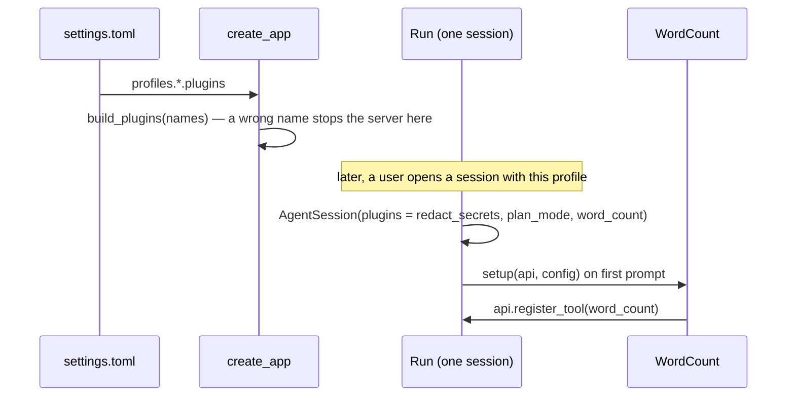

# 33 — Developer tutorial: your first tool plugin

> **Who this is for:** a developer who wants to give the agent a new tool.
> **What you need first:** [30 Architecture](30-architecture.md) (the layers), [31 How one turn flows](31-turn-flow.md) (how a tool call runs), [32 The server inside](32-server-inside.md) (how the server builds a session). Words: [plugin](glossary.md#plugin), [tool](glossary.md#tool), [profile](glossary.md#profile), [session](glossary.md#session), [tool approval](glossary.md#tool-approval).
> **What you will learn:** how to write a small tool plugin, test it with `FakeProvider` (no model, no key), and turn it on for a server profile.
> **Code paths covered:** `packages/simp_agent/src/simp_agent/plugins/` (`build_plugins`, `plan_mode.py`, `redact_secrets.py`), `.../session/__init__.py` (`PluginAPI`, `AgentSession`), `.../agent/__init__.py` (`AgentTool`, `ToolContext`), `.../testing/__init__.py` (`FakeProvider`), `apps/server/src/simp_server/server.py` (`create_app`, `Run`).
> **Verified at commit:** `c51fc79`. Every code block was put in the repo and run: the test passed, `build_plugins` accepted the name, `test_layers.py` passed. The files were then removed. The server itself was not started.

**Back:** [32 The server inside](32-server-inside.md) · **Next:** [34 Extending: providers](34-providers.md)

We will build `word_count`: a tool that counts the words in a file. It is small on purpose, so you can see every part. There are three steps:


## 1. Write the plugin

A [plugin](glossary.md#plugin) is a plain object. It has a `name` and some **hooks** (methods with known names). The session calls the hooks it finds and skips the rest. No base class is needed.

To add a [tool](glossary.md#tool), use the `setup(api, config)` hook. The session calls it once, when the session starts (on the first prompt, `continue`, or plan-mode change). `api` is a `PluginAPI`; `api.register_tool(...)` adds a tool to this session only.

Create `packages/simp_agent/src/simp_agent/plugins/word_count.py`:

```python
"""word_count: a tool that counts the words in a file."""

from __future__ import annotations

import posixpath

from ..agent import AgentTool


class WordCount:
    name = "word_count"

    def setup(self, api, config: dict) -> None:
        api.register_tool(AgentTool(
            "word_count",
            "Count the words in a text file. Path is relative to the working folder.",
            {"type": "object", "properties": {"path": {"type": "string"}}, "required": ["path"]},
            self.run,
        ))

    async def run(self, args: dict, ctx) -> str:
        text = await ctx.env.read_file(posixpath.join(ctx.cwd, args["path"]))
        return f"{len(text.split())} words"
```

What each part does:

- **`AgentTool(name, description, parameters, execute)`.** The model sees the name, the description and the JSON schema of the arguments. Write the description for the model: it decides when to call the tool from these words.
- **`run(args, ctx)`** is the `execute` function. `args` are the arguments the model sent. `ctx` is a `ToolContext` with `env`, `cwd`, `cancel` and `on_update`. It returns text; that text goes back to the model as the tool result.
- **Use `ctx.env`, not `open()`.** `env` is the [execution environment](glossary.md#execution-environment). On the server with Docker, files live inside the container, so `open()` would read the wrong disk. `env.read_file` works the same for every [sandbox](glossary.md#sandbox) ([23](23-sandboxes.md)).
- **Why `posixpath`?** Paths are for the environment (a Linux container on the server), not for your own computer.
- **Errors.** If the file is missing, `read_file` raises. You do not need to catch it: the agent loop turns an exception into an error result for the model ([31](31-turn-flow.md)).

**Why a plugin, and not a change to the built-in tool list?** A plugin is turned on per profile. Users who do not need `word_count` never see it, and the core stays small ([30](30-architecture.md)).

**Why inside `simp_agent`?** A plugin is library code. It may import from `simp_agent` only, never from the CLI or server. `test_layers.py` checks this.

## 2. Test it with `FakeProvider`

You do not want to pay for a real model each time you run a test. `FakeProvider` (in `simp_agent.testing`) is a fake model: you give it the replies, and it plays them in order. It also records what it was sent.

Our script has two replies:

1. The "model" calls `word_count` on `note.txt`.
2. After it sees the tool result, the "model" answers with text, so the loop stops.

Create `packages/simp_agent/tests/test_word_count.py`:

```python
from simp_agent.ai import AssistantMessage, Model, TextContent, ToolCall
from simp_agent.plugins.word_count import WordCount
from simp_agent.session import AgentSession
from simp_agent.testing import FakeProvider


async def test_word_count(tmp_path):
    (tmp_path / "note.txt").write_text("one two three")
    fake = FakeProvider(
        AssistantMessage([ToolCall("c1", "word_count", {"path": "note.txt"})], stop_reason="tool_use"),
        AssistantMessage([TextContent("The file has 3 words.")]),
    )
    s = AgentSession(Model(), [], stream_fn=fake, system_prompt="s", cwd=str(tmp_path), plugins=[WordCount()])
    await s.prompt("How many words are in note.txt?")
    result = s.messages[2]
    assert result.tool_name == "word_count" and result.content == "3 words"
    assert [t.name for t in fake.ctxs[0].tools] == ["word_count"]
```

Run it from the repo root:

```bash
uv run pytest packages/simp_agent/tests/test_word_count.py -q
```

Expected: `1 passed`.

How to read the test:

- `AgentSession(Model(), [], ...)` starts with **no** built-in tools (`[]`), so the only tool is ours. `stream_fn=fake` puts the fake model where the real one would be.
- The history after the prompt is: `[0]` your message, `[1]` the tool call, `[2]` the tool result, `[3]` the final text. So `s.messages[2]` is the result.
- `fake.ctxs[0].tools` is what the "model" was offered on the first call. This proves `setup` ran and the tool was registered before the model was asked.
- No `FakeEnv` is needed: the default environment is your local disk, and `tmp_path` is a fresh folder.

Run the whole suite before you go on: `uv run pytest -q`.

## 3. Register the name and turn it on

### 3a. Add it to `build_plugins`

The server and the profile name plugins by a **short name**, and `build_plugins` turns names into objects. It only knows a fixed list. Edit `packages/simp_agent/src/simp_agent/plugins/__init__.py`:

```python
def build_plugins(names: list[str]) -> list:
    from .word_count import WordCount
    known = {"redact_secrets": RedactSecrets, "plan_mode": PlanMode, "word_count": WordCount}
    ...
```

(You can also put the import at the top of the file, next to the others, and add `WordCount` to `__all__`.)

There is **no way to load a tool plugin from outside the repo** today: no `"module:Class"` path and no package entry points. You must add the name here.

Check it:

```bash
uv run python -c "from simp_agent.plugins import build_plugins; print(build_plugins(['word_count']))"
```

A wrong name gives `ValueError: unknown plugin 'wordcount'; have ['plan_mode', 'redact_secrets', 'word_count']`.

### 3b. Turn it on in a profile

In the server's `settings.toml` (where it is: [21](21-configuration.md)), add the name to the `plugins` list of a [profile](glossary.md#profile):

```toml
[profiles.default]
# ... model, api, prices as before ...
plugins = ["word_count"]
```

Then restart the server.

What happens, step by step:



- At boot, `create_app` calls `build_plugins` for every profile, so a typo fails **at start**, not in the middle of a chat.
- Each session builds its own plugin objects. `redact_secrets` and `plan_mode` are always first; your names come after.
- Only sessions that use this profile get the tool.

**Do not confuse** the profile `plugins` key with the `[plugins]` **table**. The table picks the classes for the server's Sandbox, Store and Auth slots (36 Extending: server plugins). It does not load tool plugins.

## 4. Things to know

- **The CLI does not load plugins.** Only the server passes `plugins=` to `AgentSession`. In the CLI your tool will not appear.
- **No approval prompt.** [Tool approval](glossary.md#tool-approval) asks only for `bash`, `write` and `edit`. `word_count` runs without asking. That is fine for a tool that only reads. If your tool changes things, think about this first.
- **Paths.** An absolute path from the model ignores `cwd`. The sandbox decides what the tool can reach ([23](23-sandboxes.md), [26](26-security.md)).
- **`config`.** `setup` gets a `config` dict from `plugin_config`. The server fills it only for `redact_secrets` today, so for your plugin it is `{}`.
- **Other hooks.** A plugin can do more than add tools: `tool_call` (block a call; see `plan_mode.py`), `tool_result` and `context` (change results or what the model sees; see `redact_secrets.py`), `session_start`, `on_event`. A hook that raises is reported as a `plugin_error` event; a raising `tool_call` blocks the call. The full list is the topic of [35 Extending: tools and agent plugins](35-tools-plugins.md).

## 5. Summary

- A tool plugin is an object with `name` and `setup(api, config)` that calls `api.register_tool(AgentTool(...))`.
- Read and run through `ctx.env`, so the tool works in every sandbox.
- Test it with `FakeProvider`: script the model's replies, then check the history.
- Add the name to `build_plugins`, then list it in a profile's `plugins`. The server checks names at boot.

---

**Built on by:** [34 Extending: providers](34-providers.md), [35 Extending: tools and agent plugins](35-tools-plugins.md), [36 Extending: server plugins](36-server-plugins.md), [37 Testing and evals](37-testing.md).
**Builds on:** [23](23-sandboxes.md), [30](30-architecture.md), [31](31-turn-flow.md), [32](32-server-inside.md).
