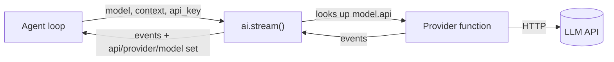

# 34 — Extending: providers

> **Who this is for:** a developer who wants the agent to talk to a new kind of LLM API.
> **What you need first:** [30 Architecture](30-architecture.md) (the `ai` layer), [31 How one turn flows](31-turn-flow.md) (how `ai.stream` is called, retry), [33 Developer tutorial](33-dev-tutorial.md) (`FakeProvider`). Words: [provider](glossary.md#provider), [message](glossary.md#message), [stop reason](glossary.md#stop-reason), [profile](glossary.md#profile).
> **What you will learn:** what a provider must do, how the three built-in providers work, how `register_provider` adds a new one, and how a profile picks one with `api`.
> **Code paths covered:** `packages/simp_agent/src/simp_agent/ai/__init__.py` (`Model`, `stream`, `register_provider`, `transform_messages`, `is_retryable`, `is_context_overflow`), `.../ai/providers/` (`anthropic.py`, `openai_completions.py`, `openai_responses.py`), `.../session/profile.py` (`build_model`), `.../testing/__init__.py` (`FakeProvider`), `apps/server/src/simp_server/server.py` (`api_key_for`).
> **Verified at commit:** `53753a9`, from code and tests (`test_register_provider` in `apps/cli/tests/test_plugins.py`). No real API was called.

**Back:** [33 Developer tutorial](33-dev-tutorial.md) · **Next:** [35 Extending: tools and agent plugins](35-tools-plugins.md)

## 1. What a provider is

A [provider](glossary.md#provider) is one **async generator function** (an `async def` that uses `yield`):

```python
async def my_stream(model, context, api_key=None):
    ...  # yield event dicts
```

It gets a `Model` (which model, which URL), a `Context` (system prompt, [messages](glossary.md#message), tools) and the key. It talks to one LLM API and **yields events**. It turns the API's own format into simp-agent messages, and back.

Everything else in the agent (loop, tools, sessions, server) only sees these events. This is why the agent can use Anthropic, OpenAI or a local server without any change: only the provider knows the wire format.



## 2. `ai.stream`: the only way in

The loop never calls a provider directly. It calls `ai.stream(model, context, api_key=...)` ([31](31-turn-flow.md)). `stream` does three things:

1. **Find the provider.** It looks up `model.api` in a table (`_PROVIDERS`). If the name is not there, it yields one `error` event: `Unknown api: <name>`.
2. **Clean the messages** with `transform_messages(messages, model)`:
   - drops assistant turns that ended in `error` or `aborted`;
   - adds a `"No result provided"` error result for any tool call that has no result;
   - fixes **thinking** blocks: signed thinking is sent back only to the *same* provider, API and model; for another model it becomes plain text (or is dropped if redacted).
   So a provider gets a clean, valid list. It does not need to repair history. (Details: [31](31-turn-flow.md).)
3. **Mark who wrote the reply.** On every event with a `message` or `partial`, it sets `api`, `provider` and `model` on that message. Step 2 uses these on the next turn to know who wrote it.

## 3. The contract

A provider must follow four rules.

**Rule 1 — yield events.** These *stream events* are not the server's [durable events](glossary.md#durable-event); the loop wraps them in `message_update`. Each event is a dict with a `type`:

| `type` | Extra keys | Meaning |
|---|---|---|
| `start` | `partial` | First event. `partial` is the `AssistantMessage` being built. |
| `text_delta` | `delta` | A piece of answer text. |
| `thinking_start` / `thinking_delta` / `thinking_end` | `delta` | Model's reasoning, if any. |
| `toolcall_start` / `toolcall_delta` / `toolcall_end` | `name` / `delta` | A tool call being written. |
| `done` | `message` | Last event, success. The final `AssistantMessage`. |
| `error` | `message` | Last event, failure. `message.stop_reason == "error"`, `message.error` holds the text. |

The loop sends every event to the UI as a `message_update`. It only *needs* two things: the last event is `done` or `error` with a `message`, and (for cancel) a `partial` in `start`. If the user cancels mid-stream, the loop keeps the `partial` content and marks it `aborted`. So build the message **in place** on the `partial` object.

**Rule 2 — never raise.** Wrap the whole body in `try/except Exception` and turn the error into an `error` event. The loop trusts this. The Anthropic provider ends like this (it marks the message it was building):

```python
except Exception as e:
    msg.stop_reason, msg.error = "error", str(e)
    yield {"type": "error", "message": msg}
```

(The two OpenAI providers yield a new, empty `AssistantMessage` instead. That is fine too: the loop drops error turns before the next call.)

**Cancel.** When the user cancels, the loop cancels the waiting `__anext__()` of your generator. A `CancelledError` is raised inside it at the `await`. Do not catch it (`except Exception` does not). Use `async with` for the HTTP stream, so it closes by itself.

**Rule 3 — map the stop reason.** Set `message.stop_reason` to one of our [stop reasons](glossary.md#stop-reason): `stop`, `tool_use`, `length`, `error`. (`aborted` is set by the loop, not by you.) Each built-in has a small `_STOP` table, for example Anthropic `end_turn → stop`, `tool_use → tool_use`, `max_tokens → length`. Also fill `message.usage` with `{"input": ..., "output": ...}` so [money limits](24-money.md) can count tokens.

**Rule 4 — never read the environment.** The key comes only as `api_key`. The app gets it with `get_api_key` and passes it in. A provider must not read `os.environ`.

### Error classes

You do not decide whether an error is retried. You only write a good `error` text; the loop decides from it. Short version here; full story in [31](31-turn-flow.md):

| Check | Matches (examples) | What the loop does |
|---|---|---|
| `is_context_overflow(error)` | `prompt is too long`, `maximum context length`, `request_too_large` | [Compaction](glossary.md#compaction), then try again. |
| `is_retryable(error, kind)` | `429`, `5xx`, `overloaded`, `rate limit`, `connection`, `timed out`, `stream ended` | Wait and retry (backoff). |
| anything else | `400 invalid_request_error` | Stop. Show the error. |

So **keep the API's own error text** in `message.error` (`str(e)` of the SDK error does this). If you rewrite it into something like "request failed", the loop cannot see it was a `429`, and will not retry.

`message.error_kind` can force "never retry": `"fatal"`, `"budget"` or `"policy"`. The built-in "no API key" error uses `"fatal"`. Most providers leave it `None`.

## 4. The three built-in providers

| `api` value | File | SDK | For |
|---|---|---|---|
| `anthropic-messages` (default) | `anthropic.py` | `anthropic` | Claude models. |
| `openai-completions` | `openai_completions.py` | `openai` (Chat Completions) | Any OpenAI-compatible server: vLLM, llama.cpp, Ollama, OpenRouter... |
| `openai-responses` | `openai_responses.py` | `openai` (Responses API) | OpenAI's newer Responses API. |

Each file has the same shape: a function that turns our messages into the API format (`_to_anthropic`, `to_openai`, ...), a `parse` function that turns the API stream into our events, and `stream()` which joins them inside `try/except`.

Some differences worth knowing:

- **Anthropic** needs user and assistant turns to alternate, so `_to_anthropic` merges two turns of the same role into one. Thinking is turned on by `compat.reasoning_effort` (adaptive) or `compat.thinking_budget` (older models).
- **OpenAI Completions** must work with many servers that do not follow the OpenAI format exactly. Settings in `compat`: `include_usage`, `max_tokens_field`, `supports_finish_reason`, `reasoning_effort`. If a server sends `finish_reason="stop"` together with tool calls (vLLM and Ollama do), it becomes `tool_use`. Tool arguments that are not valid JSON become `{"_raw": "..."}`, which then fails the tool's schema check, so the model gets an error result instead of a crash.
- **OpenAI Responses** keeps reasoning items and message ids in the `signature` field, so they can be replayed to the same model.

The built-ins are imported only on first use, and they are wrapped by a guard: with no `api_key` they yield a `fatal` error `no API key for provider ...` and never call the API. A provider you register yourself does **not** get this guard.

## 5. How a profile picks a provider

In `settings.toml`, a profile's `api` key names the provider ([21](21-configuration.md)). `build_model` (`session/profile.py`) turns the profile into a `Model`:

- `api` → `Model.api` (default `anthropic-messages`);
- `provider` is set to `"openai"` if `api` starts with `openai`, else `"anthropic"`;
- `model`, `base_url`, `api_key_env`, `compat`, `max_tokens`, `context_window` are copied;
- for `openai-*` APIs, `compat.include_usage` is set to `true` if missing.

Your provider reads its own settings from `model.compat` (a plain dict), like the built-ins do.

The server gives the key through `api_key_for`, which returns the `get_api_key` function. It reads the variable named in `api_key_env`, or else `OPENAI_API_KEY` for `openai-*` APIs and `ANTHROPIC_API_KEY` for the rest.

```toml
[profiles.local]
api = "openai-completions"
model = "qwen3-coder"
base_url = "http://localhost:8000/v1"
api_key_env = "LOCAL_KEY"
```

> **Try the existing ones first.** Most new LLM servers speak the OpenAI Chat Completions format. A profile with `api = "openai-completions"` and a `base_url` is often all you need; you write no code. Write a provider only for a truly different wire format.

## 6. Add a new provider

Write the function, then register it under a new `api` name:

```python
from simp_agent import ai
from simp_agent.ai import AssistantMessage, TextContent


async def echo_stream(model, context, api_key=None):
    msg = AssistantMessage()
    yield {"type": "start", "partial": msg}
    try:
        last = context.messages[-1].content if context.messages else ""
        msg.content.append(TextContent(""))
        for word in f"echo: {last}".split(" "):
            msg.content[-1].text += word + " "
            yield {"type": "text_delta", "delta": word + " "}
        msg.stop_reason = "stop"
        msg.usage = {"input": 0, "output": 0}
        yield {"type": "done", "message": msg}
    except Exception as e:
        msg.stop_reason, msg.error = "error", str(e)
        yield {"type": "error", "message": msg}


ai.register_provider("echo", echo_stream)
```

Now any `Model(api="echo")` uses it. `register_provider` just puts the function in the table, so it can also **replace** a built-in (same name).

A real provider follows the same plan as the built-ins:

1. Convert `context.messages` (`UserMessage`, `AssistantMessage`, `ToolResultMessage`) and `context.tools` (`name`, `description`, `parameters` JSON schema) to the API format.
2. Call the API in streaming mode with `model.id`, `model.max_tokens`, `model.base_url` and `api_key`.
3. For each chunk: add to `msg.content` (`TextContent`, `ThinkingContent`, `ToolCall(id, name, arguments_dict)`) and yield the matching event.
4. Set `stop_reason` and `usage`; yield `done` (or `error`).
5. Wrap it all in `try/except`.

### Test it

The repo already tests this path (`test_register_provider`):

```python
async def test_register_provider():
    async def mine(model, ctx, api_key=None):
        yield {"type": "done", "message": AssistantMessage([TextContent(f"mine:{api_key}")])}

    ai.register_provider("my-api", mine)
    evs = [e async for e in ai.stream(Model(api="my-api"), Context("s", []), api_key="K")]
    assert evs[-1]["message"].text() == "mine:K"
```

For the parse step, copy the style of `tests/test_openai.py`: feed fake chunk objects to `parse` and check the events. Do not call the real API in tests. To test the *agent* without any provider, use `FakeProvider` ([33](33-dev-tutorial.md)); it has the same signature.

## 7. Things to know

- **Registration is in code only.** No setting loads a provider from a file. Call `register_provider` in your own start-up code *before* the first prompt. The CLI and server do not call it for you.
- **Server profile names are not checked at boot.** An `api` value nobody registered is only noticed on the first prompt: the turn ends with `Unknown api: <name>`.
- **Keys for custom APIs.** `api_key_for` falls back to `ANTHROPIC_API_KEY` for any `api` not starting with `openai`. For a custom provider, always set `api_key_env` in the profile. `provider` will still say `"anthropic"`; that only matters for thinking replay and logs.
- **`api`, `provider`, `model` are set for you.** Do not set `msg.api`, `msg.provider`, `msg.model`; `ai.stream` overwrites them.

## 8. Summary

- A provider is `async def f(model, context, api_key=None)` that yields events and ends with `done` or `error`.
- It never raises and never reads env. It keeps the API's error text so the loop can retry or compact.
- Built-ins: `anthropic-messages`, `openai-completions`, `openai-responses`. Try `openai-completions` + `base_url` first.
- `ai.register_provider("name", f)` adds one; a profile uses it with `api = "name"` and its own `api_key_env`.

---

**Built on by:** 37 Testing and evals (not written yet).
**Builds on:** [21](21-configuration.md), [24](24-money.md), [30](30-architecture.md), [31](31-turn-flow.md), [33](33-dev-tutorial.md).
