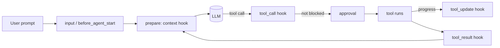
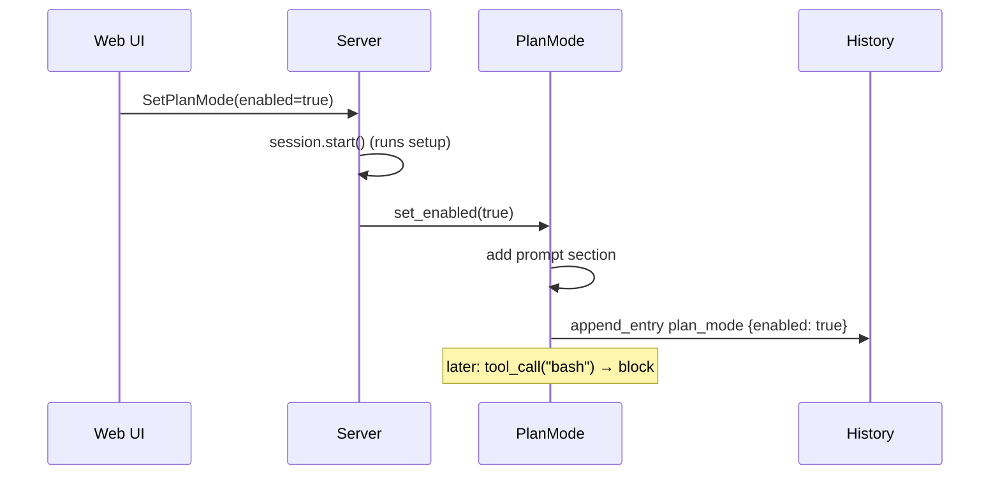

# 35 — Extending: tools and agent plugins

> **Who this is for:** a developer who wants to add tools or change how the agent behaves, without changing the core.
> **What you need first:** [30 Architecture](30-architecture.md) (the `session` and `plugins` layers), [31 How one turn flows](31-turn-flow.md) (the loop, `prepare_next_turn`), [33 Developer tutorial](33-dev-tutorial.md) (your first plugin, `word_count`). Words: [plugin](glossary.md#plugin), [tool](glossary.md#tool), [session](glossary.md#session), [history](glossary.md#history), [plan mode](glossary.md#plan-mode).
> **What you will learn:** where the built-in tools live, what a plugin can do (`PluginAPI`), every hook and when it runs, prompt sections, custom entries, and how `RedactSecrets` and `PlanMode` use all of this.
> **Code paths covered:** `packages/simp_agent/src/simp_agent/session/__init__.py` (`PluginAPI`, `AgentSession`), `.../agent/__init__.py` (`AgentTool`, `ToolContext`), `.../coding/tools.py` (`make_tools`, `TOOLS`), `.../ai/__init__.py` (`CustomEntry`), `.../plugins/` (`build_plugins`, `redact_secrets.py`, `plan_mode.py`), `apps/server/src/simp_server/server.py` (how the server loads plugins, `SetPlanMode`).
> **Verified at commit:** `17cae3b`, from code. Nothing was run for this chapter.

**Back:** [34 Extending: providers](34-providers.md) · **Next:** [36 Extending: server plugins — Sandbox, Store, Auth](36-server-plugins.md)

## 1. The big picture

There are two ways to extend the agent:

- **Add a tool.** A [tool](glossary.md#tool) is something the model can call, like `read` or `bash`.
- **Add a plugin.** A [plugin](glossary.md#plugin) is a Python object that the [session](glossary.md#session) calls at fixed moments ([hooks](glossary.md#hook)). A plugin can add tools, but it can also block calls, change results, change what the model sees, or add text to the system prompt.

Plugins are the main way. You do not edit the loop; you plug into it.

## 2. Tools

### 2.1 What a tool is

A tool is an `AgentTool` (in `agent/__init__.py`). It has:

| Field | Meaning |
|---|---|
| `name` | What the model calls it, e.g. `"read"`. |
| `description` | Text the model reads to decide when to use it. |
| `parameters` | A JSON schema for the arguments. |
| `execute(args, ctx)` | An `async` function. Returns the result **text**. |
| `prepare_arguments(args)` | Optional. Fixes raw arguments before they are checked. |

`ctx` is a `ToolContext`: `cancel` (an event set on abort), `env` (the [execution environment](glossary.md#execution-environment): all file and shell IO goes here), `cwd`, and `on_update(text)` (send progress to the UI).

**Why `ctx.env` and not `open()`?** So the same tool works on your laptop and inside a [sandbox](glossary.md#sandbox) ([23](23-sandboxes.md)). A tool that calls `open()` directly skips the sandbox.

### 2.2 The built-in tools

The built-in tools are in `coding/tools.py`. `make_tools()` returns a plain list: `read`, `write`, `edit`, `bash`, `grep`, `find`, `ls`. `TOOLS = make_tools()` is the default list.

There is no global "tool registry". The list *is* the registry: each session has `agent.tools`, a list. When you create `AgentSession(tools=None)` it copies `TOOLS`. You can pass your own list instead.

A plugin changes this list with `register_tool` / `unregister_tool` (section 3). Registering a tool with a name that already exists **replaces** the old one.

## 3. A plugin and `PluginAPI`

A plugin is any object. It needs no base class. All hooks are optional: the session calls a hook only if the object has a method with that name. Methods can be normal or `async`.

The name comes from the `name` attribute (or the class name if there is none). The name is used for config, error events and custom entries.

In `setup(api, config)` the plugin gets a `PluginAPI`. This is everything a plugin can do with its session:

| Method | What it does |
|---|---|
| `register_tool(tool)` / `unregister_tool(name)` | Add, replace or remove a tool. |
| `add_prompt_section(id, value, order)` / `remove_prompt_section(id)` | Add or remove part of the system prompt ([prompt section](glossary.md#prompt-section), section 5). |
| `append_entry(type, data)` | Save plugin data in history ([custom entry](glossary.md#custom-entry), section 6). |
| `send_message(text, mode)` | `steer`, `follow_up`, or `prompt` (starts a run if idle). |
| `set_model(model)` | Switch the model. |
| `abort()` | Stop the current run. |
| `get_messages()` | The session history. |
| `env`, `cwd` | The execution environment and folder. |
| `emit(type, data)` | Send your own event to subscribers (the UI, logs). |

## 4. Hooks: when each one runs

| Hook | When | Return | Error behaviour |
|---|---|---|---|
| `setup(api, config)` | Once, at session start (first prompt) | — | reported |
| `session_start()` | After all `setup`s | — | reported |
| `input(text)` | Each user prompt | `{"handled": True}` stops it; `{"text": ...}` changes it | reported |
| `before_agent_start(info)` | After `input`. `info` has `prompt`, `messages` | `{"messages": [...]}` adds extra messages (strings become user messages) | reported |
| `context(messages)` | Before **every** model call | a new list; `None` or `[]` keeps the old view | reported |
| `tool_call(call)` | Before a tool runs, **before** approval | `{"block": reason}` or `{"args": {...}}` | **blocks the call** |
| `tool_update(call, text)` | Each progress line from a tool | new text, or `None` | reported |
| `tool_result(call, result)` | After a tool runs | dict of fields to change, e.g. `{"content": ...}` | reported |
| `on_event(e)` | Every session event (not `plugin_error`) | — | reported |
| `session_shutdown()` | When the session shuts down | — | reported |

"Reported" means: the session catches the error, sends a `plugin_error` event (plugin name, hook, error text) and goes on. One bad plugin does not stop the agent.

`tool_call` is different on purpose: if it raises, the call is **blocked**. This is "fail closed". A safety check that crashes must not let the call through.

### 4.1 Order between plugins

Plugins run in list order. Each hook combines results in its own way:

- `tool_call`: the **first** block wins. `args` changes stack up.
- `tool_result`: each plugin's changes are merged into the result, in order.
- `context`: **chained** — each plugin gets the output of the one before.
- `input`: the text is passed along; the first `handled` stops.

### 4.2 `context` is a view, not history

The `context` hook runs inside the session's "prepare" step. Before each model call the loop calls `prepare_next_turn` ([31](31-turn-flow.md#3-agent-the-loop)). The session then:

1. compacts if needed ([compaction](glossary.md#compaction)),
2. builds the view the model sees (`build_view`),
3. runs every plugin's `context` hook on that view.

Changes here go **only** to the model. The saved [history](glossary.md#history) is not changed. The same hook also runs on the text sent to the model during compaction.

## 5. Prompt sections

The system prompt is not one string. It is a set of **sections**, each with an `id`, an `order` and a value. Before each turn they are sorted by `order` (then by when they were first added) and joined with blank lines. Empty sections are skipped.

| id | order | From |
|---|---|---|
| `coding` (or `base` if you pass `system_prompt`) | 0 | the default coding prompt, built from the tools and `cwd` |
| `context_file` | 10 | `AGENTS.md` / `CLAUDE.md` ([context file](glossary.md#context-file)) |
| your plugin's | 100 by default | `add_prompt_section` |

A value can be a string or a function `fn(ctx) -> str` (sync or async). A function runs **every turn**, so it can show fresh data. `ctx` has `tools`, `cwd`, `model`, `messages`.

Adding again with the same `id` replaces the value but keeps the first position among equal orders.

## 6. Custom entries

A plugin often has **state** that must survive a restart. For example: "is plan mode on?". Use `append_entry(type, data)`.

It creates a `CustomEntry(type, data)` and:

- adds it to history,
- saves it in the store right away (if there is a store),
- sends a `message_end` event.

A custom entry is **never sent to the LLM**. When the session is loaded again, the entries are back in `get_messages()`. In `setup`, a plugin reads the **last** entry of its type to restore its state. `PlanMode` does exactly this.

## 7. Example: `RedactSecrets`

File: `plugins/redact_secrets.py`. Goal: secrets must not reach the model, the UI or the logs.

- **`setup`**: collects secret values: `config["secrets"]`, plus (if `env` is not `False`) every environment variable whose name has `KEY`, `TOKEN`, `SECRET` or `PASSWORD`. Values shorter than 8 characters are ignored. Longest first, so a long secret is not half-masked by a shorter one.
- **`mask(text)`**: replaces known values, then known patterns (`sk-…` keys, JWTs, AWS `AKIA…`, GitHub `ghp_…` tokens) with `[REDACTED]`.
- **`tool_result`**: masks the result content. Returns `None` if nothing changed.
- **`tool_update`**: masks progress text before the UI sees it.
- **`context`**: masks **every** string in the view — text, thinking, tool call arguments — on copies. On message objects it skips the fields `id`, `signature`, `type`, `role`: those are provider data and masking them would break the request.

Why both `tool_result` and `context`? `tool_result` cleans what is saved. `context` also catches secrets the user typed, or that are in old history.

The server always loads it and passes the API keys it knows as `secrets` (`server.py`).

## 8. Example: `PlanMode`

File: `plugins/plan_mode.py`. Goal: a read-only switch ([plan mode](glossary.md#plan-mode), the **Plan** button in [11](11-web.md#4-plan-mode)).

- **`setup`**: finds the last `CustomEntry` of type `plan_mode`. If there is one, uses its `enabled`; otherwise `config["enabled"]` (default off).
- **`_apply(on)`**: on → `add_prompt_section("plan_mode", PROMPT, 1000)` (order 1000: the end of the prompt); off → removes it.
- **`set_enabled(on)`**: applies it and saves `append_entry("plan_mode", {"enabled": on})`, so it survives a restart.
- **`tool_call`**: if on and the tool is `write`, `edit` or `bash`, returns `{"block": "plan mode is on (read-only)"}`.

So it uses three sockets at once: a prompt section (tell the model), a hook (enforce it), a custom entry (remember it). The prompt alone is not enough — a model can ignore text — so the hook is the real guard.

## 9. How plugins are loaded

- `build_plugins(names)` in `plugins/__init__.py` maps names to classes. Known names: `redact_secrets`, `plan_mode`. An unknown name raises `ValueError`.
- The **server** always loads `redact_secrets` and `plan_mode`, then the names in the [profile](glossary.md#profile)'s `plugins` list ([33 §3](33-dev-tutorial.md#3-register-the-name-and-turn-it-on)).
- The **CLI** loads no plugins.
- Note: the profile `plugins` list is not the `[plugins]` table in `settings.toml` (that one is for server plugins, [36](36-server-plugins.md)).
- There is no loading of plugins from outside the repo. To add one, add it to `known` in `build_plugins`.

## 10. Planned (Stage 4)

These are reserved. They are **not built yet**; this section will be filled when they are.

- **MCP** — *planned.* Tools from MCP servers.
- **Skills** — *planned.*
- **Memory** — *planned.*
- **Sub-agents** — *planned.*

## 11. Summary

- Tools are a plain list on the session; `make_tools()` gives the built-ins.
- A plugin is an object with optional hooks; `PluginAPI` is what it can do.
- `tool_call` fails closed; other hooks report errors and go on.
- `context` changes only what the model sees, never history.
- Prompt sections build the system prompt; custom entries keep plugin state across restarts.
- `RedactSecrets` and `PlanMode` are small, real models to copy.

**Back:** [34 Extending: providers](34-providers.md) · **Next:** [36 Extending: server plugins — Sandbox, Store, Auth](36-server-plugins.md)

**Built on by:** [36 Extending: server plugins](36-server-plugins.md), 37 Testing and evals (not written yet).
