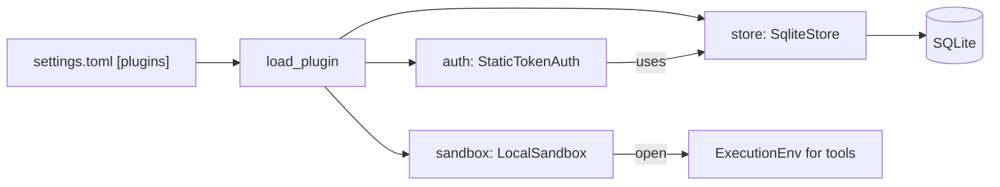

# 36 — Extending: server plugins (Sandbox, Store, Auth)

> **Who this is for:** a developer who wants to change *where* the server runs tools, *where* it keeps data, or *how* it checks who you are.
> **What you need first:** [23 Sandboxes](23-sandboxes.md) (what a sandbox is, Local vs Docker), [21 Configuration](21-configuration.md#5-plugins-and-sandbox) (the `[plugins]` table), [32 The server inside](32-server-inside.md) (runs, SQLite tables). Words: [sandbox](glossary.md#sandbox), [execution environment](glossary.md#execution-environment), [access token](glossary.md#access-token), [plugin](glossary.md#plugin).
> **What you will learn:** the three server slots, the methods each one must have, the default classes, how `"module:Class"` is loaded, and how to test a new sandbox with `EnvConformance`.
> **Code paths covered:** `apps/server/src/simp_server/server.py` (`Sandbox`, `Store`, `Auth`, `LocalSandbox`, `StaticTokenAuth`, `DEFAULT_PLUGINS`, `load_plugin`, `load_settings`, `create_app`), `.../store.py` (`SqliteStore`), `.../sandboxes/docker.py` (`DockerSandbox`), `packages/simp_agent/src/simp_agent/agent/env.py` (`ExecutionEnv`), `packages/simp_agent/src/simp_agent/testing/env_conformance.py` (`EnvConformance`).
> **Verified at commit:** `82ecfa7`, from code. Nothing was run for this chapter.

**Back:** [35 Extending: tools and agent plugins](35-tools-plugins.md) · **Next:** 37 Testing and evals (not written yet)

## 1. Two kinds of "plugin"

The word *plugin* means two different things in this project. Do not mix them up.

| | Agent plugin ([35](35-tools-plugins.md)) | Server plugin (this chapter) |
|---|---|---|
| What it changes | how the agent behaves in a turn | where tools run, where data lives, who may log in |
| Where it is chosen | profile `plugins = [...]` (a list of names) | `[plugins]` table (one `"module:Class"` per slot) |
| How many | any number | exactly one per slot |
| Used by the CLI? | no | no (server only) |

A server plugin fills a **slot**. There are three slots: `sandbox`, `store`, `auth`. Each slot has a small interface (a Python `Protocol`) and one default class.



**Why slots?** The core server should not care if files live in a folder or a container, or if users live in SQLite or somewhere else. Each slot is a seam you can swap without editing `server.py`.

## 2. How a slot is loaded

The defaults are in `server.py`:

```python
DEFAULT_PLUGINS = {"sandbox": "simp_server.server:LocalSandbox", "store": "simp_server.store:SqliteStore",
                   "auth": "simp_server.server:StaticTokenAuth"}
```

`load_settings` builds the final table in this order (later wins):

1. `DEFAULT_PLUGINS`
2. `SIMP_SANDBOX=docker` in the environment → `sandbox = "simp_server.sandboxes.docker:DockerSandbox"`
3. your `[plugins]` table in `settings.toml`

Then `load_plugin` turns the string into a class. It is two lines: split at `:`, import the module, get the attribute.

```python
def load_plugin(path: str):
    mod, _, name = path.partition(":")
    return getattr(import_module(mod), name)
```

This is the developer view; the operator view of the same table is [21 §5](21-configuration.md#5-plugins-and-sandbox). Any class the server's Python can import works. Put your module in a package installed in the server's environment, then name it:

```toml
[plugins]
sandbox = "my_company.sandboxes:K8sSandbox"
```

`create_app` builds the three objects once, at start:

```python
store = load_plugin(pl["store"])(settings)
sandbox = load_plugin(pl["sandbox"])(settings)
auth = load_plugin(pl["auth"])(store)
```

Note the arguments: **Store and Sandbox get `settings`** (the whole dict). **Auth gets the store**, not settings. A wrong module or class name fails here, at boot (`ImportError` / `AttributeError`), not later.

## 3. The Sandbox slot

### 3.1 The interface

```python
class Sandbox(Protocol):
    async def open(self, session_id: str) -> ExecutionEnv: ...
    async def close(self, session_id: str) -> None: ...
    async def remove(self, session_id: str) -> None: ...  # delete the workspace files (session deleted)
```

| Method | When the server calls it | What it must do |
|---|---|---|
| `open(id)` | a session is loaded into memory | return an [execution environment](glossary.md#execution-environment) for that session; files from before must still be there |
| `close(id)` | idle close, limit eviction, server stop | free running things (processes, containers); **keep the files** |
| `remove(id)` | the session is deleted | free everything and **delete the files** |
| `close_all()` | server stop | *optional*: the server calls it only if it exists (`hasattr`) |

When each event happens is in [23 §6](23-sandboxes.md#6-when-a-sandbox-is-closed).

The thing `open` returns is the real work. All tools do file and shell IO through it ([35 §2.1](35-tools-plugins.md#21-what-a-tool-is)). It must follow `ExecutionEnv` (`agent/env.py`): `read_file`, `write_file`, `read_bytes`, `write_bytes`, `list`, `exec`. If it has a `root` attribute, the server uses it as the tools' working folder; if not, the working folder is `/`.

### 3.2 The defaults

- **`LocalSandbox`** (`server.py`): `open` makes `<data_dir>/workspaces/<session_id>` and returns a `LocalEnv` rooted there. `close` does nothing. `remove` deletes the folder. It also moves an old Stage 2 folder (`<data_dir>/sandboxes/<id>`) into place. No isolation: tools run as the server user.
- **`DockerSandbox`** (`sandboxes/docker.py`): `open` starts a locked-down container on the same folder and returns a `DockerEnv` (a `LocalEnv` whose `exec` runs inside the container). `close` removes the container. It has `close_all`. Full story: [23 §4](23-sandboxes.md#4-how-dockersandbox-works).

**One safety check knows the default by name.** `check_sandbox` refuses more than one user when the sandbox string ends with `:LocalSandbox` (unless `allow_local_sandbox = true`): the server will not start, and sign-up of a second user gets **409**. Your own sandbox class is not checked: it is your job to make it safe.

### 3.3 Testing a new sandbox: `EnvConformance`

`EnvConformance` (`simp_agent.testing.env_conformance`) is a ready test suite for any `ExecutionEnv`. You subclass it and give one fixture, `make_env`, that returns a function `root -> env` (the env may be awaitable); the env's files live under `root`. You get these tests for free:

| Test | Checks |
|---|---|
| `test_text_and_bytes_round_trip` | write then read, text and bytes |
| `test_list` | `list` returns `{name, is_dir, size}` in name order |
| `test_containment` | paths cannot escape the root |
| `test_exec_exit_code_and_output` | exit code and output of `exec` |
| `test_exec_sees_written_files` | `exec` sees files written by `write_file` |
| `test_exec_cwd` | `exec` runs in the given folder |
| `test_exec_timeout_kills_tree` | timeout kills the command and its children |
| `test_exec_cancel` | the cancel event stops the command |

Two real users of it, a good model for yours:

```python
# packages/simp_agent/tests/test_env.py
class TestLocalEnvConformance(EnvConformance):
    @pytest.fixture
    def make_env(self):
        return lambda root: LocalEnv(str(root))

# apps/server/tests/test_docker_sandbox.py (skipped when Docker is not there)
class TestDockerEnvConformance(EnvConformance):
    @pytest.fixture
    def make_env(self, sandbox, tmp_path):
        async def make(root):
            sandbox.workspaces_dir = root.parent
            return await sandbox.open(root.name)
        return make
```

**Why this matters:** the tools assume these rules. If your env lets `../` escape, or a timeout leaves a child process alive, the agent still "works" but is unsafe. Passing the suite is the minimum bar. More on tests: 37 Testing and evals (not written yet).

## 4. The Store slot

```python
class Store(Protocol):  # see store.SqliteStore for the full method list
    async def open(self) -> None: ...
```

The Protocol is only a marker. The real contract is **every method the server calls on the store**, and `SqliteStore` (`store.py`) is the list. A new store must have all of them:

| Group | Methods |
|---|---|
| life | `open`, `close` |
| users and tokens | `add_user`, `user_by_token`, `set_password`, `login`, `logout`, `list_users`, `count_users`, `user_active`, `rotate_token`, `revoke` |
| sessions | `add_session`, `get_session`, `list_sessions`, `set_title`, `delete_session` |
| history | `add_entry`, `entries` |
| money | `add_usage`, `spent` (`usage` exists too, used only by tests) |

`set_password`, `list_users`, `rotate_token` and `revoke` are used only by the admin commands (`simp-server …`), which load the store through the same `[plugins]` setting (`with_store`). A store that skips them breaks those commands, not the web app.

Rules the server relies on (read `SqliteStore` for the exact shape of each row):

- Every session method takes `user_id` first. A store must never return another user's session. This is the line between users ([26](26-security.md)).
- Tokens are kept hashed (`sha`), passwords with scrypt (`hash_password`). Keep it that way in your store.
- `entries` returns history in `seq` order; the server rebuilds a session from it ([32](32-server-inside.md)).

**Why no full Protocol?** Simplicity: there is one store today. If you write a second one, copying the method list from `SqliteStore` is the honest spec.

## 5. The Auth slot

```python
class Auth(Protocol):
    async def authenticate(self, request: Request) -> dict | None: ...  # user {id, name} or None
```

One method. It gets the FastAPI `Request` and returns the user (a dict with at least `id` and `name`) or `None`. `None` means **401 bad token**. The server calls it on every API request. On an open event stream it checks again only when no event came for a heartbeat period, so a revoked user is cut off at the next quiet moment, not at once.

The default, `StaticTokenAuth`, reads `Authorization: Bearer <token>` and asks the store (`user_by_token`). That is all. Login with a password (`/api/login`) is not part of Auth: it is a store method that hands out a token ([22](22-users.md)).

Because Auth gets the store in its constructor, a new Auth can still use the store's users. Example idea: trust a header set by your company's proxy, then look the user up by name. (Not in the code; if you do this, make sure only the proxy can reach the server.)

## 6. Writing your own: a checklist

1. Write a class with the slot's methods. Constructor: `(settings)` for sandbox and store, `(store)` for auth.
2. Install it where the server's Python can import it.
3. Set `[plugins] <slot> = "module:Class"` ([21 §5](21-configuration.md#5-plugins-and-sandbox)).
4. Sandbox: pass `EnvConformance`. Store: copy the store calls in `apps/server/tests/test_server.py` as a start. Auth: test 401 on a bad request.
5. Start the server. A bad name fails at boot.

## What to remember

- Three slots: `sandbox`, `store`, `auth`, one `"module:Class"` each, in `[plugins]`.
- Sandbox: `open`/`close`/`remove`; `close` keeps files, `remove` deletes them. Test with `EnvConformance`.
- Store: the real spec is `SqliteStore`'s methods; always scope by `user_id`.
- Auth: one method, request in, user or `None` out.

**Back:** [35 Extending: tools and agent plugins](35-tools-plugins.md) · **Next:** 37 Testing and evals (not written yet)

**Built on by:** 37 Testing and evals (not written yet): `EnvConformance`, fake server.
