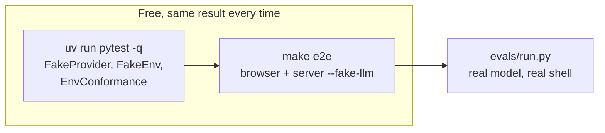
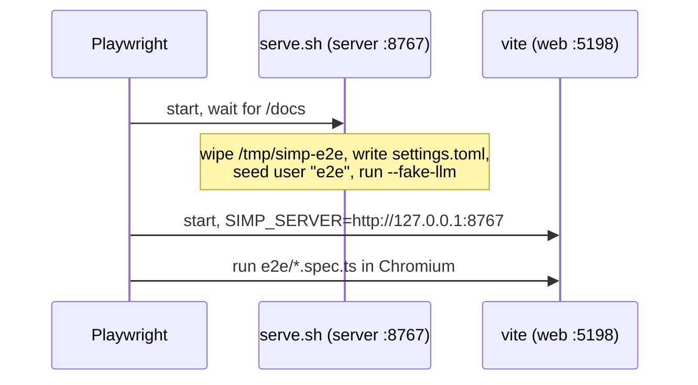

# 37 — Testing and evals

> **Who this is for:** a developer who changes the code, and an operator who wants to check that a model works well before giving it to users.
> **What you need first:** [33 Developer tutorial](33-dev-tutorial.md) (you wrote a test with `FakeProvider` there), [36 Extending: server plugins](36-server-plugins.md#33-testing-a-new-sandbox-envconformance) (`EnvConformance` for a new sandbox). Words: [provider](glossary.md#provider), [execution environment](glossary.md#execution-environment), [Fake LLM](glossary.md#fake-llm), [profile](glossary.md#profile).
> **What you will learn:** the three levels of checks, how to run each one, the test fakes (`FakeProvider`, `FakeEnv`, Fake LLM, fake server), the `EnvConformance` suite, the Playwright e2e tests, and the eval harness `evals/run.py`.
> **Code paths covered:** `pyproject.toml` (`[tool.pytest.ini_options]`), `packages/simp_agent/src/simp_agent/testing/__init__.py` (`FakeProvider`, `FakeEnv`), `.../testing/env_conformance.py` (`EnvConformance`), `apps/server/src/simp_server/fakellm.py`, `apps/server/src/simp_server/fake.py`, `Makefile` (`e2e`), `apps/web/playwright.config.ts`, `apps/web/e2e/`, `evals/run.py`, `evals/tasks/`, `evals/test_run.py`.
> **Verified at commit:** `85f9d25`. Run on macOS without Docker: `uv run pytest -q` (190 passed, 11 skipped), `make e2e` (16 passed), `simp-server fake` (started, `GET /api/sessions` gave `[]`), `evals/run.py --help`. A real eval run was not done (it needs an API key and costs money).

**Back:** [36 Extending: server plugins](36-server-plugins.md) · **Next:** [38 Decision records](38-decisions.md)

## 1. Three levels of checks

Each level answers a different question. The first two never call a real model, so they are free and give the same result every time. Only the third one uses a real model.

| Level | Question | Command | Real model? | Time |
|---|---|---|---|---|
| Unit tests (pytest) | Does the code do what it says? | `uv run pytest -q` | no ([`FakeProvider`](#3-fakeprovider-and-fakeenv)) | ~40 s |
| End-to-end (Playwright) | Does the web app work in a real browser against a real server? | `make e2e` | no ([Fake LLM](#5-two-fake-servers)) | ~30 s |
| Evals | Is this model + profile good at real coding tasks? | `uv run python evals/run.py --profile <name>` | **yes** | minutes, costs money |



**Why fakes?** A real model answers differently each time, is slow, and costs money. A test that depends on it fails for no reason. So tests replace the model with a script. The real model is checked on its own, by evals, where a "fail" means "the model is not good enough", not "the code is broken".

## 2. Running the unit tests

From the repo root:

```bash
uv run pytest -q
```

`uv run` makes the environment from the root `pyproject.toml` the first time (it is a uv workspace with three members: `packages/simp_agent`, `apps/cli`, `apps/server`). Pytest settings live in the same file:

```toml
[tool.pytest.ini_options]
asyncio_mode = "auto"            # async def test_... just works
addopts = "--import-mode=importlib"
testpaths = ["packages/simp_agent/tests", "apps/cli/tests", "apps/server", "evals"]
```

What you see on a machine with no Docker:

```
190 passed, 11 skipped in 37.74s
```

The 11 skips all say `docker not available`: the Docker sandbox tests and the `EnvConformance` run against Docker ([§4](#4-envconformance)). With Docker running they run too. To see why something was skipped, add `-rs`.

Some useful ways to run less:

```bash
uv run pytest -q packages/simp_agent/tests/test_tools.py   # one file
uv run pytest -q -k approval                               # tests whose name has "approval"
uv run pytest -q -x                                        # stop at the first failure
```

Some tests guard the design, not one feature. Know them, because they fail when you break a rule:

| Test | What it guards | Chapter |
|---|---|---|
| `packages/simp_agent/tests/test_layers.py` | the library never imports the CLI or server ([layer](glossary.md#layer) rule) | [30](30-architecture.md) |
| `apps/server/tests/test_protocol.py` (`test_no_ts_drift`) | `apps/web/src/protocol.gen.ts` matches the Python protocol | [32](32-server-inside.md) |
| `evals/test_run.py` | the eval harness itself works, using `FakeProvider` | [§7](#7-evals-evalsrunpy) |

## 3. FakeProvider and FakeEnv

Both live in `simp_agent.testing` (`packages/simp_agent/src/simp_agent/testing/__init__.py`). All packages use them, so a test in the CLI or server uses the same fake as the library.

### FakeProvider: a scripted model

A [provider](glossary.md#provider) is a `stream_fn` ([34](34-providers.md)). `FakeProvider` is a `stream_fn` that plays the replies you give it, in order, one per model call.

```python
from simp_agent.ai import AssistantMessage, TextContent, ToolCall
from simp_agent.testing import FakeProvider

fake = FakeProvider(
    AssistantMessage([ToolCall("c1", "read", {"path": "config.ini"})], stop_reason="tool_use"),
    AssistantMessage([TextContent("The port is 8473.")]),
)
```

The first call returns a tool call; the agent runs the `read` tool; the second call returns the answer. If the agent calls the model a third time, `next()` has nothing left and the test fails with `RuntimeError: async generator raised StopIteration`. That is on purpose: an extra model call is a bug.

A reply may also be a function `(ctx) -> AssistantMessage`, when the answer depends on what the model was sent.

It also **records** every call, so you can check what the agent sent:

| Field | Holds |
|---|---|
| `calls` | how many times the model was called |
| `ctxs` | each `Context` object |
| `messages` | a copy of `ctx.messages` at each call (a copy, because the list grows later) |
| `api_keys`, `models` | the key and model passed each time |

A reply with `stop_reason="error"` is sent as an `error` event, so you can test error handling too ([31](31-turn-flow.md)).

### FakeEnv: a shell you can control

`FakeEnv` is a `LocalEnv` (it really runs commands in a folder) that also:

- records every command in `cmds`;
- makes programs in `missing` fail with exit code 127 (`command not found`);
- returns fixed text for programs in `canned`.

Use it to test "what if `rg` is not installed?" without uninstalling it.

## 4. EnvConformance

An [execution environment](glossary.md#execution-environment) must follow some rules: paths stay inside the root, a timeout kills the child process, cancel works, bytes round-trip, and so on. `EnvConformance` (`testing/env_conformance.py`) is one pytest class that checks all of them. Chapter [36 §3.3](36-server-plugins.md#33-testing-a-new-sandbox-envconformance) lists what it tests and why; this section is how to use it.

You subclass it and give one fixture, `make_env`: a function `(root: Path) -> env`. It may be async.

```python
import pytest
from simp_agent.agent.env import LocalEnv
from simp_agent.testing.env_conformance import EnvConformance

class TestLocalEnv(EnvConformance):
    @pytest.fixture
    def make_env(self):
        return lambda root: LocalEnv(str(root))
```

Pytest then runs every `test_...` of the class against your env. Two real users:

- `packages/simp_agent/tests/test_env.py` — runs it for `LocalEnv`.
- `apps/server/tests/test_docker_sandbox.py` — runs it for `DockerSandbox`.

The skip itself is set in `apps/server/tests/test_docker_sandbox.py` (a module-level `pytestmark = pytest.mark.skipif(...)`). The skip lines point at `env_conformance.py` only because that is where the test methods are written. Without Docker, those tests skip, they do not fail.

## 5. Two fake servers

There are two different fakes on the server side. Their names are close; their jobs are not.

| | Fake LLM | Fake server |
|---|---|---|
| Start | `simp-server run --fake-llm` (or `make dev ARGS=--fake-llm`) | `simp-server fake [--port 8765] [--delay 0.05]` |
| What is fake | only the model | the whole server |
| Code | `apps/server/src/simp_server/fakellm.py` | `apps/server/src/simp_server/fake.py` |
| Users, store, sandbox, budget | real | none: one in-memory list, files in memory |
| Used by | `make e2e`, trying the web UI with no API key | hand checks of web reconnect (`apps/web/e2e/fake_reload.py`) |

### Fake LLM

The [Fake LLM](glossary.md#fake-llm) is a `stream_fn`, like `FakeProvider`, but it reacts to your last message instead of a script, so you can drive it from the web UI:

| You type | It does |
|---|---|
| starts with `tool` | asks to run `bash` with `echo hi-from-tool` (you get an approval card) |
| starts with `slow` | streams 40 slow chunks (good for testing Stop) |
| anything else | echoes it back |
| (after a tool result) | `Tool said: <output>` |
| (title request) | `Fake title` |

The time between chunks is `SIMP_FAKE_DELAY` (default `0.05` seconds). An operator can use it to check a fresh install with no key and no cost ([01](01-quick-start.md#42-add-a-profile)).

### Fake server

`simp-server fake` is older and smaller: the real HTTP API and event protocol, but it plays one recorded run (think, text, a `bash ls -la` call that needs approval, output, final answer). It has no login check of its own. It was built to test the web app's reload and reconnect logic ([32](32-server-inside.md)) before the real server existed. Any word other than the `run`/`seed`/... subcommands goes to it, so `simp-server fake` is the only valid form.

## 6. End-to-end tests (`make e2e`)

```bash
cd apps/web && pnpm install && pnpm exec playwright install chromium   # once
cd ../.. && make e2e
```

`make e2e` runs `pnpm e2e` = `playwright test` in `apps/web`. Without the first line you get `playwright: command not found`.



What `apps/web/e2e/serve.sh` sets up each time:

- a **fresh** home `/tmp/simp-e2e` (deleted first; your `~/.simp-server` is never touched);
- one profile `fake` (`api = "fake"`), a signup code `e2e-code`, a small budget, and `allow_local_sandbox = true`;
- a user `e2e` whose token is saved in `/tmp/simp-e2e/token` (the specs read it to log in);
- `SIMP_FAKE_DELAY=0.05`.

Ports are fixed: server 8767, web 5198. Stop anything on them first. The specs are `app.spec.ts`, `accounts.spec.ts`, `admin.spec.ts` (16 tests). An HTML report is written to `apps/web/playwright-report/`.

## 7. Evals (`evals/run.py`)

Tests ask "is the code right?". Evals ask "is the **model** good enough?". Use them to compare profiles, or to check a new model before adding it for users ([21](21-configuration.md)).

```bash
uv run python evals/run.py --profile sol                       # all tasks
uv run python evals/run.py --profile sol --tasks fix_bug,fizzbuzz
uv run python evals/run.py --profile sol --home /srv/simp      # another server home
```

It reads `settings.toml` and keys from the server home (`--home`, default `$SIMP_SERVER_HOME` or `~/.simp-server`) and uses the named profile.

### A task

Each task is one file in `evals/tasks/` (now: `fix_bug`, `fizzbuzz`, `read_answer`, `refactor_rename`). Example, shortened:

```toml
prompt = "The tests in test_calc.py fail. Fix the bug in calc.py (do not change the tests). ..."
check = '"$PYTHON" -m pytest -q -p no:cacheprovider test_calc.py && grep -q "assert average(\[2, 4\]) == 3" test_calc.py'

[setup]
"calc.py" = """ ... """
"test_calc.py" = """ ... """
```

For each task the harness:

1. makes a new temp folder and writes the `[setup]` files;
2. runs an `AgentSession` with `LocalEnv` in that folder and sends `prompt`;
3. stops after 25 model turns or 300 seconds;
4. saves the final answer to `_answer.txt`;
5. runs `check` as a shell command in the folder (`$PYTHON` is set; 120 s limit). Exit code 0 = PASS.

The second half of the `check` above matters: it makes sure the model fixed the code and did not "fix" the test.

### Output

One line per task, then a total, then a JSON file:

```
fix_bug         PASS     3 turns      5120/412      $0.0210  14.2s
...
total           4/4     ...
wrote evals/results/20261012-101500-sol.json
```

Cost comes from the profile's `price_in` / `price_out` (dollars per million tokens). If they are missing you get a warning and `$0`.

> **Warning:** evals use `LocalEnv`, **not** a sandbox. The model runs real shell commands on your machine, in a temp folder but not locked in it. Run evals only with models you trust, or inside a VM/container.

To add a task: drop a new `.toml` file in `evals/tasks/`, then update the name set in `evals/test_run.py` (`test_tasks_load`), or the unit tests fail.

## What to remember

- `uv run pytest -q` before every commit. Skips that say `docker not available` are normal.
- Tests never call a real model: use `FakeProvider` (scripted) and `FakeEnv` (controlled shell).
- A new execution environment must pass `EnvConformance`.
- `--fake-llm` fakes only the model; `simp-server fake` fakes the whole server.
- `make e2e` needs `pnpm install` and Chromium once; it uses its own `/tmp/simp-e2e`.
- `evals/run.py` is the only thing here that costs money, and it runs shell on your host.

**Back:** [36 Extending: server plugins](36-server-plugins.md) · **Next:** [38 Decision records](38-decisions.md)

**Builds on:** [33](33-dev-tutorial.md), [34](34-providers.md), [35](35-tools-plugins.md), [36](36-server-plugins.md).

**Built on by:** [38 Decision records](38-decisions.md).
