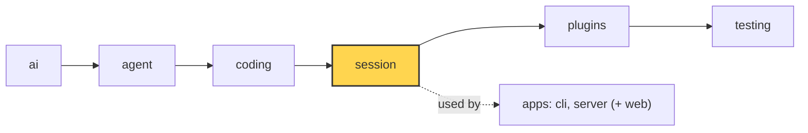

# simp-agent: a build book

This book teaches you how to **build** simp-agent, step by step. It is not a user manual.

**Who it is for:** developers who know Python (and a little TypeScript for ch 30) and want to understand how a coding agent works inside.

**Pinned commit:** `2fc2776` (master). Every path, symbol and code excerpt matches this commit.

## How the book goes

Chapter 00 shows the whole system. Then we start from the smallest piece and add one capability per chapter. Each chapter builds on the one before it.

Each Part starts with a **big-picture page**: one picture and one table of all its blocks, with what goes IN and comes OUT of each.
The block numbers in the picture and the table are the same, in the order the steps run; a step from another Part has no number.

- [00 Overview: what we build](00-overview.md) — See the whole of simp-agent before building it piece by piece.
- [01 Part 1 big picture: the AI layer](01-part-1-ai.md) — All blocks of Part 1, their IN and OUT, on one page.
- [02 Part 1 · Pick + Clean](02-pick-clean.md) — Pick the right code for a model, and clean the chat history before it is sent.
  - [Reference · the `ai` objects](ref-objects.md) — every message, block and request field; JSON save/load.
- [03 Part 1 · Translate + Send](03-translate-send.md) — Turn our clean messages into one vendor's JSON, and open a stream to that vendor.
- [04 Part 1 · Parse](04-parse.md) — Turn streamed deltas into a complete assistant message, for all three vendors.
- [05 Part 1 · Label + test the pipeline](05-label-test.md) — Label every answer with who wrote it, read errors, and test the whole pipeline without a real model.
- [06 Part 2 big picture: the agent loop](06-part-2-agent.md) — All blocks of Part 2, their IN and OUT, on one page.
- [07 Part 2 · The agent loop](07-agent-loop.md) — Build the smallest loop that calls a model and runs tools.
- [08 Part 2 · Events and abort](08-events-abort.md) — Let callers watch the loop and stop it.
- [09 Part 2 · Steering](09-steering.md) — Let the user add messages while the agent works.
- [10 Part 2 · Hooks and approval](10-hooks-approval.md) — Check or change tool calls before and after they run.
- [11 Part 3 big picture: the coding layer](11-part-3-coding.md) — All blocks of Part 3, their IN and OUT, on one page.
- [12 Part 3 · Execution environment](12-exec-env.md) — Give tools one safe place to touch files and run commands.
- [13 Part 3 · Coding tools](13-coding-tools.md) — Build read, write, edit, ls, grep, find and bash.
- [14 Part 3 · The system prompt](14-system-prompt.md) — Tell the model who it is and what the project wants.
- [15 Part 3 · Evals](15-evals.md) — Measure the agent on real tasks; when you add a capability later, you can add a case for it.
- [16 Part 4 big picture: the session layer](16-part-4-session.md) — All blocks of Part 4, their IN and OUT, on one page.
- [17 Part 4 · Sessions](17-session.md) — Keep a conversation across turns and save it.
- [18 Part 4 · Plugins](18-plugins.md) — Add behaviour without changing the core.
- [19 Part 4 · Retry](19-retry.md) — Retry failed model calls with backoff.
- [20 Part 4 · Compaction](20-compaction.md) — Keep long conversations inside the context window.
- [21 Part 4 · Context overflow](21-overflow.md) — Recover when the model says the context is too big.
- [22 Part 4 · Profiles and built-in plugins](22-profiles-plugins.md) — Pick models by profile and ship two real plugins.
- [23 Part 5 big picture: the system](23-part-5-system.md) — All blocks of Part 5, their IN and OUT, on one page.
- [24 Part 5 · The CLI](24-cli.md) — Wrap the session in a terminal app.
- [25 Part 5 · The server run](25-server-run.md) — Run a session on a server with a typed protocol.
- [26 Part 5 · Transport](26-transport.md) — Stream events to clients and take commands back.
- [27 Part 5 · Store and auth](27-store-auth.md) — Save users, sessions and events durably.
- [28 Part 5 · Limits](28-limits.md) — Stop runaway cost and free idle resources.
- [29 Part 5 · Docker sandbox](29-docker-sandbox.md) — Run each session's tools inside a container.
- [30 Part 5 · Web client](30-web-client.md) — Build the browser UI on the protocol.
- [31 Part 5 · System tests and deploy](31-system-tests-deploy.md) — Test the whole system and run it on one machine.
- [32 Choices, limits and extending](32-limits-choices-extend.md) — Know why it is built this way, where it stops, and how to grow it.

Also: [glossary](glossary.md) · [changelog](changelog.md)

## Chapter template

Every chapter has these parts, in this order:

1. **Goal** — one sentence.
2. **Where we are** — the shared architecture diagram with the new part marked, and one line in italics under it.
3. **Code in this chapter** — the commit, then a list of code paths with the names they hold.
4. **Problem** — what is missing without this part.
5. **Naive version** — 15–30 runnable lines; show where it breaks.
6. **Real design** — short excerpts with file path; why each part exists.
7. **Builds on / Next** links.

Format for parts 2 and 3 (from [17](17-session.md)):

````markdown
## Where we are



*This chapter starts the `session` layer (marked).*

Code in this chapter (commit `2fc2776`):

- `packages/simp_agent/src/simp_agent/session/__init__.py` — `SessionStore`, `AgentSession`
````

## Writing rules

- Plain, simple English. Short sentences.
- 1500–2500 words per chapter.
- Define a term at its first use and link it to the [glossary](glossary.md).
- Never invent behaviour: read the real code at the pinned commit.
- Explain "why", not only "what".
