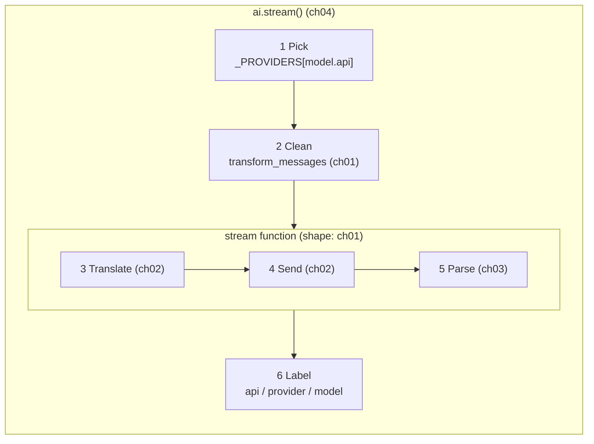

# Part 1 big picture: the AI layer

**In one sentence:** Part 1 builds `ai.stream()`. You give it a **Model** and a **Context**. It gives back a stream of small **events**, and the last event holds one finished **AssistantMessage**.

Read this page before [01](01-pick-clean.md), and come back to it any time you get lost in [01](01-pick-clean.md)–[04](04-label-test.md). Chapters follow the blocks below, in data-flow order: 01 Pick + Clean, 02 Translate + Send, 03 Parse, 04 Label + test. The strip at the top of each chapter shows which blocks it builds. It adds no new facts; it only puts the pieces of those four chapters side by side.

## The picture

Read it left to right on the top row (the question goes out), then right to left on the bottom row (the answer comes back). Blocks are steps. Cards on the arrows are the data passed between steps. Purple tags say which chapter builds the block.

## The blocks

| # | Block | What it does | IN | OUT | Code (file · function) | Chapter |
|---|---|---|---|---|---|---|
| 1 | Pick the driver | Look up `Model.api` in `_PROVIDERS` and get a stream function. Unknown api → `error` event. | `Model` | a stream function | `ai/__init__.py` · `stream()`, `_PROVIDERS` | [01](01-pick-clean.md#1-pick-_providers-register_provider) |
| 2 | Clean | Drop error/aborted replies, skip compaction/custom entries, add a result for tool calls with no result, fix thinking blocks for this model. | `Context.messages` | clean `messages` (new `Context`) | `ai/__init__.py` · `transform_messages()` | [01](01-pick-clean.md#2-clean-transform_messages) |
| 3 | Translate | Rewrite our messages and tools in the vendor's own JSON. | `Context` | vendor request | `ai/providers/*.py` · `_to_anthropic()`, `to_openai()`, `to_input()` + `request()`; tools are mapped inside `stream()` | [02](02-translate-send.md#3-translate--4-send-the-three-providers) |
| 4 | Send | Open one HTTP stream to the vendor with the key. | vendor request | raw chunks | `ai/providers/*.py` · `stream()` | [02](02-translate-send.md#3-translate--4-send-the-three-providers) |
| 5 | Parse | Turn raw chunks into events, one per piece, and fill the `AssistantMessage`. | raw chunks | events | `ai/providers/*.py` · `parse()`; `stream()` adds `start` and the last `done`/`error` | [03](03-parse.md) |
| 6 | Label | Write `api`, `provider`, `model` on every message an event carries, then pass each event on. | events | labelled events | `ai/__init__.py` · `stream()` | [04](04-label-test.md#the-entry-point-stream-runs-1-2-6) |

Words: a **vendor** is the model company (Anthropic, OpenAI). A **driver** is our plain name for its [stream function](glossary.md#stream-function). For Anthropic, `stream()` takes the final message from the SDK (`get_final_message()`) instead of building it in `parse()`.

Paths are under `packages/simp_agent/src/simp_agent/`.

## Which block is inside which

- **`ai.stream()` is the whole Part.** It does Pick (1), Clean (2) and Label (6) itself.
- **A stream function = Translate + Send + Parse** (3, 4, 5). Pick only *chooses* it; Clean and Label happen *outside* it, in `ai.stream()`.
- [01](01-pick-clean.md) fixes the **shape** of a stream function (`(model, context, api_key) → events`, never raises), the registry (Pick) and `transform_messages` (Clean).
- [02](02-translate-send.md) builds Translate and Send of the **real** stream functions (one file per vendor).
- [03](03-parse.md) builds the **Parse** step, for all three vendors.
- [04](04-label-test.md) builds `ai.stream()` around them (Label), and `FakeProvider`, which skips Translate/Send/Parse and just plays a scripted reply, to test the pipeline.
- Small extra: the built-in entries in `_PROVIDERS` first check for an API key. No key → an `error` event, and the vendor file is never called.

The small chart below shows only the nesting:

**Rule for the whole Part:** `ai.stream()` never raises. Unknown api, no key, network error: each one becomes an `error` event with an `AssistantMessage` whose `stop_reason` is `"error"`.

## The objects

| Object | Fields | Meaning |
|---|---|---|
| [Model](glossary.md#model) | `id`, `provider`, `api`, `max_tokens`, `context_window`, `base_url`, `api_key_env`, `compat` | Which model to call, and how. `api` picks the driver. |
| [Context](glossary.md#context) | `system_prompt`, `messages`, `tools` | Everything sent in one request. |
| [Tool](glossary.md#tool) | `name`, `description`, `parameters` (JSON schema) | A tool the model may ask to call. |
| [Message](glossary.md#message) | `UserMessage(content)`, `AssistantMessage`, `ToolResultMessage(tool_call_id, tool_name, content, is_error)` | One entry in the chat. |
| [AssistantMessage](glossary.md#assistantmessage) | `content[]`, `stop_reason`, `usage`, `error`, `error_kind`, `api`, `provider`, `model` | The model's reply. `content` holds `TextContent`, `ThinkingContent`, `ToolCall` blocks in order. |
| [ToolCall](glossary.md#tool-call) | `id`, `name`, `arguments` | "Run this tool with these inputs." |
| [Stream event](glossary.md#stream-event) | `start`, `text_delta`, `thinking_*`, `toolcall_*`, `done`, `error` | One signal from the stream. The last one (`done`/`error`) holds the final message. |
| [Delta](glossary.md#delta) | a small string | One piece of text, thinking or tool-call JSON inside a `*_delta` event. |
| [Usage](glossary.md#usage) | `input`, `output` | Token counts of one call. |

## One worked example: "What is in README.md?"

1. The agent calls `ai.stream(model, context, api_key=...)`. `model.api` is `"anthropic-messages"`. `context.messages` is `[UserMessage("What is in README.md?")]`, and `context.tools` has a `read` tool.
2. **Pick:** `_PROVIDERS["anthropic-messages"]` → the Anthropic stream function.
3. **Clean:** nothing to fix in one user message; it passes through.
4. **Translate:** the message becomes Anthropic JSON; the tool's `parameters` become `input_schema`.
5. **Send:** one HTTP stream opens.
6. **Parse:** chunks arrive. We yield `start`, then `toolcall_start {name: "read"}`, some `toolcall_delta` pieces of JSON, `toolcall_end`, then `done`. The message has one `ToolCall(name="read", arguments={"path": "README.md"})` and `stop_reason="tool_use"`.
7. **Label:** the message gets `api="anthropic-messages"`, `provider="anthropic"`, `model=model.id`.
8. Part 1 ends here. The [agent loop](05-agent-loop.md) sees `tool_use`, runs `read`, adds the reply and a `ToolResultMessage`, and calls `ai.stream()` again. This time Parse yields `text_delta`s and `done` with `stop_reason="stop"`.

## Builds on / Next

- Builds on: [00 Overview](00-overview.md).
- Chapters: [01 Pick + Clean](01-pick-clean.md) · [02 Translate + Send](02-translate-send.md) · [03 Parse](03-parse.md) · [04 Label + test the pipeline](04-label-test.md).
- Next: [Part 2 big picture](part-2-agent.md), then [05 The agent loop](05-agent-loop.md) uses `ai.stream()` as its `stream_fn`.
