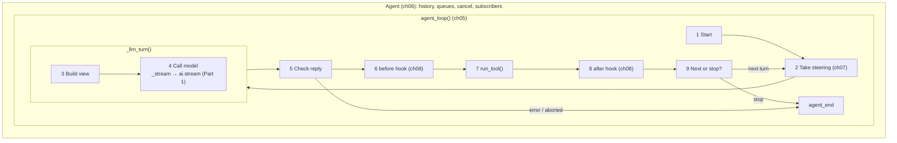

# Part 2 big picture: the agent loop

**In one sentence:** Part 2 builds the [agent loop](glossary.md#agent-loop) `agent_loop()` and the `Agent` class around it. You give it a **prompt** (and a history, tools and a model). It calls the model, runs the tools the model asks for, and repeats until the model stops asking. It gives back the **new messages**, and sends **events** while it works.

Read this page before [05](05-agent-loop.md), and come back to it any time you get lost in [05](05-agent-loop.md)–[08](08-hooks-approval.md). It adds no new facts; it only puts the pieces of those four chapters side by side.

## The picture

Read the top row left to right (build the question, ask the model), then the bottom row right to left (handle the answer, run tools). Blocks are steps. Yellow cards on the arrows are the data passed between steps. Purple tags say which chapter builds the block. The dashed green arrow goes back for the next [turn](glossary.md#turn). `ai.stream()` is grey: it is Part 1, see [part-1-ai](part-1-ai.md).

## The blocks

| # | Block | What it does | IN | OUT | Code (file · function) | Chapter |
|---|---|---|---|---|---|---|
| 1 | Start the run | Add the prompt messages to the history. Send `agent_start`. | prompts | history | `agent/__init__.py` · `agent_loop()` | [05](05-agent-loop.md) |
| 2 | Take steering | Add messages the user typed while the agent worked. They are read after block 1 and after each turn, and added after `turn_start`. | steering queue | history | `agent/__init__.py` · `agent_loop()` → `config.get_steering()` | [07](07-steering.md) |
| 3 | Build the view | Run `prepare_next_turn`, poll steering once more, add a "Tools added / removed" note if tools changed, clean the messages, make a `Context`. | history | `Context` | `agent/__init__.py` · `_llm_turn()` | [05](05-agent-loop.md), [07](07-steering.md); the hook is filled in [16](16-compaction.md) |
| 4 | Call the model | Call `stream_fn` (normally `ai.stream()`), send each event on as `message_update`, keep the final message. Stop closes the stream. | `Context` | `AssistantMessage` | `agent/__init__.py` · `_llm_turn()`, `_stream()` | [05](05-agent-loop.md), [06](06-events-abort.md) |
| 5 | Check the reply | `error` or `aborted` → end the run. `length` → every tool call gets an error result and does not run. | `AssistantMessage` | tool calls | `agent/__init__.py` · `agent_loop()` | [05](05-agent-loop.md), [06](06-events-abort.md) |
| 6 | Before hook | Ask "may this call run?". `None` = run it. A string = deny, and the result is `"User denied: <reason>"`. | `ToolCall`, `ToolContext` | `None` or a reason | `agent/__init__.py` · `LoopConfig.before_tool_call` | [08](08-hooks-approval.md) |
| 7 | Run the tool | Find the tool by name, fix the args (`prepare_arguments`), check them against the schema, call `execute`. Never raises: every problem becomes an error result. | `ToolCall`, `ToolContext` | `ToolResultMessage` | `agent/__init__.py` · `run_tool()` | [05](05-agent-loop.md) |
| 8 | After hook | May return a new result to replace the old one. Runs after a deny too. | call, result, `ToolContext` | `ToolResultMessage` | `agent/__init__.py` · `LoopConfig.after_tool_call` | [08](08-hooks-approval.md) |
| 9 | Next turn or stop? | Had tool calls, or steering waits → go to block 2. Else take a follow-up → go to block 2. Else send `agent_end` and return. | tool calls, queues | next turn, or new messages | `agent/__init__.py` · `agent_loop()` | [05](05-agent-loop.md), [07](07-steering.md) |

Blocks 6, 7 and 8 run once **for each** tool call in the reply, in order. `tool_execution_start` is sent before block 6 and `tool_execution_end` after block 8, so a denied call gets both events too.

Words: the **view** is the list of messages sent in one call (it may be shorter than the history). The **cancel flag** is the `asyncio.Event` behind [abort](glossary.md#abort). The **queues** are the steer and follow-up lists in `Agent`.

Paths are under `packages/simp_agent/src/simp_agent/`.

## Which block is inside which

- **`agent_loop()` is the whole Part.** It does blocks 1, 2, 5, 9 itself, and the hooks 6 and 8 inside `agent_loop()` itself.
- **One model turn = `_llm_turn()`** = blocks 3 and 4. Inside block 4, `_stream()` wraps `stream_fn`. `stream_fn` is `ai.stream()` from Part 1 (or `FakeProvider` in tests, [02](02-fake-provider.md)).
- **`run_tool()`** is block 7 only. The hooks (6, 8) are *around* it, in `agent_loop()`.
- **The `Agent` class** ([06](06-events-abort.md)) is *outside* the loop. It keeps the history, the subscribers, the cancel flag and the two queues. Each `prompt()` builds a `LoopConfig` and calls `agent_loop()` once.
- **Events** ([06](06-events-abort.md)) are not a block. Every block sends them through one `emit` function; `Agent` gives them to each subscriber.
- **[Tool approval](glossary.md#tool-approval)** is not in this Part's code. It is one `before_tool_call` (block 6) written in `AgentSession` → Part 4, [13](13-session.md). [08](08-hooks-approval.md) shows it early.

**Rule for the whole Part:** the loop does not crash on a bad tool. Unknown tool, bad args, an exception in `execute`: each one becomes a `ToolResultMessage` with `is_error=True`, and the model sees it on the next turn.

If something else raises (for example a subscriber), `Agent` ends the run with an `AssistantMessage` whose `stop_reason` is `"error"`.

## The objects

| Object | Fields | Meaning |
|---|---|---|
| [Agent](glossary.md#agent-class) | `messages`, `tools`, `steering`, `follow_ups`, `is_streaming` + `prompt()`, `steer()`, `follow_up()`, `abort()`, `subscribe()` | The thin object that keeps state between runs and calls `agent_loop()`. |
| [Agent tool](glossary.md#agent-tool) (`AgentTool`) | `name`, `description`, `parameters` + `execute(args, ctx)`, `prepare_arguments` | A [Tool](glossary.md#tool) that can also run. |
| [Tool context](glossary.md#tool-context) (`ToolContext`) | `cancel`, `env`, `cwd`, `on_update` | What a tool (and a hook) gets besides its args. `on_update(text)` sends `tool_execution_update`. |
| [LoopConfig](glossary.md#loopconfig) | `model`, `tools` / `get_tools`, `stream_fn`, `get_steering`, `get_follow_up`, `prepare_next_turn`, `get_api_key`, `env`, `cwd`, `before_tool_call`, `after_tool_call`, … | All settings of one run. Every hook has a "do nothing" default. |
| [Event](glossary.md#event) | a dict with `type`: `agent_start`, `turn_start`, `message_start`, `message_update`, `message_end`, `tool_execution_start` / `_update` / `_end`, `turn_end`, `agent_end` | One signal to the subscribers. `message_update` carries one Part 1 [stream event](glossary.md#stream-event). |
| [Abort](glossary.md#abort) | one `asyncio.Event` (the cancel flag) | `Agent.abort()` sets it. The stream closes, tools see `ctx.cancel`, the run ends `aborted`. |
| [Steer](glossary.md#steer) / [Follow-up](glossary.md#follow-up) queue | a list of `UserMessage` | Steer = add at the next turn. Follow-up = add only when the loop would stop. |
| [Queue mode](glossary.md#queue-mode) | `"one-at-a-time"` (default) or `"all"` | How many queued messages are taken each time. |
| [Tool hook](glossary.md#tool-hook) | `before_tool_call(call, ctx)`, `after_tool_call(call, result, ctx)` | Sync or async. Gate or change one tool call. |

Messages (`UserMessage`, `AssistantMessage`, `ToolResultMessage`, `ToolCall`) come from Part 1: see [part-1-ai](part-1-ai.md#the-objects).

## One worked example: "What is in README.md?"

1. The app calls `agent.prompt("What is in README.md?")`. `Agent` builds a `LoopConfig` and calls `agent_loop()`.
2. **Start:** the `UserMessage` goes into the history. Events: `agent_start`, `message_start`, `message_end`.
3. **Take steering:** the queue is empty. Event: `turn_start`.
4. **Build the view:** nothing to compact, no tool change. The `Context` has the system prompt, one message and the `read` tool.
5. **Call the model:** `ai.stream()` streams. Each piece is sent as `message_update`. The final message has one `ToolCall(name="read", arguments={"path": "README.md"})`, `stop_reason="tool_use"`.
6. **Check the reply:** not an error, not cut off. Go on to the tools.
7. **Before hook:** first the event `tool_execution_start`. Then the hook returns `None` (or, in a session, the human clicks "allow").
8. **Run the tool:** `read` is found, args pass the schema, `execute` returns the file text → `ToolResultMessage`.
9. **After hook:** keeps the result. Events: `tool_execution_end`, then the result is added (`message_start`, `message_end`), then `turn_end`.
10. **Next or stop?** There was a tool call → next turn. While the tool ran, the user called `agent.steer("only the first line")`. Block 2 adds that message now, before the next model call.
11. The model answers with text, `stop_reason="stop"`. No tool calls, no steering, no follow-up → `agent_end`. `prompt()` returns the new messages.

If the user pressed Stop in step 8, the tool would see `ctx.cancel`, the loop would add an `AssistantMessage` with `stop_reason="aborted"` and end.

## Builds on / Next

- Builds on: [Part 1 big picture](part-1-ai.md) · [04 Providers](04-providers.md).
- Chapters: [05 The agent loop](05-agent-loop.md) · [06 Events and abort](06-events-abort.md) · [07 Steering](07-steering.md) · [08 Hooks and approval](08-hooks-approval.md).
- Next: [Part 3 big picture](part-3-coding.md), then [09 Execution environment](09-exec-env.md) gives tools a safe `env` (the `ToolContext.env` field).
