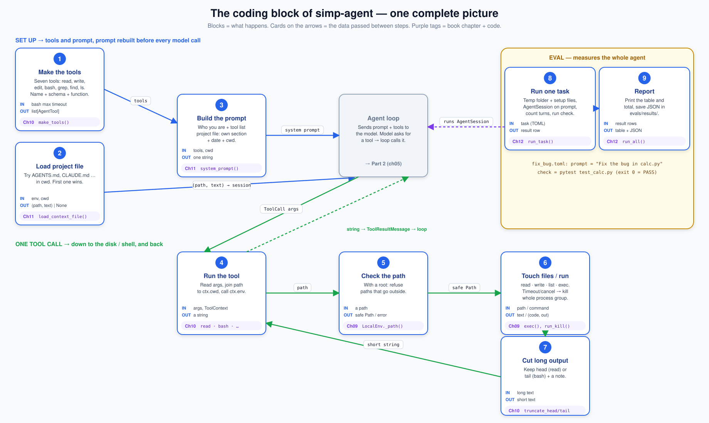
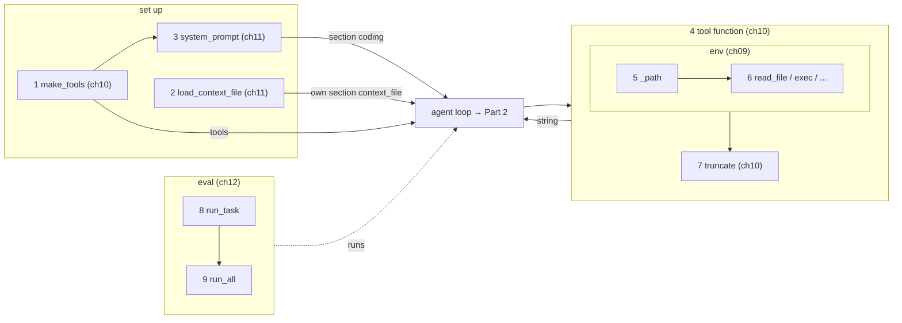

# Part 3 big picture: the coding layer

**In one sentence:** Part 3 turns the bare agent loop into a coding agent. It gives the loop a **list of tools** and a **system prompt**. Each tool takes the model's **arguments** and gives back one **string**, and it touches files and runs commands only through one **execution environment**. Evals then measure the whole agent on real tasks.

Read this page before [09](09-exec-env.md), and come back to it any time you get lost in [09](09-exec-env.md)–[12](12-evals.md). It adds no new facts; it only puts the pieces of those four chapters side by side.

## The picture

Read the top row left to right: we set up tools and the prompt, then hand them to the agent loop (grey, Part 2). Read the middle row left to right: one tool call goes down to the disk or shell and the result comes back. The bottom row is the eval, which runs the whole thing on a task. Purple tags say which chapter builds the block.

## The blocks

| # | Block | What it does | IN | OUT | Code (file · function) | Chapter |
|---|---|---|---|---|---|---|
| 1 | Make the tools | Build the seven tools: name, description, JSON schema, function. `bash` gets the host's max timeout. | `bash_max_timeout_s` | `list[AgentTool]` | `packages/simp_agent/src/simp_agent/coding/tools.py` · `make_tools()` | [10](10-coding-tools.md#make_tools-names-descriptions-schemas) |
| 2 | Load the project file | Try `AGENTS.override.md`, `AGENTS.md`, …, `CLAUDE.md` in cwd. Return the first one found. | `env`, `cwd` | `(path, text)` or `None` | `packages/simp_agent/src/simp_agent/coding/__init__.py` · `load_context_file()`, `CONTEXT_FILES` | [11](11-system-prompt.md) |
| 3 | Build the prompt | Write "who you are", the tool list, date and cwd into one string. In a session the project file (2) is added as its own prompt section, not passed here. | tools, `cwd` (project file optional) | system prompt string | `packages/simp_agent/src/simp_agent/coding/__init__.py` · `system_prompt()` | [11](11-system-prompt.md) |
| 4 | Run the tool | Read the arguments, join the path to `ctx.cwd`, call the env, shape the answer. | `args`, `ToolContext` | a string | `packages/simp_agent/src/simp_agent/coding/tools.py` · `read`, `write`, `edit`, `ls`, `grep`, `find`, `make_bash()` | [10](10-coding-tools.md) |
| 5 | Check the path | If the env has a `root`, refuse any path that leads outside it. | a path | a safe `Path` or `PermissionError` | `packages/simp_agent/src/simp_agent/agent/env.py` · `LocalEnv._path()` | [09](09-exec-env.md#path-safety) |
| 6 | Touch files / run | Read, write, list, or run a shell command; stream output; on timeout or cancel kill the whole process group. | path / command | text, bytes, entries, or `(exit code, output)` | `packages/simp_agent/src/simp_agent/agent/env.py` · `LocalEnv.read_file()`, `write_file()`, `list()`, `exec()`, `run_kill()` | [09](09-exec-env.md) |
| 7 | Cut long output | Keep the head (read) or the tail (bash) so one tool result cannot fill the model's window. | long text | short text + a note | `packages/simp_agent/src/simp_agent/coding/truncate.py` · `truncate_head()`, `truncate_tail()`, `head()`, `tail()` | [10](10-coding-tools.md#truncation-truncate_head-and-truncate_tail) |
| 8 | Run one eval task | Make a temp folder, write the `setup` files, run an `AgentSession` on the `prompt`, count turns and tokens, then run the `check` command. | one task (TOML) | a result row (`passed`, turns, tokens, cost, seconds) | `evals/run.py` · `run_task()` | [12](12-evals.md#run_task-one-task-one-fresh-folder) |
| 9 | Report | Run all tasks, print a table and a total, save one JSON file in `evals/results/`. | result rows | table + JSON file | `evals/run.py` · `run_all()`, `main()` | [12](12-evals.md#run_all-the-table-and-the-file) |

## Which block is inside which

- **A tool (4) wraps the env (5, 6).** A tool never opens a file or starts a process itself. It always calls `ctx.env`. The env checks the path (5) first, then does the work (6).
- **Cut (7) happens inside the tool,** after the env answers and before the string goes back to the loop.
- **Blocks 1–2 run once at start; block 3 runs before every model call.** The loop (Part 2) gets the tools and the prompt. It calls a tool (4) when the model asks for one.
- The prompt (3) is not built once. The session keeps it as a [prompt section](glossary.md#prompt-section) function, and `AgentSession._build_prompt` calls it before **every** model call. The project file (2) is a second section (`context_file`, order 10) after this one (`coding`, order 0). So the tool list in it is never old. How sections are stored is built in [13](13-session.md).
- **The eval (8, 9) is outside everything.** It starts a full `AgentSession` with a `LocalEnv` rooted in a temp folder, and only looks at events and the files left behind.
- `ExecutionEnv` is a contract; `LocalEnv` is the one we build here. A Docker env with the same contract comes in [24](24-docker-sandbox.md). `EnvConformance` is one test suite every env must pass.

**Rule for the whole Part:** tools do all IO through `ctx.env`, and a tool's answer is always one string. If a tool raises, `run_tool` (Part 2) turns it into an error result for the model.

## The objects

| Object | Fields | Meaning |
|---|---|---|
| [Agent tool](glossary.md#agent-tool) | `name`, `description`, `parameters`, function | One tool the model may call. The function is `async (args, ctx) → str`. |
| [Tool context](glossary.md#tool-context) | `cancel`, `env`, `cwd`, `on_update` | What every tool call gets. `env` is the only way to touch the world. |
| [Execution environment](glossary.md#execution-environment) | `read_file`, `write_file`, `list`, `read_bytes`, `write_bytes`, `exec` | The contract (`ExecutionEnv`). `exec` returns `(exit code, output)`; the code is `None` when killed. |
| `LocalEnv` | `root` | The env on this machine. With a `root`, paths may not leave it. |
| [Truncation](glossary.md#truncation) | text in, (text, info) out | Cut long tool output to a line and byte limit. |
| [System prompt](glossary.md#system-prompt) | one string | Who the model is, the tools, the project file, date, cwd. |
| [Context file](glossary.md#context-file) | `(path, text)` | The project's `AGENTS.md` / `CLAUDE.md`, put into the prompt. |
| [Eval task](glossary.md#eval-task) | `prompt`, `check`, `[setup]` | One TOML file in `evals/tasks/`. `check` is a shell command; exit code 0 = pass. |

## One worked example: "What is in README.md?"

1. **Make the tools:** `make_tools()` gives seven `AgentTool`s, one of them `read`.
2. **Load the project file:** `load_context_file(env, cwd)` finds `AGENTS.md` and returns its path and text.
3. **Build the prompt:** `system_prompt(tools, cwd)` lists `- read: Read a text file. ...` and the other tools, the date and the cwd. The session adds the `AGENTS.md` text as its own `context_file` section after it.
4. The agent loop (Part 2) sends this to the model. The model answers with `ToolCall(name="read", arguments={"path": "README.md"})`.
5. **Run the tool:** `read` joins the path to `ctx.cwd` and calls `ctx.env.read_file(...)`.
6. **Check the path:** `LocalEnv._path` makes sure the path stays inside `root` (if one is set).
7. **Touch files:** the env reads the file and returns its text.
8. **Cut:** `read` numbers the lines and keeps the head with `truncate_head`. If lines are left, it adds `[N more lines; use offset=... to continue]`.
9. The string goes back to the loop as a `ToolResultMessage`. The model reads it and answers in words.
10. **Eval** (uses `AgentSession` from [13](13-session.md) and `build_model` from [18](18-profiles-plugins.md), as ch12 warns): to measure this kind of work for real, `run_task` takes a task like `evals/tasks/fix_bug.toml`, writes `calc.py` and `test_calc.py` into a temp folder, sends the prompt, and then runs the `check`. `run_all` prints `fix_bug  PASS ...` and the total.

## Builds on / Next

- Builds on: [Part 2](part-2-agent.md) — the loop, `AgentTool`, `run_tool` and `ToolContext` from [05](05-agent-loop.md), the approval gate from [08](08-hooks-approval.md).
- Chapters: [09 Execution environment](09-exec-env.md) · [10 Coding tools](10-coding-tools.md) · [11 The system prompt](11-system-prompt.md) · [12 Evals](12-evals.md).
- Next: [Part 4 big picture](part-4-session.md), then [13 Sessions](13-session.md) wraps the loop, tools and prompt into one `AgentSession`.
