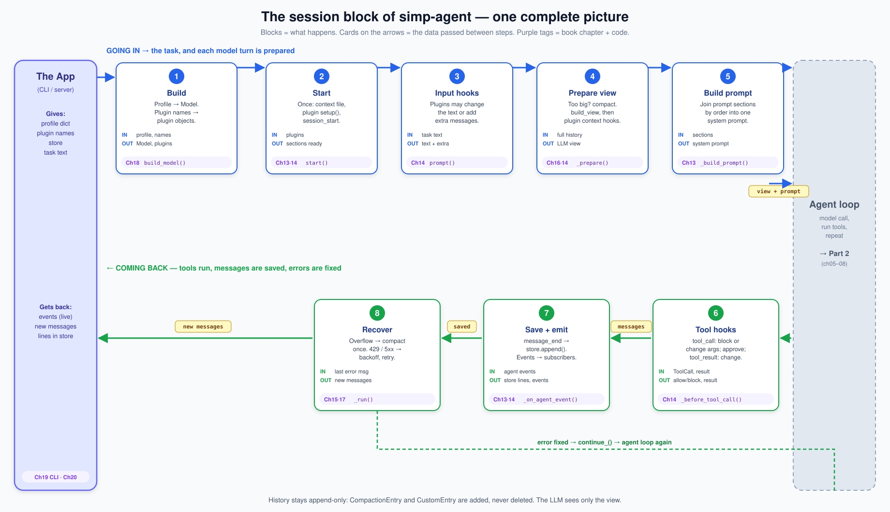
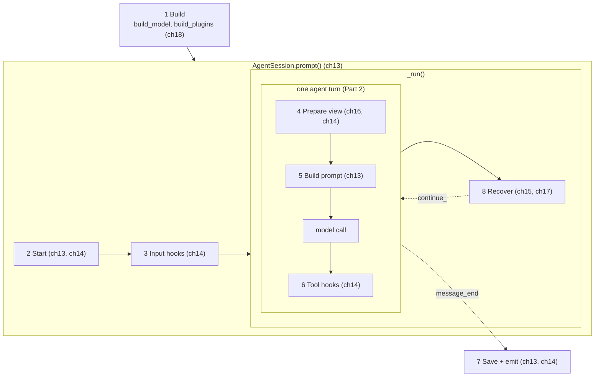

# Part 4 big picture: the session layer

**In one sentence:** Part 4 builds `AgentSession`, one object that owns an `Agent` for a whole conversation. You give it a **profile**, plugin names, a **store** and a task text. It runs the agent, saves every finished message right away, and gives back the new messages and a stream of events.

Read this page before [13](13-session.md), and come back to it any time you get lost in [13](13-session.md)–[18](18-profiles-plugins.md). It adds no new facts; it only puts the pieces of those six chapters side by side.

## The picture

Read the top row left to right: the task goes in, and each model turn is prepared. The grey box is the agent loop from Part 2. Then read the bottom row right to left: tools run, messages are saved, and errors are fixed. Blocks are steps. Cards on the arrows are the data passed between steps. Purple tags say which chapter builds the block.

## The blocks

| # | Block | What it does | IN | OUT | Code (file · function) | Chapter |
|---|---|---|---|---|---|---|
| 1 | Build | Turn a profile dict into a `Model`, and plugin names into plugin objects. The app then makes the `AgentSession`. | profile dict, plugin names | `Model`, plugin list | `packages/simp_agent/src/simp_agent/session/profile.py` · `build_model()`; `packages/simp_agent/src/simp_agent/plugins/__init__.py` · `build_plugins()` | [18](18-profiles-plugins.md) |
| 2 | Start | Once, before the first prompt: add the context file as a prompt section, call each plugin's `setup(api, config)`, then `session_start`. | plugins, `plugin_config` | plugins ready, prompt sections | `packages/simp_agent/src/simp_agent/session/__init__.py` · `AgentSession.start()` | [13](13-session.md), [14](14-plugins.md) |
| 3 | Input hooks | Each plugin may change the text (`input`), say "handled", or add extra messages (`before_agent_start`). | task text | text + extra messages | `packages/simp_agent/src/simp_agent/session/__init__.py` · `AgentSession.prompt()` | [14](14-plugins.md) |
| 4 | Prepare view | Each turn: if history is too big, compact it. Then build the LLM view and pass it through each plugin's `context` hook. | full history | LLM view (list of messages) | `packages/simp_agent/src/simp_agent/session/__init__.py` · `_prepare()`, `_context()`; `packages/simp_agent/src/simp_agent/agent/compaction.py` · `should_compact()`, `compact()`, `build_view()` | [16](16-compaction.md), [14](14-plugins.md) |
| 5 | Build prompt | Each turn: join all prompt sections, sorted by `order`, into one system prompt. | prompt sections | system prompt string | `packages/simp_agent/src/simp_agent/session/__init__.py` · `_build_prompt()` | [13](13-session.md) |
| 6 | Tool hooks | Before a tool runs: plugin `tool_call` may block or change args, then ask for approval. After: plugin `tool_result` may change the result. | `ToolCall`, result | allowed or blocked; final result | `packages/simp_agent/src/simp_agent/session/__init__.py` · `_before_tool_call()`, `_after_tool_call()` | [14](14-plugins.md) |
| 7 | Save + emit | On each `message_end`, append the message to the store. Pass every event to subscribers and to plugin `on_event`. | agent events | lines in the store, events | `packages/simp_agent/src/simp_agent/session/__init__.py` · `_on_agent_event()`, `_emit()` | [13](13-session.md), [14](14-plugins.md) |
| 8 | Recover | If the last message is an error: context overflow → compact once and continue; retryable → wait (2 s, 4 s, 8 s…) and continue, up to `max_retries` (3); else stop. | last `AssistantMessage` | new messages | `packages/simp_agent/src/simp_agent/session/__init__.py` · `_run()`; `packages/simp_agent/src/simp_agent/ai/__init__.py` · `is_context_overflow()`, `is_retryable()` | [15](15-retry.md), [17](17-overflow.md) |

Not numbered: the agent loop (call the model, run tools, repeat) is Part 2, [05](05-agent-loop.md)–[08](08-hooks-approval.md). The real store, `JsonlStore`, lives in the CLI app: `apps/cli/src/simp_cli/__init__.py` ([13](13-session.md)).

## Which block is inside which

- **`AgentSession` is the whole Part.** It holds one `Agent` and gives it three hooks: `prepare_next_turn=_prepare` (4), `before_tool_call` and `after_tool_call` (6). The system prompt (5) is also a function the agent calls each turn.
- **`prompt()` = Start (2) + Input hooks (3) + `_run()`.** `continue_()` is the same without Input hooks.
- **`_run()` = the agent run + Recover (8).** It runs the start function once (`agent.prompt` or `agent.continue_`), then loops while the last message is an error.
- **One agent turn = Prepare view (4) + Build prompt (5) + model call + Tool hooks (6).** Save (7) happens on every `message_end` event, so a crash loses at most the message in progress.
- **Compaction is used in two places:** in Prepare view (4) when the history is near the window, and in Recover (8) after an overflow error. Both call the same `AgentSession.compact()`.
- **Build (1) is outside the session.** The app (CLI or server) calls `build_model` and `build_plugins`, then makes the `AgentSession`.
- [14](14-plugins.md) adds the plugin sockets; [18](18-profiles-plugins.md) ships two real plugins that use them: `RedactSecrets` (hooks `tool_result`, `tool_update`, `context`) and `PlanMode` (hook `tool_call`, a prompt section, a custom entry).

The small chart below shows only the nesting:

**Rule for the whole Part:** history is append-only. Compaction adds a `CompactionEntry` and plugins add `CustomEntry`s; nothing is deleted. The LLM sees only the view that `build_view()` makes from it.

## The objects

| Object | Fields | Meaning |
|---|---|---|
| [AgentSession](glossary.md#agentsession) | `agent`, `store`, `plugins`, `plugin_config`, `auto_compact`, `compaction`, `max_retries`, `retry_base_delay`, `approve` | Owns one `Agent` for a whole conversation. |
| [SessionStore](glossary.md#sessionstore) | `append(entry)`, `load()` | Where history is saved. `append` is called once per finished entry. |
| [Profile](glossary.md#profile) | `api`, `model`, `base_url`, `api_key_env`, `compat`, `max_tokens`, `context_window` | A plain dict from the settings file. `build_model` turns it into a `Model`. |
| [Plugin](glossary.md#plugin) | `name` (optional) + any [plugin hooks](glossary.md#plugin-hook) | Any object. A hook is a method with a known name; missing = skipped. |
| [PluginAPI](glossary.md#pluginapi) | `register_tool`, `add_prompt_section`, `append_entry`, `send_message`, `set_model`, `abort`, `get_messages`, `emit`, … | What a plugin may do with its session. |
| [Prompt section](glossary.md#prompt-section) | `id` → (`order`, string or function) | One part of the system prompt, rebuilt every turn. |
| [CustomEntry](glossary.md#custom-entry) | `type`, `data` | Saved and replayed on resume, never sent to the LLM. |
| [CompactionEntry](glossary.md#compactionentry) | `summary`, `first_kept_index`, `read_files`, `modified_files` | Marker in history: "everything before this index is replaced by this summary". |
| [CompactionSettings](glossary.md#compaction) | `enabled`, `reserve_tokens`, `keep_recent_tokens` | When to compact, and how much recent history to keep. |

## One worked example: "now add tests" the next day

Yesterday the agent wrote `fizzbuzz.py`. The history is in a JSONL file. Today you type "now add tests" with the `redact_secrets` plugin on.

1. **Build:** the app calls `build_model(profile)` → a `Model`, and `build_plugins(["redact_secrets"])` → `[RedactSecrets()]`. It makes `AgentSession(model, store=JsonlStore(path), messages=store.load(), plugins=...)`. Yesterday's messages are back.
2. **Start:** `AGENTS.md` (if there is one) becomes the `context_file` section. `RedactSecrets.setup` collects secret values from env vars.
3. **Input hooks:** `RedactSecrets` has no `input` hook, so the text stays "now add tests".
4. **Prepare view:** the history is small, so no compaction. `build_view` returns the messages; `RedactSecrets.context` masks secrets in copies.
5. **Build prompt:** the `coding` section + the `context_file` section → one system prompt. The model call runs (Part 2) and asks to `write` `test_fizzbuzz.py`.
6. **Tool hooks:** no plugin blocks `write`; with no `approve` function, it is allowed. After the tool runs, `RedactSecrets.tool_result` finds no secret and returns nothing.
7. **Save + emit:** the assistant message and the tool result each get one new line in the JSONL file as soon as they end.
8. **Recover:** the next model call fails with `429`. It is retryable, so the session emits `auto_retry_start` (attempt 1, delay 2 s), waits, and calls `agent.continue_()`. This time it works; `auto_retry_end` says `success: true`. If the error had been "prompt is too long", the session would compact once instead, then continue.

## Builds on / Next

- Builds on: [Part 3 big picture](part-3-coding.md), [Part 3 · 11 The system prompt](11-system-prompt.md) and [12 Evals](12-evals.md); the agent loop from [05](05-agent-loop.md)–[08](08-hooks-approval.md).
- Chapters: [13 Sessions](13-session.md) · [14 Plugins](14-plugins.md) · [15 Retry](15-retry.md) · [16 Compaction](16-compaction.md) · [17 Context overflow](17-overflow.md) · [18 Profiles and built-in plugins](18-profiles-plugins.md).
- Next: [Part 5 big picture](part-5-system.md), then [19 The CLI](19-cli.md) builds an app on top of `AgentSession`.
