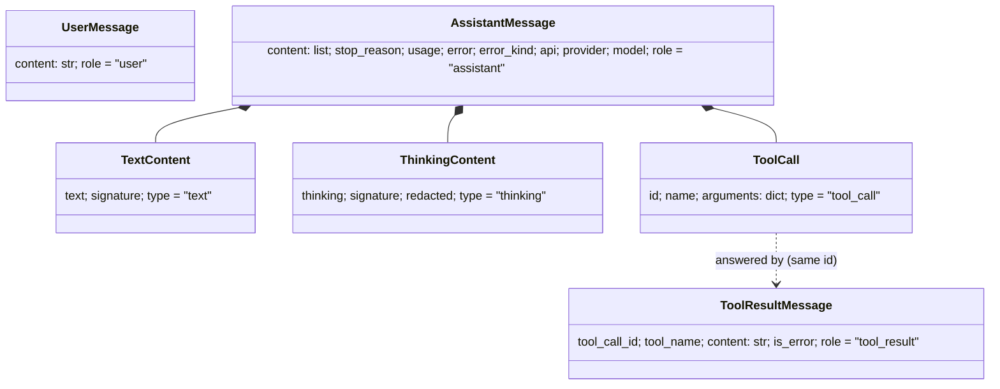
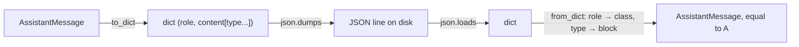

# Reference · The `ai` objects

**Used by:** [01 Pick + Clean](01-pick-clean.md) · [02](02-translate-send.md) · [03](03-parse.md) · [05](05-agent-loop.md) · [13 Session](13-session.md) · [14](14-plugins.md) · [16](16-compaction.md) · [20 The server run](20-server-run.md) · [21](21-transport.md)

This page is a lookup page, not a chapter. Chapters introduce each object at the block that first uses it, and only the parts that block needs. Here is every field in one place, plus how history turns into JSON and back.

Code: `packages/simp_agent/src/simp_agent/ai/__init__.py` (commit `2fc2776`).



## Why dataclasses with a tag

Plain dicts (like vendor examples) break fast: one place writes `"args"`, another reads `"arguments"`; one string cannot keep "think, text, tool call, text" in order; there is no room for "why it stopped". So:

- **A class per kind.** A typo in a field name fails when the object is built.
- **Content is a list of blocks**, in model order.
- **A fixed `role` (messages) or `type` (blocks)** on every class, so `from_dict` knows which class a dict was.
- **Our own shape, not a vendor's.** Providers translate at the edge ([ch 02](02-translate-send.md)).
- **Not pydantic.** No extra dependency in the lowest layer; we do not validate on load, the data was written by us.

## Messages

```python
@dataclass
class UserMessage:
    content: str
    role: Literal["user"] = "user"

@dataclass
class ToolResultMessage:
    tool_call_id: str
    tool_name: str
    content: str
    is_error: bool = False
    role: Literal["tool_result"] = "tool_result"
```

`is_error` tells the model "this failed" (unknown tool, bad arguments, user denied, cut off by `length`), so it can try again.

```text
AssistantMessage = record:
    content     = list of TextContent | ThinkingContent | ToolCall, in model order
    stop_reason = stop | tool_use | length | error | aborted   (default stop)
    usage       = {input 0, output 0}
    error, error_kind = none     // error_kind fatal | budget | policy = never retried
    api, provider, model = ""    // set by stream(): who produced this message
    role = "assistant"

text():       JOIN the text of every TextContent block
tool_calls(): RETURN only the ToolCall blocks
```

| Field | Who uses it |
|---|---|
| `content` | everyone; built by Parse ([ch 03](03-parse.md)) |
| `stop_reason` | the loop ([ch 05](05-agent-loop.md)) decides "run tools?" from `tool_calls()`, and uses `stop_reason` for `error`/`aborted`/`length` ([06](06-events-abort.md), [15](15-retry.md)) |
| `usage` | [usage](glossary.md#usage); compaction estimates size ([ch 16](16-compaction.md)) |
| `error`, `error_kind` | providers never raise, they return this ([ch 02](02-translate-send.md)); `is_retryable` reads it ([ch 04](04-label-test.md), [15](15-retry.md)) |
| `api`, `provider`, `model` | stamped by Label ([ch 04](04-label-test.md)); read by Clean's thinking rule ([ch 01](01-pick-clean.md#thinking-who-can-read-it-back)) |

## Content blocks

```python
@dataclass
class TextContent:
    text: str
    signature: str | None = None
    type: Literal["text"] = "text"

@dataclass
class ThinkingContent:
    thinking: str
    signature: str | None = None
    redacted: bool = False
    type: Literal["thinking"] = "thinking"

@dataclass
class ToolCall:
    id: str
    name: str
    arguments: dict
    type: Literal["tool_call"] = "tool_call"
```

`signature` is a vendor value we never read or change, only send back. `ToolCall.arguments` is already a parsed dict ([ch 03](03-parse.md)).

## Two history entries that are not messages

```python
@dataclass
class CompactionEntry:
    summary: str
    first_kept_index: int
    read_files: list = field(default_factory=list)
    modified_files: list = field(default_factory=list)
    role: Literal["compaction"] = "compaction"

@dataclass
class CustomEntry:
    type: str
    data: dict = field(default_factory=dict)
    role: Literal["custom"] = "custom"
```

- A **[compaction entry](glossary.md#compaction-entry)**: "everything before `first_kept_index` is replaced by `summary`". History is append-only. Built in [ch 16](16-compaction.md).
- A **[custom entry](glossary.md#custom-entry)**: plugin data kept in history, so it comes back on resume. Used in [ch 14](14-plugins.md).

Both are saved like messages but never sent: Clean skips them ([ch 01](01-pick-clean.md#2-clean-transform_messages)).

## Request objects: `Tool`, `Context`, `Model`

```python
@dataclass
class Tool:
    name: str
    description: str
    parameters: dict  # JSON schema

@dataclass
class Context:
    system_prompt: str
    messages: list
    tools: list = field(default_factory=list)

@dataclass
class Model:
    id: str = "claude-sonnet-5-5"
    provider: str = "anthropic"
    max_tokens: int = 8192
    context_window: int = 200000
    api: str = "anthropic-messages"  # anthropic-messages | openai-completions | openai-responses
    base_url: str | None = None
    api_key_env: str | None = None  # env var holding the key
    compat: dict = field(default_factory=dict)
```

`compat` known keys: openai `include_usage`, `max_tokens_field`, `supports_finish_reason`; all `reasoning_effort`; anthropic `thinking_budget` ([ch 02](02-translate-send.md)). These are not saved in history, so they have no `role`.

## Going to JSON and back

```text
FUNCTION to_dict(m):
    RETURN dataclasses.asdict(m)        // walks nested blocks for us

FUNCTION from_dict(d):
    pick the class from d["role"]:
        user -> UserMessage, assistant -> AssistantMessage,
        tool_result -> ToolResultMessage, compaction -> CompactionEntry,
        custom -> CustomEntry
    IF the class is AssistantMessage:
        FOR EACH block in d["content"]:
            pick the block class from block["type"]:
                text -> TextContent, thinking -> ThinkingContent, tool_call -> ToolCall
            rebuild the block from its fields
    RETURN the class built from the fields of d
```



- **Old files still load.** A field added later has a default, so a dict without it still builds.
- **Cost:** `from_dict` trusts its input. Unknown `role` → `KeyError`; stray field → `TypeError`. Fine for files we wrote.
- The CLI saves sessions as JSON lines with this pair (`JsonlStore.append` / `load` in `apps/cli/src/simp_cli/__init__.py`; [ch 13](13-session.md)).

Tests (`tests/test_reasoning.py`, `tests/test_compaction_serialize.py`):

```python
def test_from_dict_old_and_new():
    old = {"role": "assistant", "content": [{"type": "text", "text": "x"}], "stop_reason": "stop",
           "usage": {"input": 1, "output": 2}, "error": None}
    assert ai.from_dict(old).content == [TextContent("x")]
    new = asst([ThinkingContent("t", "s"), TextContent("x", '{"id": "m"}')])
    assert ai.from_dict(json.loads(json.dumps(ai.to_dict(new)))) == new

def test_entry_roundtrip_and_old_format():
    e = CompactionEntry("s", 3, ["r"], ["m"])
    assert from_dict(to_dict(e)) == e
    assert from_dict({"role": "compaction", "summary": "s", "first_kept_index": 3}).read_files == []
```

Exercise: build an `AssistantMessage` with thinking, text and a tool call; send it through `to_dict` → `json.dumps` → `json.loads` → `from_dict`; check `==`.

## Server protocol messages

These are not `ai` objects. They are the wire messages of simp-server, defined in `apps/server/src/simp_server/protocol.py`. Chapter [20](20-server-run.md#protocol-models) explains why they look this way; [21](21-transport.md) shows how they flow. Every model has a fixed `type` field (the snake_case name, like `follow_up` for `FollowUp`).

| Group | Messages |
|---|---|
| Handshake | `Hello` (`hello`), `HelloError` (`hello_error`) |
| Commands | `Prompt`, `Steer`, `FollowUp`, `Abort`, `Approve`, `Compact`, `Continue`, `SetPlanMode` |
| Durable events (have `seq`, saved) | `UserMessage`, `AssistantMessage`, `ToolResult`, `ApprovalRequest`, `ApprovalResolved`, `RunState`, `Compaction`, `Notice`, `SessionTitle` |
| Live events (no `seq`, not saved) | `TextDelta`, `ThinkingDelta`, `ToolOutput` |
| Snapshot | `Snapshot` (`snapshot`) |

The full text of live events is saved later: text and thinking in `AssistantMessage`, tool output in `ToolResult`.

`Snapshot` fields:

| Field | Meaning |
|---|---|
| `last_seq` | the last durable `seq` the server has |
| `run_state` | `idle`, `running`, `waiting_approval`, `aborting` or `error` |
| `in_flight` | `InFlight`: `msg_id`, `thinking`, `text`, `tool_outputs` streamed so far |
| `pending_approval` | `PendingApproval` (`call_id`, `tool`, `args`) or none |
| `title` | the session title |
| `plan_mode` | true if plan mode is on |
